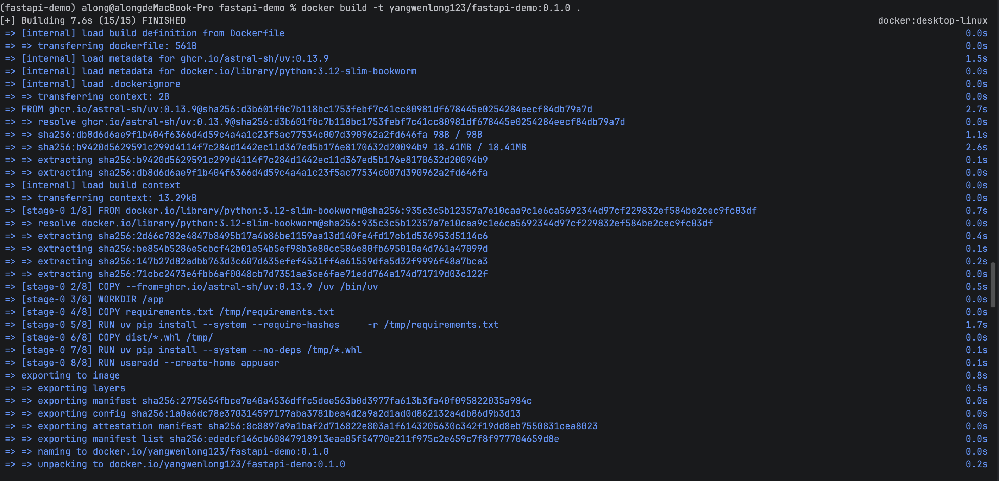
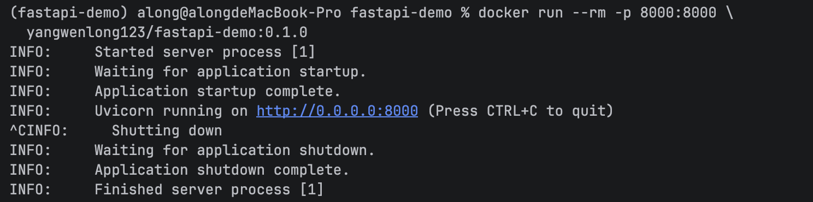
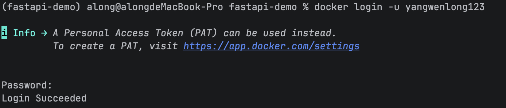
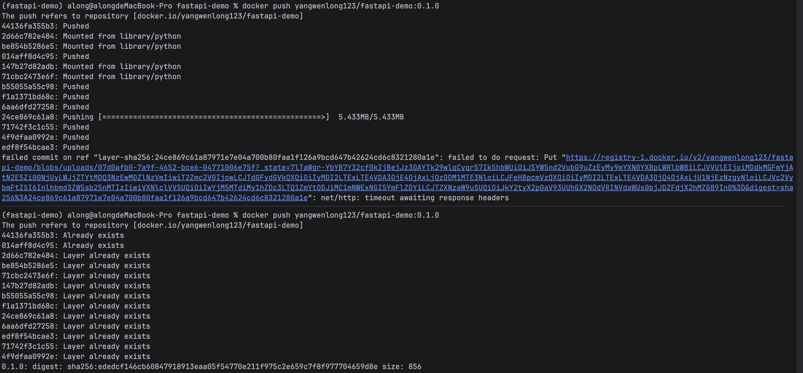
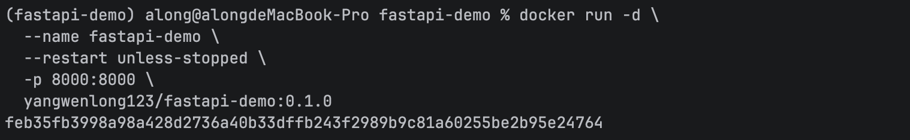
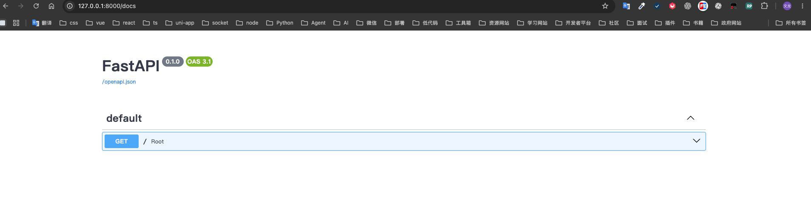

下面以 fastapi-demo 为例，完成 uv 创建项目 → 安装 FastAPI → 本地运行 → 打包 → 发布 → 部署。使用 Docker 部署服务。

## 使用uv创建项目

安装uv:

```bash
brew install uv
```

检查安装结果:

```bash
uv --version
```

创建一个可以构建 wheel 的项目：

```bash
uv init --package --build-backend hatch --python 3.12 fastapi-demo

cd fastapi-demo
```

这里几个参数的作用是：

| 参数 | 作用 |
|---|---|
| `--package` | 创建可安装、可打包的项目 |
| `--build-backend hatch` | 使用 Hatchling 作为构建后端 |
| `--python 3.12` | 选择 Python 3.12 |


uv 可以根据需要下载兼容的 Python，也可以提前安装：

```bash
uv python install 3.12
```

添加依赖：

```bash
uv add fastapi uvicorn
```

uv 会自动创建 .venv，并生成 uv.lock 锁定依赖版本。通过 uv run 执行命令时，无需手动激活环境。


创建 src/fastapi_demo/main.py，只写最小接口：

```Python
from fastapi import FastAPI

app = FastAPI()


@app.get("/")
async def root():
    return {"message": "Hello FastAPI"}
```

启动本地开发服务：

```bash
uv run uvicorn fastapi_demo.main:app --reload
```

访问：

- 接口：http://127.0.0.1:8000
- 文档：http://127.0.0.1:8000/docs

确认运行正常后，构建 Python 安装包，并导出锁定的生产依赖：

```bash
uv build

uv export --locked --no-dev --no-emit-project \
  --format requirements-txt \
  --output-file requirements.txt
```

生成的主要文件：

```Plain text
fastapi-demo/
├── src/fastapi_demo/main.py
├── pyproject.toml
├── uv.lock
├── requirements.txt
└── dist/
    ├── fastapi_demo-0.1.0-py3-none-any.whl
    └── fastapi_demo-0.1.0.tar.gz
```

wheel 包含项目代码；依赖通过 requirements.txt 安装。


在项目根目录创建 Dockerfile：

```dockerfile
FROM python:3.12-slim-bookworm

COPY --from=ghcr.io/astral-sh/uv:0.13.9 /uv /bin/uv

WORKDIR /app

COPY requirements.txt /tmp/requirements.txt

RUN uv pip install --system --require-hashes \
    -r /tmp/requirements.txt

COPY dist/*.whl /tmp/

RUN uv pip install --system --no-deps /tmp/*.whl

RUN useradd --create-home appuser
USER appuser

EXPOSE 8000

CMD ["python", "-m", "uvicorn", "fastapi_demo.main:app", "--host", "0.0.0.0", "--port", "8000"]
```

构建镜像:

```bash
docker build -t yangwenlong123/fastapi-demo:0.1.0 .
```



本地运行镜像，验证打包结果：

```bash
docker run --rm -p 8000:8000 \ yangwenlong123/fastapi-demo:0.1.0
```



登录docker:

```bash
docker login -u yangwenlong123
```



发布：

```bash
docker push yangwenlong123/fastapi-demo:0.1.0
```


启动：

```bash
docker run -d \
  --name fastapi-demo \
  --restart unless-stopped \
  -p 8000:8000 \
  yangwenlong123/fastapi-demo:0.1.0
```





查看并停止容器：

```bash
docker ps

docker stop 容器ID或名称
```

以后重新启动：

```bash
docker start fastapi-demo
```