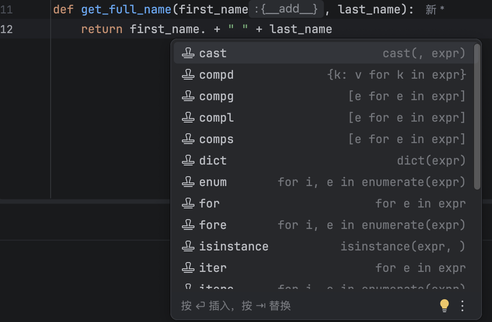
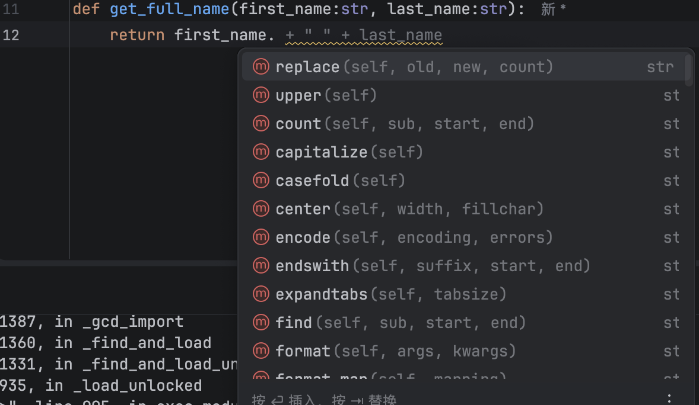
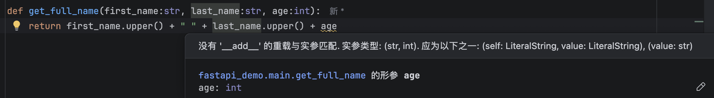
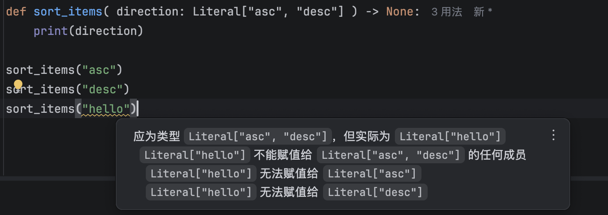

FastAPI 的类型提示，是理解这个框架的关键。它既能帮助编辑器检查代码，也能让 FastAPI 自动解析请求参数、校验数据、生成接口文档，并处理响应数据。


首先要理解：类型提示描述预期类型，通常不负责运行时校验。

```Python
def add(a: int, b: int) -> int:
    return a + b
```

这里声明：
- a、`b` 预期是整数。
- 返回值预期是整数。
但 Python 通常不会主动检查：


```Python
result = add("hello", "world")

print(result)  # helloworld
```

编辑器、mypy、Pyright 等工具可以报告类型错误，但 Python 仍然可能执行成功。


## 类型提示

我们先看一个简单的例子：

```Python
def get_full_name(first_name, last_name):
    return first_name + " " + last_name
```

1. 接下来我们有个需求是把接收参数的首字母变成大写，然后，你试试程序员的老朋友——编辑器的自动补全。



但很遗憾，没有什么有用的提示.

2. 那么我们把参数改成这样

```Python
def get_full_name(first_name:str, last_name:str):
    return first_name + " " + last_name
```

我们再试下：


这样，你可以滚动查看选项，直到找到那个“看着眼熟”的方法。

3. 如果我们再加个字段`age`,可以看到下面编辑器的提示报错



现在你知道需要修复它，用 str(age) 把 age 转成字符串：

```Python
def get_full_name(first_name:str, last_name:str, age:int):
    return first_name.upper() + " " + last_name.upper() + str(age)
```

## 声明类型

### 基础类型

| 注解 | 含义 |
|---|---|
| `int` | 整数 |
| `float` | 浮点数 |
| `bool` | 布尔值 |
| `str` | 字符串 |
| `bytes` | 不可变字节序列 |
| `bytearray` | 可变字节序列 |
| `complex` | 复数 |
| `object` | 任意 Python 对象，但使用前通常需要确认具体类型 |
| `None` | 空值 |
| `type[User]` | `User` 类本身，或它的子类 |

```Python
name: str = "Alice"
age: int = 18
price: float = 19.9
enabled: bool = True
number: complex = 1 + 2j

content: bytes = b"hello"
buffer: bytearray = bytearray(b"hello")
view: memoryview = memoryview(b"hello")
```

函数参数和返回值的写法：

```Python
def greet(name: str) -> str:
    return f"Hello, {name}"

def save_message(message: str) -> None:
    print(message)
```

### 列表、字典、集合和元组，直接使用内置泛型写法。

```Python
names: list[str] = ["Alice", "Bob"]

scores: dict[str, int] = {
    "Alice": 90,
    "Bob": 85,
}

tags: set[str] = {"python", "fastapi"}

permissions: frozenset[str] = frozenset({"read", "write"})
```


嵌套结构：

```Python
matrix: list[list[int]] = [
    [1, 2],
    [3, 4],
]

groups: dict[str, list[int]] = {
    "admins": [1, 2],
    "members": [3, 4],
}
```

元组需要区分固定长度和任意长度：

```Python
# 固定两个元素：第一个 int，第二个 str。
record: tuple[int, str] = (1, "Alice")

# 任意数量的整数。
numbers: tuple[int, ...] = (1, 2, 3)

# 只有一个整数元素。
single: tuple[int] = (1,)

# 空元组。
empty: tuple[()] = ()
```


### 任意类型
Any 需要从 typing 导入；联合类型的 | 写法适用于 Python 3.10+：

```Python
from typing import Any

data: Any = {"name": "Alice"}
user_id: int | str = "user-001"
```

Any 不限制具体类型；`int | str` 将类型限定为整数或字符串。


### Union 和 | 表示一个值可以属于多种类型

Python 3.10+ 推荐使用 |：

```Python
def normalize(value: int | str) -> str:
    return str(value)
```

等价的旧写法：

```Python
from typing import Union


def normalize(value: Union[int, str]) -> str:
    return str(value)
```

可以声明多个候选类型：

```Python
value: int | float | str = 10
```


### None

你可以声明一个值的类型是某种类型（比如 str），但它也可能是 None。


```Python
def say_hi(name: str | None = None):
    if name is not None:
        print(f"Hey {name}!")
    else:
        print("Hello World")
```


## 标准库模块

### typing

1. 联合类型

```Python

## 不推荐这种写法，了解就行
from typing import Union

def normalize(value: Union[int, str]) -> str:
    return str(value)

## 等价于

def normalize(value: int | str) -> str:
    return str(value)
```

2. Optional[T] 表示 T | None

```Python
## 不推荐这种写法，了解就行
from typing import Optional

name: Optional[str] = None

## 等价于

name: str | None = None
```

3. Any任意类型

```PYthon
from typing import Any


def some_function(data: Any):
    print(data)
```

4. Literal 用于限定允许的具体值

```Python
from typing import Literal


def sort_items(direction: Literal["asc", "desc"] ) -> None:
    print(direction)
```

调用sort_items("hello"),类型检查错误：




也可以使用整数和布尔字面值：

```Python
HttpMethod = Literal["GET", "POST", "PUT", "DELETE"]

Level = Literal[1, 2, 3]

Enabled = Literal[True]
```

5. LiteralString 表示类型检查器能够确认由字符串字面量构成的字符串

```Python
from typing import LiteralString


def execute_statement(statement: LiteralString) -> None:
    print(statement)


execute_statement("SELECT id FROM users")
```

直接来自用户输入的普通 str，不能自动视为 LiteralString：

```Python
statement = input("请输入内容：")

# execute_statement(statement)
# 支持该功能的类型检查器可能报告错误。
```

6. Annotated 可以在类型上附加元数据。

```Python
from typing import Annotated

UserName = Annotated[str, "用户名"]
```

它由两部分组成：

```Python
Annotated[基础类型, 附加信息]
```

例如：

```Python
def greet(name: Annotated[str, "用户显示名称"]) -> str:
    return f"Hello, {name}"
```

一般的类型检查器主要把 name 看作 str，框架则可以进一步读取元数据。

FastAPI 中的典型写法：

```Python
from typing import Annotated

from fastapi import Query

PageSize = Annotated[
    int,
    Query(ge=1, le=100),
]
```

Annotated 自身不理解 ge=1 的业务含义，也不执行校验；这里的规则由 FastAPI、Pydantic 等组件解释。

也可以附加多项元数据：

```Python
UserName = Annotated[
    str,
    "用户名",
    "用于界面展示",
]
```

7. 类型别名

```Python
type UserId = int
type UserMap = dict[int, str]
type ApiResult = dict[str, int | str | None]
```

使用：

```Python
def get_user_name(
    users: UserMap,
    user_id: UserId,
) -> str:
    return users[user_id]
```

Python 3.10、3.11 中，可以用 TypeAlias 明确表示别名：

```Python
from typing import TypeAlias

UserMap: TypeAlias = dict[int, str]
```

TypeAlias 自 Python 3.12 起被弃用，新代码可使用 type 语句。


8. NewType 用于区分底层相同、业务含义不同的类型

例如，用户 ID 和订单 ID 都是整数，但不应该混用：

```Python
from typing import NewType

UserId = NewType("UserId", int)

OrderId = NewType("OrderId", int)


def load_user(user_id: UserId) -> None:
    print(user_id)


user_id = UserId(100)
order_id = OrderId(200)

load_user(user_id)

# load_user(order_id)  # 类型检查错误。
# load_user(100)       # 通常也会被类型检查器拒绝。
```

与类型别名相比：

| 工具 | 静态类型上的含义 |
|---|---|
| `type UserId = int` | `UserId` 是 `int` 的另一个名字 |
| `NewType("UserId", int)` | 创建一个需要明确区分的类型 |

9. TypedDict 用于描述字典中每个字段的名称和类型

```Python
from typing import TypedDict


class UserInfo(TypedDict):
    id: int
    name: str
    active: bool


user: UserInfo = {
    "id": 1,
    "name": "Alice",
    "active": True,
}
```

与 dict[str, object] 相比，`TypedDict` 能表达更精确的字段结构：

```Python
def describe_user(user: UserInfo) -> str:
    return f"{user['id']}: {user['name']}"
```

默认情况下，声明的字段都是必需的。

`NotRequired` 表示某个键可以不存在；Python 3.11+ 提供：

```Python
from typing import NotRequired, TypedDict


class UserInfo(TypedDict):
    id: int
    name: str
    nickname: NotRequired[str]  # 表示键可以不存在，但存在时值应为字符串。 等价于 str | None
```

下面两种数据都符合声明：

```Python
user1: UserInfo = {
    "id": 1,
    "name": "Alice",
}

user2: UserInfo = {
    "id": 2,
    "name": "Bob",
    "nickname": "B",
}
```

如果希望整个字典默认允许缺少字段，可以使用 total=False，再用 Required 指定必需字段：

```Python
from typing import Required, TypedDict


class UserPatch(TypedDict, total=False):
    id: Required[int]
    name: str
    active: bool
```

这里：
- id 必须提供。
- name、`active` 可以省略。

TypedDict 对象在运行时仍然是普通字典，通常不会自动检查结构。

10. ReadOnly 可以将 TypedDict 的某些字段标记为只读

Python 3.13+ 提供：

```Python
from typing import ReadOnly, TypedDict


class UserInfo(TypedDict):
    id: ReadOnly[int]
    name: str


user: UserInfo = {
    "id": 1,
    "name": "Alice",
}

user["name"] = "Bob"

# user["id"] = 2  # 类型检查错误。
```

ReadOnly 表达静态约束，不会把普通字典转换为运行时不可修改的对象，也不会递归冻结字段内部的数据。

11. NamedTuple 用于创建具有字段名称的元组类型

```Python
from typing import NamedTuple


class Point(NamedTuple):
    x: float
    y: float


point = Point(1.0, 2.0)

print(point.x)
print(point.y)

print(point[0])
print(point[1])
```

它同时具备：
- 元组的位置访问能力。
- 通过字段名访问的能力。
- 字段类型提示。

12. TypeVar 和 Generic 用于表达“类型之间的关联”

假设需要返回列表中的第一个元素：

```Python
from collections.abc import Sequence
from typing import TypeVar

T = TypeVar("T")


def first(items: Sequence[T]) -> T:
    return items[0]
```

调用：

```Python
number = first([1, 2, 3])       # 推导为 int。
name = first(["Alice", "Bob"])  # 推导为 str。
```

T 表示：输入元素是什么类型，返回值就是什么类型。

泛型类的传统写法：

```Python
from typing import Generic, TypeVar

T = TypeVar("T")


class Box(Generic[T]):
    def __init__(self, value: T) -> None:
        self.value = value

    def get(self) -> T:
        return self.value


number_box = Box[int](123)
text_box = Box[str]("hello")
```

Python 3.12+ 可以使用更简洁的类型参数语法：

```Python
from collections.abc import Sequence


def first[T](items: Sequence[T]) -> T:
    return items[0]


class Box[T]:
    def __init__(self, value: T) -> None:
        self.value = value

    def get(self) -> T:
        return self.value
```

泛型别名同样支持类型参数：

```Python
type Lookup[T] = dict[str, T]

scores: Lookup[int] = {
    "Alice": 90,
}
```


### callable.abc

1. Callable 用于声明函数或其他可调用对象。


```Python
from collections.abc import Callable


def calculate(
    a: int,
    b: int,
    operation: Callable[[int, int], int],
) -> int:
    return operation(a, b)


def add(a: int, b: int) -> int:
    return a + b


result = calculate(1, 2, add)
```

语法是：

```Python
Callable[[参数类型1, 参数类型2], 返回类型]
````

常见形式：

```Python
Callable[[], None]          # 无参数，返回 None。
Callable[[str], int]       # 接收字符串，返回整数。
Callable[[int, str], bool] # 接收整数和字符串，返回布尔值。
Callable[..., str]         # 参数签名不作具体描述，返回字符串。
```