## 介绍
最简单的 FastAPI 文件可能像下面这样：

```Python
from fastapi import FastAPI

app = FastAPI()


@app.get("/")
async def root():
    return {"message": "Hello World"}
```

将其复制到 main.py 文件中。

- 打开浏览器访问：http://127.0.0.1:8000/

```json
{"message": "Hello World"}
```

-  打开浏览器访问交互式API文档： http://127.0.0.1:8000/docs

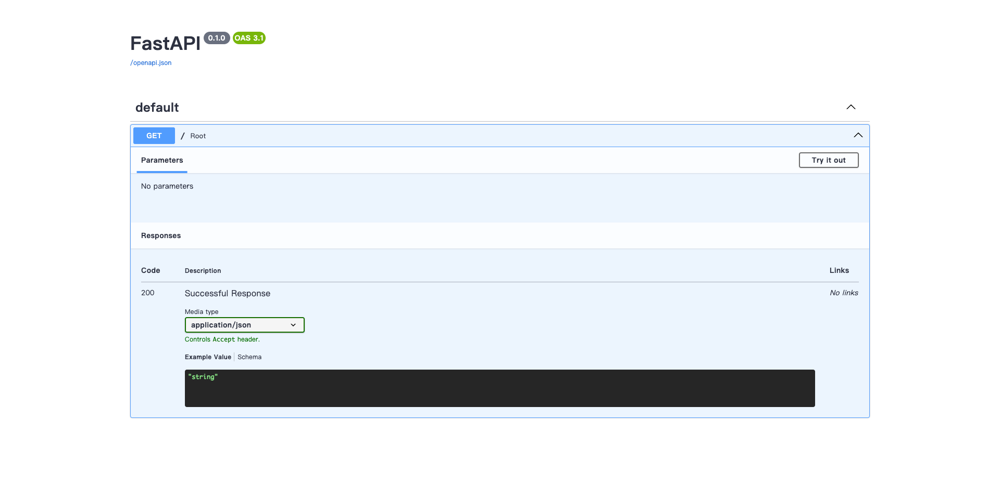

- 或者访问：http://127.0.0.1:8000/redoc

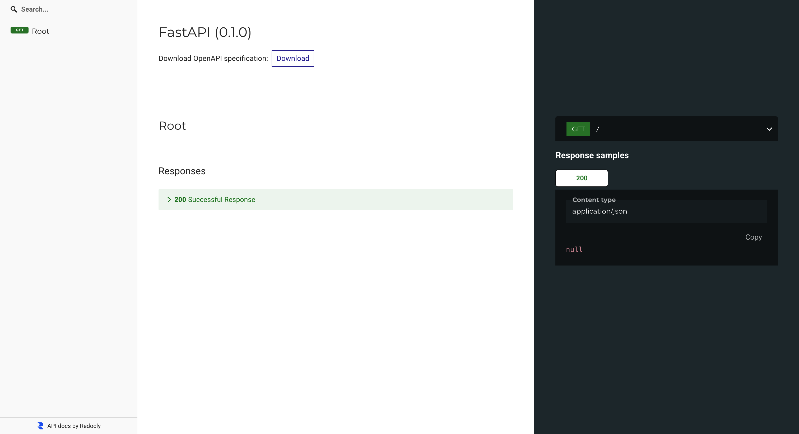

## 请求方法

Python 中的 HTTP 请求方法由 HTTP 协议定义。下面以常用的 requests 库为例：

| 方法 | 主要用途 | Python 示例 |
|---|---|---|
| **GET** | 获取资源、查询数据 | `requests.get(url, params={"id": 1})` |
| **POST** | 提交数据、创建资源 | `requests.post(url, json={"name": "张三"})` |
| **PUT** | 完整替换资源 | `requests.put(url, json={"name": "李四", "age": 20})` |
| **PATCH** | 更新资源的部分字段 | `requests.patch(url, json={"age": 21})` |
| **DELETE** | 删除资源 | `requests.delete(url)` |
| **HEAD** | 获取响应头，不获取响应体 | `requests.head(url)` |
| **OPTIONS** | 查询服务器支持的方法或通信选项 | `requests.options(url)` |
| **TRACE** | 回显收到的请求，用于诊断，通常被禁用 | `requests.request("TRACE", url)` |
| **CONNECT** | 通过代理建立隧道，常用于 HTTPS | 通常由客户端或代理自动处理 |

## 路径参数

1. 先看这样一个简单的案例，路径参数 item_id 的值会作为参数 item_id 传递给你的函数。

```Python
from fastapi import FastAPI

app = FastAPI()


@app.get("/items/{item_id}")
async def read_item(item_id):
    return {"item_id": item_id}
```

运行示例并访问 http://127.0.0.1:8000/items/foo， 可获得如下响应：

```json
{"item_id":"foo"}
```

2. 声明路径参数的类型

```Python
from fastapi import FastAPI

app = FastAPI()


@app.get("/items/{item_id}")
async def read_item(item_id: int):
    return {"item_id": item_id}
```
、
把`item_id`的类型声明为`int`.

3. 数据转换

运行示例并访问 http://127.0.0.1:8000/items/3， 返回的响应如下：

```json
{"item_id":3}
```

> 注意，函数接收并返回的值是 3（ int），不是 "3"（str）。

4. 数据校验

通过浏览器访问 http://127.0.0.1:8000/items/'3'， 接收如下 HTTP 错误信息：

```json
{
  "detail": [
    {
      "type": "int_parsing",
      "loc": [
        "path",
        "item_id"
      ],
      "msg": "Input should be a valid integer, unable to parse string as an integer",
      "input": "'1'"
    }
  ]
}
```

这是因为路径参数 item_id 的值（"3"）的类型不是 int。

5. Pydantic

所有数据校验都由 [Pydantic](https://pydantic.dev/docs/) 在幕后完成

6. 接口的顺序

有时，路径操作中的路径是写死的。比如要使用 /users/me 获取当前用户的数据。然后还要使用 /users/{user_id}，通过用户 ID 获取指定用户的数据。

由于路径操作是按顺序依次运行的，因此，一定要在 /users/{user_id} 之前声明 /users/me ：

```Python
from fastapi import FastAPI

app = FastAPI()


@app.get("/users/me")
async def read_user_me():
    return {"user_id": "the current user"}


@app.get("/users/{user_id}")
async def read_user(user_id: str):
    return {"user_id": user_id}
```

否则，`/users/{user_id}` 将匹配 `/users/me`，FastAPI 会认为正在接收值为 `"me"` 的 `user_id` 参数。

同样，你不能重复定义一个路径操作,由于路径首先匹配，始终会使用第一个定义的。

```Python
from fastapi import FastAPI

app = FastAPI()


@app.get("/users")
async def read_users():
    return ["Rick", "Morty"]


@app.get("/users")
async def read_users2():
    return ["Bean", "Elfo"]
```

7. 预设值

如果你的路径操作接收一个路径参数，但你希望可能有效的路径参数值是预设的，可以使用标准 Python Enum。

```Python
from enum import StrEnum

from fastapi import FastAPI


class ModelName(StrEnum):
    alexnet = "alexnet"
    resnet = "resnet"
    lenet = "lenet"


app = FastAPI()


@app.get("/models/{model_name}")
async def get_model(model_name: ModelName):
    if model_name is ModelName.alexnet:
        return {"model_name": model_name, "message": "Deep Learning FTW!"}

    if model_name.value == "lenet":
        return {"model_name": model_name, "message": "LeCNN all the images"}

    return {"model_name": model_name, "message": "Have some residuals"}
```

## 查询参数

1. 声明的参数不是路径参数时，路径操作函数会把该参数自动解释为“查询”参数。

```Python
from fastapi import FastAPI

app = FastAPI()

fake_items_db = [{"item_name": "Foo"}, {"item_name": "Bar"}, {"item_name": "Baz"}]


@app.get("/items/")
async def read_item(skip: int = 0, limit: int = 10):
    return fake_items_db[skip : skip + limit]
```

查询字符串是键值对的集合，这些键值对位于 URL 的 ? 之后，以 & 分隔。

例如：以下URL中：

```bash
http://127.0.0.1:8000/items/?skip=0&limit=10
```

或者也可以这样写,和上面的结果一样：

```bash
http://127.0.0.1:8000/items/
```

2. 可选参数

同理，把默认值设为 None 即可声明可选的查询参数：

```Python
from fastapi import FastAPI

app = FastAPI()


@app.get("/items/{item_id}")
async def read_item(item_id: str, q: str | None = None):
    if q:
        return {"item_id": item_id, "q": q}
    return {"item_id": item_id}
```

3. 查询参数类型转换

参数还可以声明为 bool 类型，FastAPI 会自动转换参数类型：

```Python
from fastapi import FastAPI

app = FastAPI()


@app.get("/items/{item_id}")
async def read_item(item_id: str, q: str | None = None, short: bool = False):
    item = {"item_id": item_id}
    if q:
        item.update({"q": q})
    if not short:
        item.update(
            {"description": "This is an amazing item that has a long description"}
        )
    return item
```

`short`参数这样写都会进行转换为`True`

```bash
http://127.0.0.1:8000/items/foo?short=1
http://127.0.0.1:8000/items/foo?short=True
http://127.0.0.1:8000/items/foo?short=true
http://127.0.0.1:8000/items/foo?short=on
http://127.0.0.1:8000/items/foo?short=yes
```

`short`参数这样写都会进行转换为`False`
```bash
http://127.0.0.1:8000/items/foo?short=0
http://127.0.0.1:8000/items/foo?short=False
http://127.0.0.1:8000/items/foo?short=false
http://127.0.0.1:8000/items/foo?short=off
http://127.0.0.1:8000/items/foo?short=no
```

4. 多个路径和查询参数

FastAPI 可以识别同时声明的多个路径参数和查询参数,而且声明这些参数的顺序并不重要,FastAPI 通过参数名进行检测：

```Python
from fastapi import FastAPI

app = FastAPI()


@app.get("/users/{user_id}/items/{item_id}")
async def read_user_item(
    user_id: int, item_id: str, q: str | None = None, short: bool = False
):
    item = {"item_id": item_id, "owner_id": user_id}
    if q:
        item.update({"q": q})
    if not short:
        item.update(
            {"description": "This is an amazing item that has a long description"}
        )
    return item
```

5. 必选查询参数

如果只想把参数设为可选，但又不想指定参数的值，则要把默认值设为 None.如果要把查询参数设置为必选，就不要声明默认值:

```Python
from fastapi import FastAPI

app = FastAPI()


@app.get("/items/{item_id}")
async def read_user_item(item_id: str, needy: str):
    item = {"item_id": item_id, "needy": needy}
    return item
```

如果在浏览器打开：http://127.0.0.1:8000/items/123, 会报错

```json
{
  "detail": [
    {
      "type": "missing",
      "loc": [
        "query",
        "needy"
      ],
      "msg": "Field required",
      "input": null
    }
  ]
}
```
## 请求体


当你需要从客户端（比如浏览器）向你的 API 发送数据时，会把它作为请求体发送。

请求体是客户端发送给你的 API 的数据。响应体是你的 API 发送给客户端的数据。

你的 API 几乎总是需要发送响应体。但客户端不一定总是要发送请求体，有时它们只请求某个路径，可能带一些查询参数，但不会发送请求体。

使用 `Pydantic` 模型来声明请求体，能充分利用它的功能和优点。

1. 导入 Pydantic 的 BaseModel

```Python
from fastapi import FastAPI
from pydantic import BaseModel


class Item(BaseModel):
    name: str
    description: str | None = None
    price: float
    tax: float | None = None


app = FastAPI()


@app.post("/items/")
async def create_item(item: Item):
    return item
```

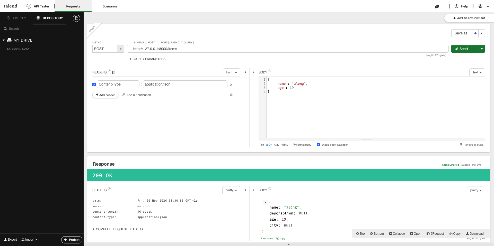

2.请求体 + 路径参数

可以同时声明路径参数和请求体。

```Python
from fastapi import FastAPI
from pydantic import BaseModel


class Item(BaseModel):
    name: str
    description: str | None = None
    price: float
    tax: float | None = None


app = FastAPI()


@app.put("/items/{item_id}")
async def update_item(item_id: int, item: Item):
    return {"item_id": item_id, **item.model_dump()}
```


3. 请求体 + 路径 + 查询参数

也可以同时声明请求体、路径和查询参数。


```Python
from fastapi import FastAPI
from pydantic import BaseModel


class Item(BaseModel):
    name: str
    description: str | None = None
    price: float
    tax: float | None = None


app = FastAPI()


@app.put("/items/{item_id}")
async def update_item(item_id: int, item: Item, q: str | None = None):
    result = {"item_id": item_id, **item.model_dump()}
    if q:
        result.update({"q": q})
    return result
```

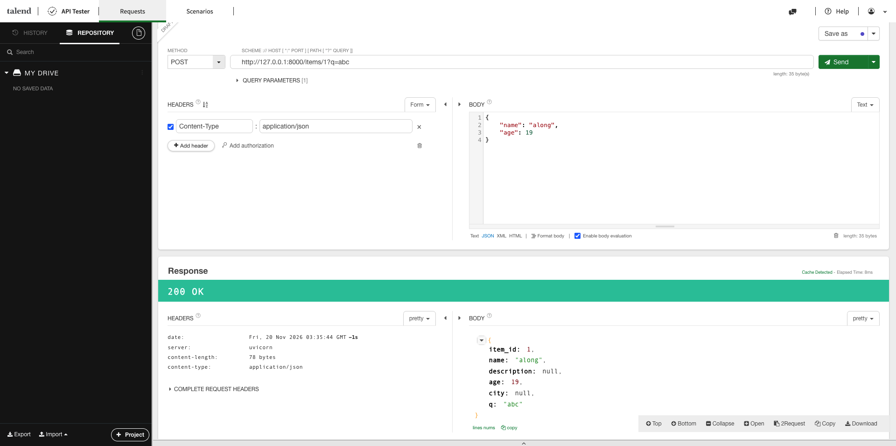

4. 请求体-字段Field

```Python
from typing import Annotated

from fastapi import Body, FastAPI
from pydantic import BaseModel, Field

app = FastAPI()


class Item(BaseModel):
    name: str
    description: str | None = Field(
        default=None, title="The description of the item", max_length=300
    )
    price: float = Field(gt=0, description="The price must be greater than zero")
    tax: float | None = None


@app.put("/items/{item_id}")
async def update_item(item_id: int, item: Annotated[Item, Body(embed=True)]):
    results = {"item_id": item_id, "item": item}
    return results
```

`Body(embed=True)`表示：请求 JSON 必须用参数名再包一层数据。

所以请求 `PUT /items/123` 时，JSON 必须包含 "item" 这一层：

```Python
{
  "item": {
    "name": "手机",
    "description": "一部手机",
    "price": 2999,
    "tax": 100
  }
}
```


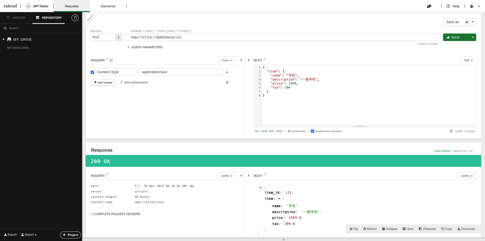

## 查询参数和字符串校验

1. 默认值的校验和是否必传

我们对下面查询参数添加校验，长度最多不超过5个字符。

```Python
from typing import Annotated

from fastapi import FastAPI, Query

app = FastAPI()


@app.get("/items/")
async def read_items(q: Annotated[str | None, Query(max_length=50)] = None):
    results = {"items": [{"item_id": "Foo"}, {"item_id": "Bar"}]}
    if q:
        results.update({"q": q})
    return results
```

我们发起一个请求如下，http://127.0.0.1:8000/items?q=abc


如果我们发起的请求参数超过5个字符会怎样？

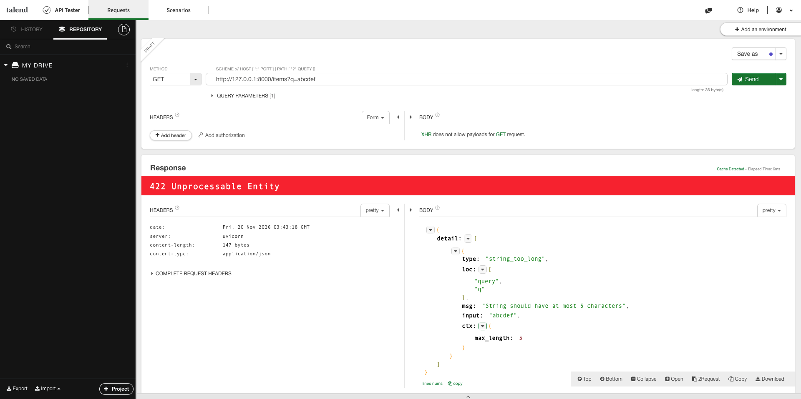

我们如果想把`q`参数变成可选的呢，我们应该怎么写?

```Python
from typing import Annotated

from fastapi import FastAPI, Query

app = FastAPI()


@app.get("/items/")
async def read_items(q: Annotated[str | None, Query(max_length=50)] = None):
    results = {"items": [{"item_id": "Foo"}, {"item_id": "Bar"}]}
    if q:
        results.update({"q": q})
    return results
```


当然也还有另外的写法，在`Query`中设置`default`参数

```Python
from fastapi import FastAPI, Query

app = FastAPI()


@app.get("/items/")
async def read_items(q: str | None = Query(default=None, max_length=50)):
    results = {"items": [{"item_id": "Foo"}, {"item_id": "Bar"}]}
    if q:
        results.update({"q": q})
    return results
```

- 注意 Query和Annotated的默认值只能设置一个，不可以都设置.
- q: Annotated[str, Query(default="rick")] = "morty",这种写法是不允许的
- 推荐使用 Annotated

2. 添加元数据

```Python
from typing import Annotated

from fastapi import FastAPI, Query

app = FastAPI()


@app.get("/items/")
async def read_items(
    q: Annotated[
        str | None,
        Query(
            title="Query string",
            description="Query string for the items to search in the database that have a good match",
            min_length=3,
        ),
    ] = None,
):
    results = {"items": [{"item_id": "Foo"}, {"item_id": "Bar"}]}
    if q:
        results.update({"q": q})
    return results
```

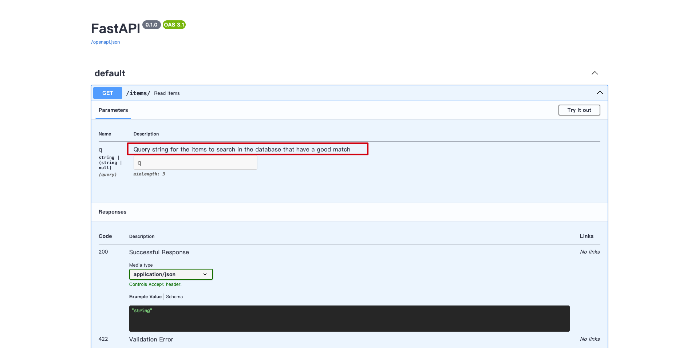

3. 别名参数

假设你想要参数名为 item-query。但 item-query 不是有效的 Python 变量名。这时可以用 alias 参数声明一个别名，FastAPI 会用该别名在 URL 中查找参数值：

```Python
from typing import Annotated

from fastapi import FastAPI, Query

app = FastAPI()


@app.get("/items/")
async def read_items(q: Annotated[str | None, Query(alias="item-query")] = None):
    results = {"items": [{"item_id": "Foo"}, {"item_id": "Bar"}]}
    if q:
        results.update({"q": q})
    return results
```


4.  弃用参数

现在假设你不再喜欢这个参数了。

由于还有客户端在使用它，你不得不保留一段时间，但你希望文档清楚地将其展示为已弃用。

那么将参数 deprecated=True 传给 Query：

```Python
from typing import Annotated

from fastapi import FastAPI, Query

app = FastAPI()


@app.get("/items/")
async def read_items(
    q: Annotated[
        str | None,
        Query(
            alias="item-query",
            title="Query string",
            description="Query string for the items to search in the database that have a good match",
            min_length=3,
            max_length=50,
            pattern="^fixedquery$",
            deprecated=True,
        ),
    ] = None,
):
    results = {"items": [{"item_id": "Foo"}, {"item_id": "Bar"}]}
    if q:
        results.update({"q": q})
    return results
```

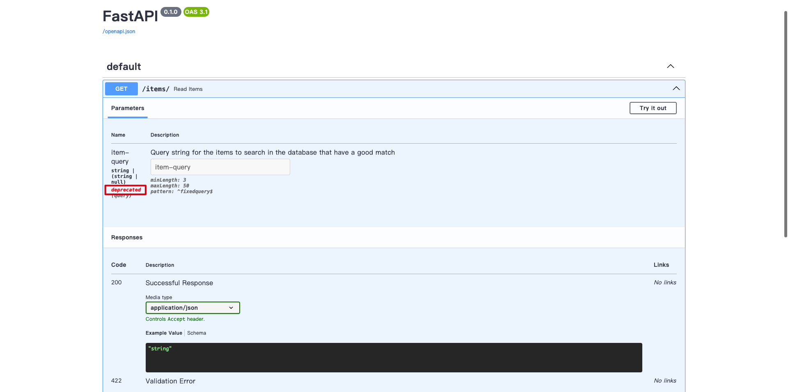

5. 移除接口文档参数

要把某个查询参数从生成的 OpenAPI 模式中排除（从而也不会出现在自动文档系统中），将 Query 的参数 include_in_schema 设为 False：

```Python
from typing import Annotated

from fastapi import FastAPI, Query

app = FastAPI()


@app.get("/items/")
async def read_items(
    hidden_query: Annotated[str | None, Query(include_in_schema=False)] = None,
):
    if hidden_query:
        return {"hidden_query": hidden_query}
    else:
        return {"hidden_query": "Not found"}
```

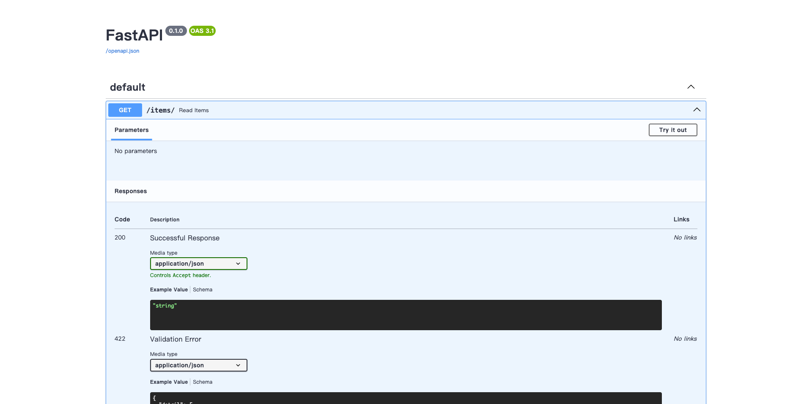

6. 自定义校验参数

例如，这个自定义校验器会检查条目 ID 是否以 isbn-（用于 ISBN 书号）或 imdb-（用于 IMDB 电影 URL 的 ID）开头：

```Python
import random
from typing import Annotated

from fastapi import FastAPI
from pydantic import AfterValidator

app = FastAPI()

data = {
    "isbn-9781529046137": "The Hitchhiker's Guide to the Galaxy",
    "imdb-tt0371724": "The Hitchhiker's Guide to the Galaxy",
    "isbn-9781439512982": "Isaac Asimov: The Complete Stories, Vol. 2",
}


def check_valid_id(id: str):
    if not id.startswith(("isbn-", "imdb-")):
        raise ValueError('Invalid ID format, it must start with "isbn-" or "imdb-"')
    return id


@app.get("/items/")
async def read_items(
    id: Annotated[str | None, AfterValidator(check_valid_id)] = None,
):
    if id:
        item = data.get(id)
    else:
        id, item = random.choice(list(data.items()))
    return {"id": id, "name": item}
```

> 字符串的 value.startswith() 可以接收一个元组，它会检查元组中的每个值

## 查询参数模型

1. 在一个 Pydantic 模型中声明你需要的查询参数，然后将参数声明为 Query

```Python
from typing import Annotated, Literal

from fastapi import FastAPI, Query
from pydantic import BaseModel, Field

app = FastAPI()


class FilterParams(BaseModel):
    limit: int = Field(100, gt=0, le=100)
    offset: int = Field(0, ge=0)
    order_by: Literal["created_at", "updated_at"] = "created_at"
    tags: list[str] = []


@app.get("/items/")
async def read_items(filter_query: Annotated[FilterParams, Query()]):
    return filter_query
```

FastAPI 将会从请求的查询参数中提取出每个字段的数据，并将你定义的 Pydantic 模型提供给你。


2. 禁止额外的查询参数

根据上面的接口，我们先发起一个这样的一个请求：

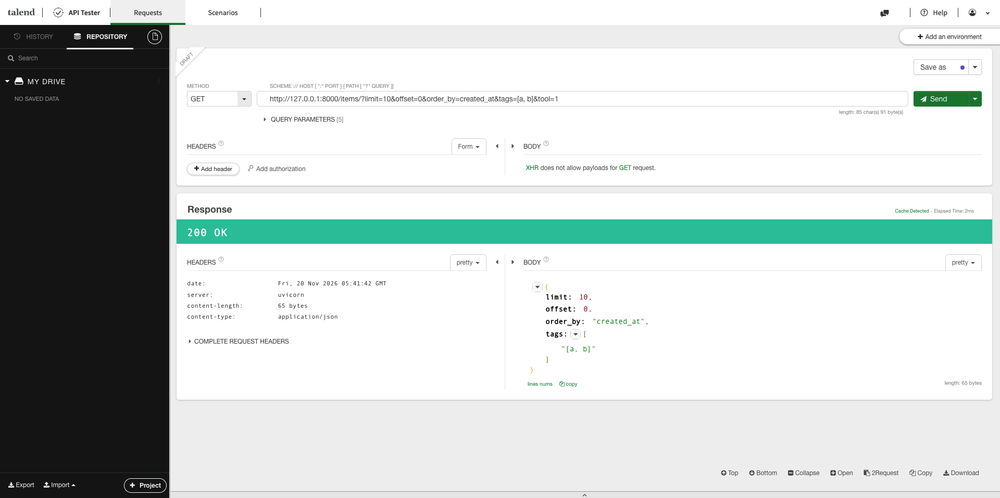

可以看到，我们多加了一个参数，接口没有返回，也没有报错。

在一些特殊的使用场景中（可能不是很常见），你可能希望限制你要接收的查询参数。

你可以使用 Pydantic 的模型配置来 forbid 任何 extra 字段：

```Python
from typing import Annotated, Literal

from fastapi import FastAPI, Query
from pydantic import BaseModel, Field

app = FastAPI()


class FilterParams(BaseModel):
    model_config = {"extra": "forbid"}

    limit: int = Field(100, gt=0, le=100)
    offset: int = Field(0, ge=0)
    order_by: Literal["created_at", "updated_at"] = "created_at"
    tags: list[str] = []


@app.get("/items/")
async def read_items(filter_query: Annotated[FilterParams, Query()]):
    return filter_query
```

他们将收到一个错误响应，告诉他们查询参数 tool 是不允许的：

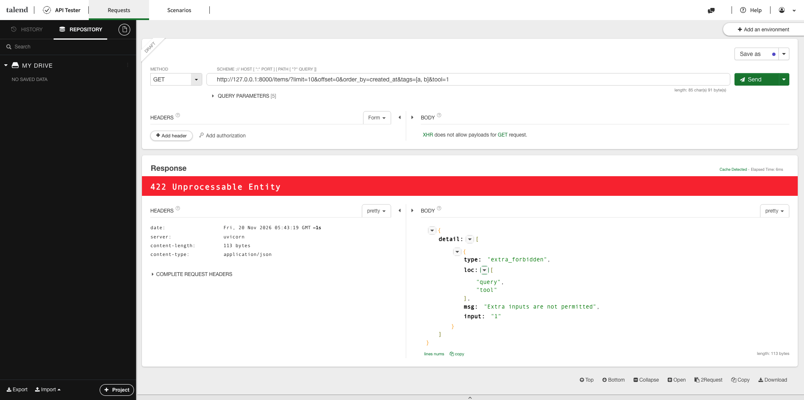

extra 一共有三种配置：

| 配置 | 额外字段的处理方式 |
|---|---|
| `"ignore"`（默认） | 忽略额外字段，不报错 |
| `"forbid"` | 拒绝额外字段，抛出验证错误 |
| `"allow"` | 接受并保存额外字段 |

3. 组合参数模型

你可以声明多个查询参数模型，并将它们与单独的查询参数或依赖项组合使用。

```Python
from typing import Annotated

from fastapi import FastAPI, Query
from pydantic import BaseModel, Field

app = FastAPI()


class Pagination(BaseModel):
    limit: int = Field(10, ge=1)
    offset: int = Field(0, ge=0)


class Filters(BaseModel):
    tags: list[str] = []


@app.get("/items/")
def read_items(
    pagination: Annotated[Pagination, Query()],
    filters: Annotated[Filters, Query()],
    search: str | None = None,
):
    return {"pagination": pagination, "filters": filters, "search": search}
```

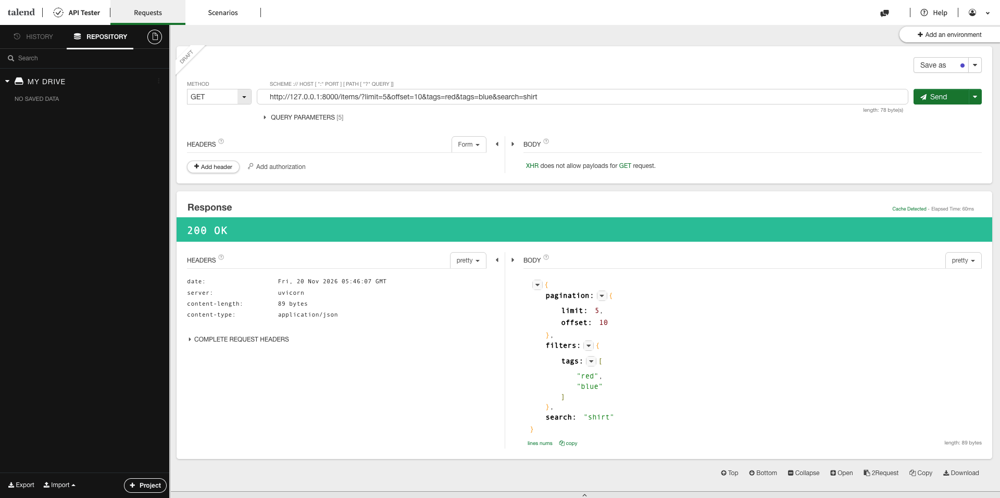

4. 可选查询参数模型

声明查询参数模型时，使用 | None 并将默认值设为 None，即可使这组参数变为可选。

```Python
from datetime import date
from typing import Annotated

from fastapi import FastAPI, Query
from pydantic import BaseModel

app = FastAPI()


class DateRange(BaseModel):
    start: date
    end: date


@app.get("/items/")
async def read_items(
    limit: int = 10,
    date_range: Annotated[DateRange | None, Query()] = None,
):
    return {"limit": limit, "date_range": date_range}
```
不传递参数
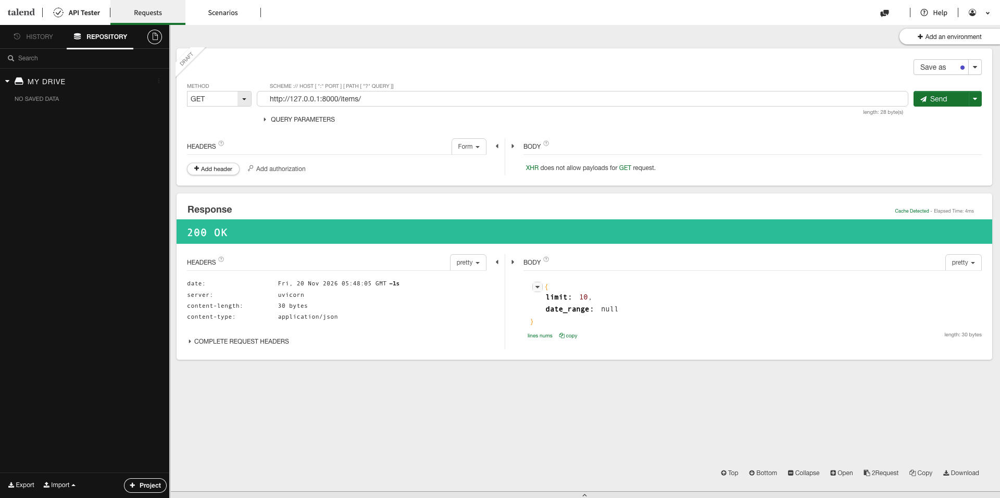

传递参数


## 声明请求示例数据

1. Pydantic 模型中的额外 JSON Schema 数据¶

你可以为一个 Pydantic 模型声明 examples，它们会被添加到生成的 JSON Schema 中。

```Python
from fastapi import FastAPI
from pydantic import BaseModel

app = FastAPI()


class Item(BaseModel):
    name: str
    description: str | None = None
    price: float
    tax: float | None = None

    model_config = {
        "json_schema_extra": {
            "examples": [
                {
                    "name": "Foo",
                    "description": "A very nice Item",
                    "price": 35.4,
                    "tax": 3.2,
                }
            ]
        }
    }


@app.put("/items/{item_id}")
async def update_item(item_id: int, item: Item):
    results = {"item_id": item_id, "item": item}
    return results
```

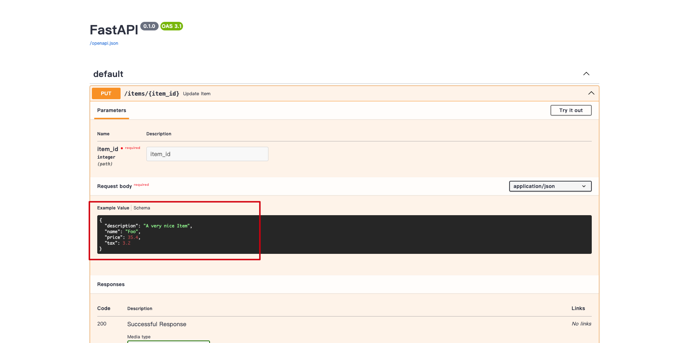

2. Field 的附加参数

在 Pydantic 模型中使用 Field() 时，你也可以声明额外的 examples, 实际效果和上面一致

```Python
from fastapi import FastAPI
from pydantic import BaseModel, Field

app = FastAPI()


class Item(BaseModel):
    name: str = Field(examples=["Foo"])
    description: str | None = Field(default=None, examples=["A very nice Item"])
    price: float = Field(examples=[35.4])
    tax: float | None = Field(default=None, examples=[3.2])


@app.put("/items/{item_id}")
async def update_item(item_id: int, item: Item):
    results = {"item_id": item_id, "item": item}
    return results
```


3. JSON Schema 中的 examples 

  - 在以下任意场景中使用：
    - Path()
    - Query()
    - Header()
    - Cookie()
    - Body()
    - Form()
    - File()

4.带有 examples 的 Body

```Python
from typing import Annotated

from fastapi import Body, FastAPI
from pydantic import BaseModel

app = FastAPI()


class Item(BaseModel):
    name: str
    description: str | None = None
    price: float
    tax: float | None = None


@app.put("/items/{item_id}")
async def update_item(
    item_id: int,
    item: Annotated[
        Item,
        Body(
            examples=[
                {
                    "name": "Foo",
                    "description": "A very nice Item",
                    "price": 35.4,
                    "tax": 3.2,
                }
            ],
        ),
    ],
):
    results = {"item_id": item_id, "item": item}
    return results
```


当然，你也可以传入多个 examples：


```Python
from typing import Annotated

from fastapi import Body, FastAPI
from pydantic import BaseModel

app = FastAPI()


class Item(BaseModel):
    name: str
    description: str | None = None
    price: float
    tax: float | None = None


@app.put("/items/{item_id}")
async def update_item(
    *,
    item_id: int,
    item: Annotated[
        Item,
        Body(
            examples=[
                {
                    "name": "Foo",
                    "description": "A very nice Item",
                    "price": 35.4,
                    "tax": 3.2,
                },
                {
                    "name": "Bar",
                    "price": "35.4",
                },
                {
                    "name": "Baz",
                    "price": "thirty five point four",
                },
            ],
        ),
    ],
):
    results = {"item_id": item_id, "item": item}
    return results
```

不过，在撰写本文时，用于展示文档 UI 的 Swagger UI 并不支持显示 JSON Schema 中数据的多个示例,目前看只会展示第一个。

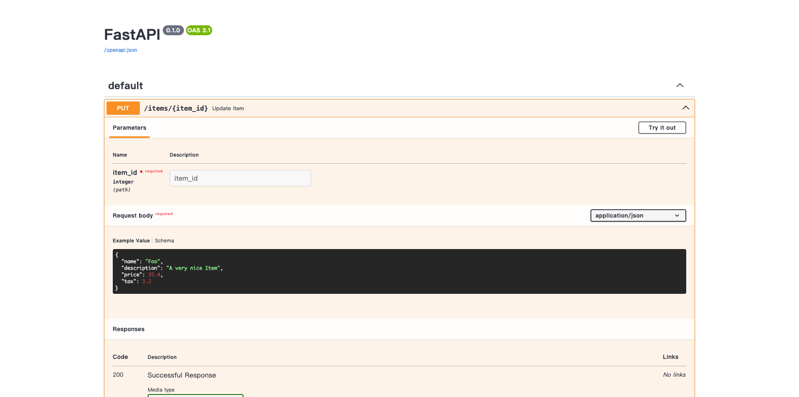
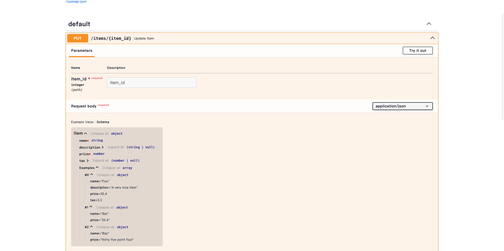

5. 使用 openapi_examples 参数显示多个

你可以在 FastAPI 中通过参数 openapi_examples 来声明这个 OpenAPI 特定的 examples，适用于：

  - Path()
  - Query()
  - Header()
  - Cookie()
  - Body()
  - Form()
  - File()

examples 中每个具体示例的 dict 可以包含：
  - summary：该示例的简短描述。
  - description：较长描述，可以包含 Markdown 文本。
  - value：实际展示的示例，例如一个 dict。
  - externalValue：value 的替代项，指向该示例的 URL。不过它的工具支持度可能不如 value。


你可以这样使用：

```Python
from typing import Annotated

from fastapi import Body, FastAPI
from pydantic import BaseModel

app = FastAPI()


class Item(BaseModel):
    name: str
    description: str | None = None
    price: float
    tax: float | None = None


@app.put("/items/{item_id}")
async def update_item(
    *,
    item_id: int,
    item: Annotated[
        Item,
        Body(
            openapi_examples={
                "normal": {
                    "summary": "A normal example",
                    "description": "A **normal** item works correctly.",
                    "value": {
                        "name": "Foo",
                        "description": "A very nice Item",
                        "price": 35.4,
                        "tax": 3.2,
                    },
                },
                "converted": {
                    "summary": "An example with converted data",
                    "description": "FastAPI can convert price `strings` to actual `numbers` automatically",
                    "value": {
                        "name": "Bar",
                        "price": "35.4",
                    },
                },
                "invalid": {
                    "summary": "Invalid data is rejected with an error",
                    "value": {
                        "name": "Baz",
                        "price": "thirty five point four",
                    },
                },
            },
        ),
    ],
):
    results = {"item_id": item_id, "item": item}
    return results
```

点击下拉选择框就可以切换数据

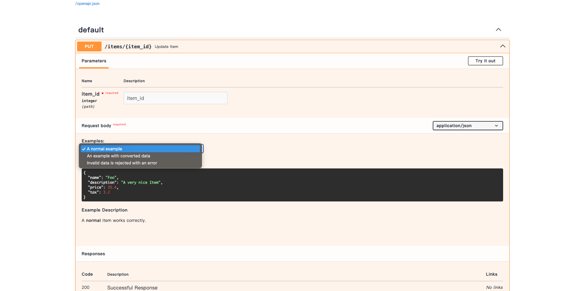


## Cookie上的参数

Cookie 是客户端保存的一小段数据，浏览器会在后续符合条件的请求中，自动把它发送给服务器。 常见用途有：保持登录状态、保存主题偏好、记录购物车标识等。


`Cookie()` 负责读取请求中的 Cookie，`Response.set_cookie()` 负责让客户端保存 Cookie。

1. Cookie 是怎样工作的？

例如，用户第一次访问网站，服务器通过响应头设置 Cookie：

```http
HTTP/1.1 200 OK
Set-Cookie: theme=dark; Path=/; Max-Age=604800
```
浏览器保存后，再次访问符合条件的地址时，会自动携带：

```http
GET /items HTTP/1.1
Host: example.com
Cookie: theme=dark
```

2. 完整案例：保存、读取和删除主题偏好

```Python
from typing import Annotated, Literal

from fastapi import Cookie, FastAPI, Response

app = FastAPI()


# 设置 Cookie
@app.post("/theme/{theme}")
async def set_theme(
    theme: Literal["light", "dark"],
    response: Response,
):
    response.set_cookie(
        key="theme",
        value=theme,
        max_age=7 * 24 * 60 * 60,  # 有效期：7 天，单位为秒
        path="/",
        httponly=True,
        secure=False,            # 本地 HTTP 调试；生产 HTTPS 环境设为 True
        samesite="lax",
    )

    return {"message": "主题已保存", "theme": theme}


# 读取 Cookie
@app.get("/theme")
async def get_theme(
    theme: Annotated[
        Literal["light", "dark"] | None,
        Cookie(),
    ] = None,
):
    return {"theme": theme or "light"}


# 删除 Cookie
@app.delete("/theme")
async def delete_theme(response: Response):
    response.delete_cookie(
        key="theme",
        path="/",
    )

    return {"message": "主题 Cookie 已删除"}
```
- 初次查询

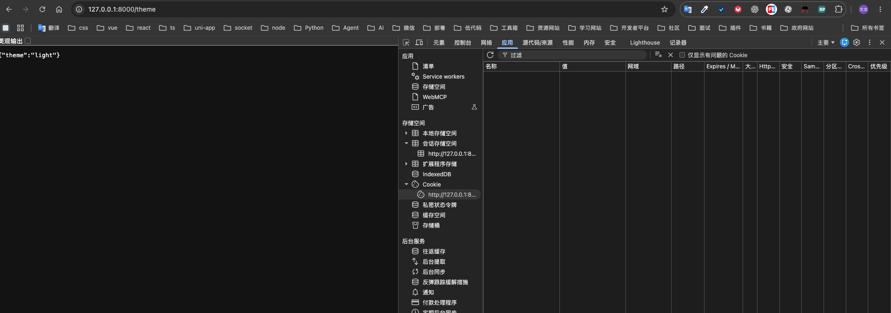

- 设置Cookie

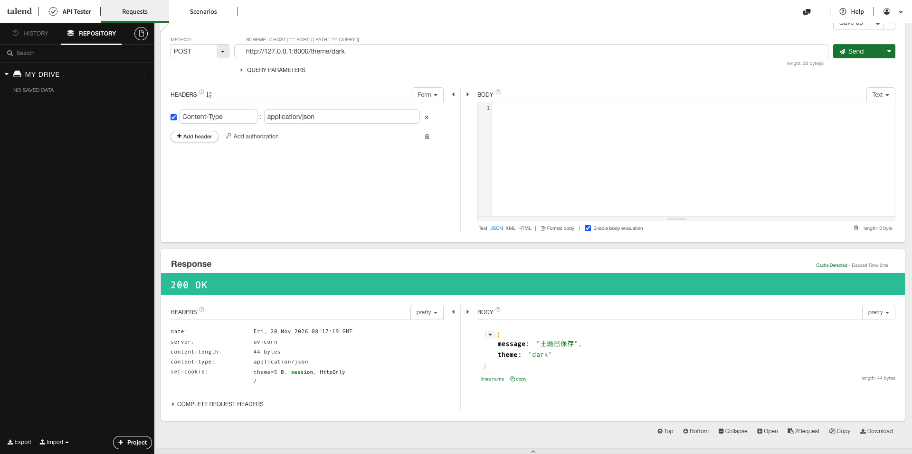

- 查询Cookie


- 移除Cookie


- 再次查询


3. set_cookie() 常见参数

| 参数 | 作用 | 示例 |
|---|---|---|
| `key` | Cookie 名称 | `"theme"` |
| `value` | Cookie 值，通常为字符串 | `"dark"` |
| `max_age` | 从设置开始，多少秒后过期 | `3600` 表示一小时 |
| `expires` | 指定过期时间，可使用 UTC 时间对象 | 到指定时间过期 |
| `path` | 哪些 URL 路径可以携带 | `"/"` 表示整个网站 |
| `domain` | 限定发送到哪些域名 | 不设置时通常只发送给当前主机 |
| `httponly` | 禁止 JavaScript 通过 `document.cookie` 读取 | 登录 Cookie 通常设为 `True` |
| `secure` | 限制通过 HTTPS 发送 | 生产环境通常设为 `True` |
| `samesite` | 控制跨站请求时是否携带 | `"lax"`、`"strict"`、`"none"` |

SameSite 的区别：

| 值 | 大致行为 |
|---|---|
| `"strict"` | 跨站请求通常不携带 |
| `"lax"` | 大多数跨站请求不携带，但允许部分顶层导航，例如点击链接进入网站 |
| `"none"` | 允许跨站携带，现代浏览器通常要求同时设置 `Secure` |

`HttpOnly` 不会阻止浏览器自动发送 `Cookie`，只会限制 `JavaScript` 读取它。

4. Cookie 怎样保持登录状态？

常见做法是：Cookie 保存随机会话 ID，服务器保存该会话对应的用户信息。

```text
登录成功
   ↓
服务器生成随机 session_id
   ↓
服务器保存：session_id → 用户信息
   ↓
通过 Set-Cookie 将 session_id 发给浏览器
   ↓
后续请求自动携带 session_id
   ↓
服务器查询会话，识别当前用户
```

## 请求头上的参数

```Python
from typing import Annotated

from fastapi import FastAPI, Header

app = FastAPI()

class CommonHeaders(BaseModel):
    host: str
    cache_control: str
    user_agent: str


@app.get("/items/")
async def read_items(headers: Annotated[CommonHeaders, Header()]):
    return headers
```

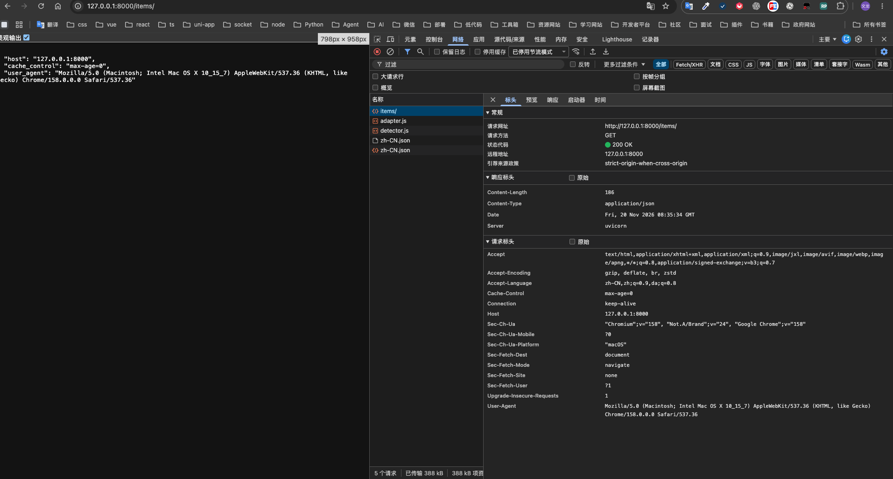