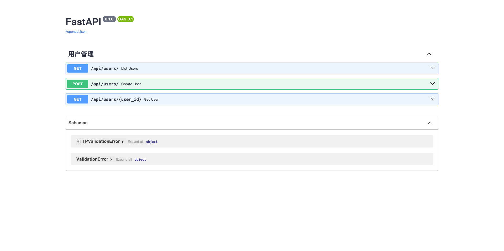

| 框架 | 路由管理方式 |
|---|---|
| FastAPI | `APIRouter` 按模块拆分，`include_router` 统一注册 |

推荐按业务模块管理。

```text
project/
├── main.py
└── routers/
    ├── __init__.py
    └── users.py
```

在 `routers/users.py` 中定义用户相关路由：


```Python
from fastapi import APIRouter

router = APIRouter()


@router.get("/")
def list_users():
    return [{"id": 1, "name": "张三"}]


@router.get("/{user_id}")
def get_user(user_id: int):
    return {"id": user_id}


@router.post("/")
def create_user():
    return {"message": "创建用户"}
```

在 `main.py` 中统一注册：

```Python
from fastapi import FastAPI
from routers.users import router as users_router

app = FastAPI()

app.include_router(
    users_router,
    prefix="/api/users",
    tags=["用户管理"],
)
```

最终得到这些接口：

```text
GET  /api/users/       查询用户列表
GET  /api/users/123    查询指定用户
POST /api/users/       创建用户
```

