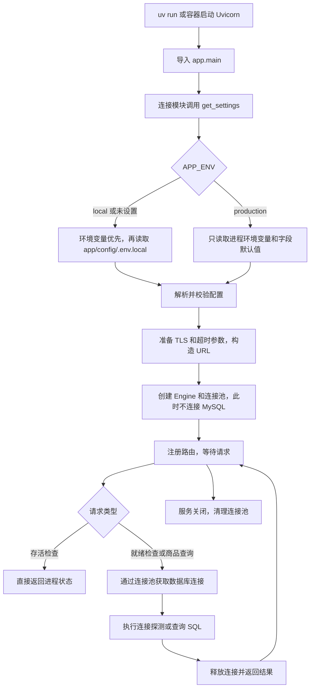
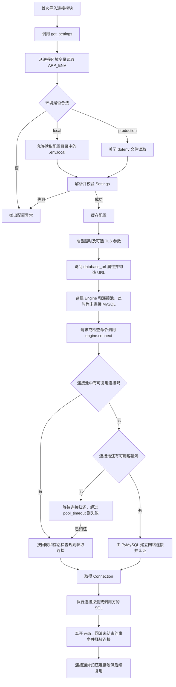
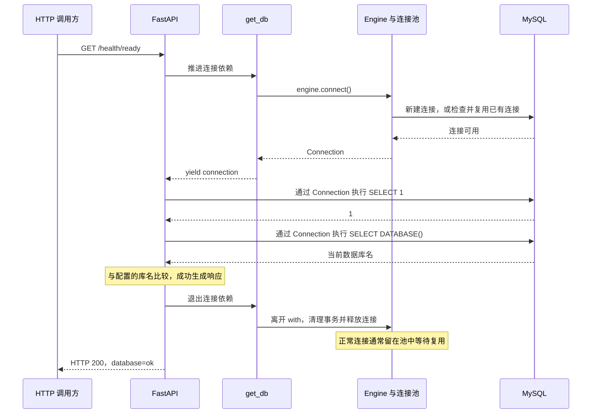

## 介绍

项目使用 FastAPI、SQLAlchemy Core、PyMySQL 和 pydantic-settings，演示一套可实际运行的数据库连接结构：统一配置目录、本地与生产环境隔离、配置校验、连接池、可选 TLS、连接检查和资源释放，并提供 products 表的分页查询接口。

使用 uv 管理 Python、虚拟环境、依赖锁定和 Python 打包，使用 Docker Compose 在 Linux 宝塔服务器运行服务。默认 Python 版本为 3.13，项目兼容范围为 Python 3.11+；uv 版本要求为 0.12.5 或更新版本。

项目地址：https://github.com/YangWenLong123/python-mysql-connect

- 文件结构

```text
python-mysql-connect/
├── app/
│   ├── __init__.py
│   ├── config/                     # 统一管理数据库配置与连接
│   │   ├── __init__.py
│   │   ├── settings.py             # 环境选择、配置校验、连接地址
│   │   ├── database.py             # TLS、引擎、连接池、连接依赖和探测
│   │   ├── .env.local              # 本地实际配置，不应提交或打进镜像
│   │   ├── .env.local.example      # 本地配置模板
│   │   ├── .env.production.example # 生产数据库变量模板
│   │   └── .env.deploy.example     # Docker 镜像版本模板
│   ├── routers/
│   │   ├── __init__.py
│   │   └── products.py             # products 表分页查询
│   ├── check_db.py                 # 独立的只读连接与权限检查
│   └── main.py                     # FastAPI 入口、健康检查、生命周期
├── docs/                           # 代码流程说明
├── tests/                          # 配置、连接和接口测试
├── .python-version                 # uv 默认使用 Python 3.13
├── .gitignore                      # 本地配置、缓存与构建产物忽略规则
├── .dockerignore                   # Docker 构建上下文白名单
├── pyproject.toml                  # 项目信息、运行依赖和 dev 依赖组
├── uv.lock                         # uv 依赖锁文件，需要提交到版本库
├── Dockerfile                      # 使用 uv 的多阶段镜像构建
├── compose.yaml                    # 生产环境注入、网络和启动配置
├── MANIFEST.in                     # Python 源码包包含/排除规则
└── readme.md
```

## 项目运行流程



## 1. 先认识参与连接的文件与对象

连接配置集中在 `app/config/`，相关调用关系如下：

```text
app/
├── config/
│   ├── __init__.py             包入口，本身不读取配置、不连接数据库
│   ├── settings.py             选择环境、读取配置、校验配置、构造连接地址
│   ├── database.py             创建引擎和连接池，提供连接获取与验证函数
│   ├── .env.local              本地环境的实际配置
│   └── .env.production.example 生产环境变量的字段模板
├── check_db.py                 独立验证连接和 products 表读取权限
└── main.py                     使用连接依赖做就绪检查，关闭时清理连接池
```


| 对象 | 在本项目中的作用 |
| --- | --- |
| `Settings` | 配置模型，声明主机、端口、账户、密码、连接池和超时的类型及约束。 |
| `settings` | 校验成功后的配置实例，通过 `get_settings()` 获得。 |
| `URL` | SQLAlchemy 的结构化连接地址，保存驱动、账户、主机和数据库等信息。 |
| `Engine` | 数据库访问入口，管理数据库方言、驱动及连接池。 |
| 连接池 | 按需创建、保存和复用底层数据库连接。 |
| `Connection` | 从引擎借出的连接包装对象，用于执行 SQL，用完必须释放。 |
| PyMySQL | 负责与 MySQL 建立网络连接、认证、发送 SQL 和接收结果的驱动。 |


主应用从 [app/main.py](../app/main.py) 导入连接模块：

```python
from app.config.database import engine, get_db, probe_database
```

Python 首次导入 `app.config.database` 时，会先加载 `app.config` 包，再执行 `database.py`；其中的 `from app.config.settings import get_settings` 又会先加载 `settings.py`。随后执行 `settings = get_settings()`，才真正读取配置。同一进程后续通常复用已经导入的模块。

## 2. 数据库连接流程



## 3. 第一步：确定环境，再决定从哪里加载配置

对应 [app/config/settings.py](../app/config/settings.py) 的 `CONFIG_DIR` 与 `get_settings()`：

```python
CONFIG_DIR = Path(__file__).resolve().parent


@lru_cache
def get_settings() -> Settings:
    environment = os.getenv("APP_ENV", "local")
    if environment not in {"local", "production"}:
        raise ValueError("APP_ENV 只能是 local 或 production")
    env_file = CONFIG_DIR / ".env.local" if environment == "local" else None
    return Settings(app_env=environment, _env_file=env_file)
```

执行过程逐行分析：

1. `Path(__file__).resolve().parent` 取得 `settings.py` 所在目录，也就是 `app/config/`。因此本地配置文件不会随着终端当前目录改变而改变。
2. `os.getenv("APP_ENV", "local")` 先读取**当前进程的环境变量**。没有设置时使用 `local`，这里尚未读取任何 dotenv 文件。
3. 环境名只能为 `local` 或 `production`。例如 `prod`、`Production` 或带空格的值都会被拒绝，避免拼写错误后继续使用其他配置。
4. 本地环境把 `.env.local` 的绝对路径传给 `_env_file`；生产环境明确传入 `_env_file=None`，禁用 dotenv 文件读取。
5. `Settings(app_env=environment, ...)` 创建配置实例；`_env_file` 是 pydantic-settings 的加载参数，不是数据库连接参数。
6. 成功返回的对象由 `@lru_cache` 缓存在当前进程中，后续调用通常直接返回同一个对象。创建失败的结果不会被缓存。

| 环境 | `APP_ENV` 的来源 | `DB_*` 配置的取值顺序 |
| --- | --- | --- |
| 本地 | 进程变量未设置，或显式为 `local`。 | 进程环境变量 → `app/config/.env.local` → 字段默认值。 |
| 生产 | 进程环境变量显式为 `production`。 | 进程环境变量 → 字段默认值；不读取 dotenv 文件。 |

这里的优先级针对当前 `get_settings()` 调用：它没有直接传入 `DB_*` 对应的构造参数。`app_env` 则由函数明确传入，所以不会再被 dotenv 中的同名项决定。

例如，本地文件写了 `DB_PORT=3306`，而进程中已经存在 `DB_PORT=3307`，最终使用 `3307`。生产缺少密码时会在配置校验阶段失败，不会用本地文件补齐。

**仅创建名为 `.env.production` 的文件不会让 Python 切换环境，也不会让生产模式读取它。** 连接代码只关心进程中已提供的 `APP_ENV` 和 `DB_*`；环境选择发生在 `get_settings()` 调用时，与安装包的构建过程无关。

本地文件中的主要字段可对照 [本地配置模板](../app/config/.env.local.example)；生产需要提供的字段可对照 [生产配置模板](../app/config/.env.production.example)。实际密码保留在受控配置来源中，文档中不重复记录。

## 4. 第二步：把外部字符串转换为经过校验的 Settings

仍在 [app/config/settings.py](../app/config/settings.py)。下面保留配置字段和校验器，连接地址属性单独放到下一步分析：

```python
class Settings(BaseSettings):
    model_config = SettingsConfigDict(
        env_file_encoding="utf-8", extra="ignore", hide_input_in_errors=True
    )
    app_env: Literal["local", "production"] = "local"
    db_host: str = Field(min_length=1)
    db_port: int = Field(default=3306, ge=1, le=65535)
    db_name: str = Field(min_length=1)
    db_user: str = Field(min_length=1)
    db_password: SecretStr = Field(min_length=1)
    db_pool_size: int = Field(default=5, ge=1)
    db_max_overflow: int = Field(default=5, ge=0)
    db_pool_timeout: int = Field(default=10, ge=1)
    db_pool_recycle: int = Field(default=1800, ge=1)
    db_connect_timeout: int = Field(default=5, ge=1)
    db_read_timeout: int = Field(default=10, ge=1)
    db_write_timeout: int = Field(default=10, ge=1)
    db_ssl_ca: FilePath | None = None

    @model_validator(mode="after")
    def reject_placeholder_password(self) -> Self:
        if self.db_password.get_secret_value() == "CHANGE_ME":
            raise ValueError("请先把 DB_PASSWORD 替换为实际数据库密码")
        return self
```

### 4.1 字段如何读取和转换

`Settings` 继承 `BaseSettings`，因此能读取环境变量和指定的 dotenv 文件。默认按不区分大小写的字段名匹配，例如 `DB_HOST` 对应 `db_host`。

外部配置原本是字符串；Pydantic 根据类型注解进行解析。例如 `DB_PORT=3306` 会转换为整数，而不是保留为字符串。随后执行 `Field` 约束：

| 配置字段 | 作用与校验 |
| --- | --- |
| `db_host`、`db_name`、`db_user` | 必填且不能为空。没有为生产自动设置本地地址、库名或账户。 |
| `db_port` | 默认 `3306`，必须处于 `1～65535`。 |
| `db_password` | 必填且非空，用 `SecretStr` 遮盖常规字符串显示。 |
| `db_pool_size`、`db_max_overflow` | 分别限制常规连接池容量与允许的临时额外连接数。 |
| `db_pool_timeout`、`db_pool_recycle` | 限制等待连接池的时间，以及连接重新取用时的回收年龄。 |
| `db_connect_timeout`、`db_read_timeout`、`db_write_timeout` | 给底层驱动提供网络超时，均必须大于 `0`。 |
| `db_ssl_ca` | 可不配置；配置后必须指向存在的文件。能否读取、是否是有效证书还会在后续检查。 |

配置模型中的超时和回收时间均以秒为单位。

### 4.2 为什么还要有整体校验器

`@model_validator(mode="after")` 在字段解析、字段校验成功后运行。`reject_placeholder_password()` 检查模板占位密码 `CHANGE_ME`，防止只复制模板、没有填写实际密码就继续执行。

`get_secret_value()` 取出密码明文用于比较；返回 `self`，让 Pydantic 继续返回已经校验完成的实例。`SecretStr` 只影响常规显示，不加密原始文件，也不应成为打印全部配置的理由。

`hide_input_in_errors=True` 减少常规校验异常文本中的原始输入回显；`extra="ignore"` 允许文件包含其他配置项，也意味着未知字段不会自动报错，应核对变量名。

**完成这一步只说明配置的格式和取值通过校验。** 它尚未验证主机是否可达、密码是否正确、数据库是否存在，也未连接 MySQL。

## 5. 第三步：准备驱动超时与 TLS 参数

转到 [app/config/database.py](../app/config/database.py)：

```python
settings = get_settings()
connect_args: dict[str, Any] = {
    "connect_timeout": settings.db_connect_timeout,
    "read_timeout": settings.db_read_timeout,
    "write_timeout": settings.db_write_timeout,
}
if settings.db_ssl_ca is not None:
    connect_args["ssl"] = ssl.create_default_context(cafile=str(settings.db_ssl_ca))
```

`settings = get_settings()` 在连接模块的顶层执行，取得前面分析的配置实例。后面的 `connect_args` 会原样交给 PyMySQL，而不是用于 Pydantic 校验。

| 参数 | 控制的阶段 | 默认值 |
| --- | --- | --- |
| `connect_timeout` | 驱动建立网络连接的等待时间。 | `5` 秒 |
| `read_timeout` | 驱动读取网络数据的等待时间。 | `10` 秒 |
| `write_timeout` | 驱动写入网络数据的等待时间。 | `10` 秒 |

这些是驱动层超时，不应理解为“一条 SQL 最多运行多少秒”，也不是一个 HTTP 请求的完整耗时上限。建立连接还可能涉及 DNS、握手等多个阶段。

如果设置了 `DB_SSL_CA`，`ssl.create_default_context(cafile=...)` 会加载 CA，创建默认启用证书链和主机名校验的 `SSLContext`。此时会读取并解析本地证书文件，真正与 MySQL 进行 TLS 握手是在建立数据库连接时。

CA 文件不存在会在配置校验阶段失败；文件无法读取或证书内容无效可能在创建上下文时失败；服务器证书不受信任或主机名不匹配则在握手时失败。未设置 `DB_SSL_CA` 时，本实现不会主动传入这个 TLS 上下文。

## 6. 第四步：构造数据库连接地址

对应 `Settings.database_url` 属性，定义在 `Settings` 类内部。驱动参数准备完成后，`database.py` 执行 `create_engine(settings.database_url, ...)`，会先计算第一个实参，触发这个属性：

```python
@property
def database_url(self) -> URL:
    return URL.create(
        drivername="mysql+pymysql",
        username=self.db_user,
        password=self.db_password.get_secret_value(),
        host=self.db_host,
        port=self.db_port,
        database=self.db_name,
        query={"charset": "utf8mb4"},
    )
```

代码的执行与用途：

1. `@property` 允许通过 `settings.database_url` 访问它；访问时才构造 `URL` 对象，不是定义类时就执行。
2. `drivername="mysql+pymysql"` 告诉 SQLAlchemy：使用 MySQL 方言，通过 PyMySQL 驱动通信。
3. `username`、`password`、`host`、`port` 和 `database` 来自已校验的配置。
4. 密码用 `get_secret_value()` 取出，因为驱动认证最终需要真实值。
5. `URL.create()` 分别接收各个部分，能正确保留密码里的 `@`、`:`、`/` 等字符，避免手工拼接字符串时把密码误当成 URL 分隔符。
6. `charset=utf8mb4` 指定数据库连接使用的字符集，支持中文和 Emoji；它不会修改已有数据库或表的字符集。

`URL` 保存的是连接描述，此时仍没有创建网络连接。`str(URL)` 的常规显示会隐藏密码，但不要提取明文密码写入日志。

## 7. 第五步：创建 Engine 和连接池

仍在 [app/config/database.py](../app/config/database.py)，模块顶层继续执行：

```python
engine = create_engine(
    settings.database_url,
    pool_pre_ping=True,
    pool_recycle=settings.db_pool_recycle,
    pool_size=settings.db_pool_size,
    max_overflow=settings.db_max_overflow,
    pool_timeout=settings.db_pool_timeout,
    connect_args=connect_args,
    hide_parameters=True,
)
```

`create_engine()` 把连接地址、连接池规则及驱动参数组合成一个 `Engine`。**它采用惰性连接：此处不会立即建立 MySQL 网络连接，也不会提前创建 `pool_size` 条连接。** 缺少驱动等初始化问题可以在这里报错，但账号密码错误通常要等到真正连接时才发现。

各参数对连接流程的影响：

| 参数 | 在什么时候起作用 |
| --- | --- |
| `pool_size` | 按需建立连接，默认最多保留 `5` 个常规连接。 |
| `max_overflow` | 常规池不足时，默认还允许 `5` 个临时额外连接；归还时不保证继续保留。 |
| `pool_timeout` | 连接容量耗尽后，默认等待最多 `10` 秒；仍无连接就抛出超时异常。 |
| `pool_recycle` | 默认连接年龄超过 `1800` 秒后，在下一次取用时回收重建；不是每隔半小时主动扫描，也不会强制中断正在使用的连接。 |
| `pool_pre_ping` | 取用已有连接时检查存活状态，必要时丢弃失效连接并尝试重建；不能保证随后的 SQL 永不失败。 |
| `connect_args` | 新建底层连接时，把网络超时及可选 TLS 上下文交给 PyMySQL。 |
| `hide_parameters` | 避免 SQLAlchemy 常规异常文本和日志显示绑定参数；不会自动清理所有自定义日志。 |

每个工作进程通常拥有自己的配置实例、`Engine` 和连接池。当前默认参数下，每个进程最多同时借出 `5 + 5 = 10` 条连接；多个进程要合计计算数据库连接预算。

不要在每个请求中重新执行 `create_engine()`，否则连接池无法复用；也不要在多个请求之间共享同一个借出的 `Connection`。

## 8. 第六步：调用 engine.connect()，真正获取数据库连接

本项目用 `get_db()` 向 FastAPI 请求提供连接：

```python
def get_db() -> Generator[Connection, None, None]:
    with engine.connect() as connection:
        yield connection
```

### 8.1 哪一行开始访问数据库

执行到 `with engine.connect() as connection:` 时，SQLAlchemy 从连接池取连接：

1. 池中存在可复用连接时，按回收和存活检查规则取出；失效连接可能被替换。
2. 没有可复用连接、但仍有容量时，由 PyMySQL 新建底层连接。
3. 新建连接通常涉及主机名解析、TCP 连接、MySQL 协议握手、可选 TLS、账户认证及选择目标数据库，之后还可能进行方言初始化。
4. 池已达到最大容量时，先等待其他请求归还连接，超过 `pool_timeout` 就失败。
5. 成功后，`connection` 是本次调用持有的 SQLAlchemy `Connection` 对象。

密码错误、库名不存在、来源主机未授权和网络故障，都可能导致 `engine.connect()` 抛出异常。**`engine` 对象存在与拿到真实数据库连接，是两个不同阶段。**

### 8.2 yield 与 with 分别负责什么

`get_db()` 含有 `yield`，因此调用函数会先得到生成器；FastAPI 在处理该依赖时推进生成器，才执行 `engine.connect()`。

取得连接后，`yield connection` 暂停依赖函数，把本次连接交给使用 `Depends(get_db)` 的调用方。依赖退出时，函数恢复执行，离开 `with`，由上下文管理器释放连接。

即使调用方的 SQL 抛出异常，已经进入的上下文仍会清理。SQLAlchemy 2 执行 SQL 时通常会自动开启事务；退出时尚未完成的事务会回滚。对于当前只读操作，这能清理事务状态；将来如果增加写操作，需要显式设计提交和回滚，不能指望 `yield` 自动提交。

这里释放 `Connection`，通常是把底层连接归还池中，并不意味着每次请求都断开 TCP。失效连接或池容量不需要保留的连接可能被关闭。

当前[商品路由](../app/routers/products.py)也通过 `Depends(get_db)` 获取查询连接。另外，首次调用 `get_products_table()` 时，`autoload_with=engine` 会为表结构反射额外获取连接。因此，商品请求的实际连接使用还包含首次表结构读取；它属于表结构处理，这里只说明其触发连接的位置。

## 9. 第七步：执行探测 SQL，确认连接可用且库名正确

对应 [app/config/database.py](../app/config/database.py) 的连接探测逻辑：

```python
class DatabaseProbeError(SQLAlchemyError):
    pass


def probe_database(connection: Connection) -> None:
    if connection.scalar(text("SELECT 1")) != 1:
        raise DatabaseProbeError("数据库探测结果异常")
    if connection.scalar(text("SELECT DATABASE()")) != settings.db_name:
        raise DatabaseProbeError("当前数据库名与配置不一致")
```

这里的 `DatabaseProbeError` 继承 `SQLAlchemyError`，让“SQL 执行成功但探测结果不符合预期”的情况，也能进入项目统一的数据库异常处理。

| 代码 | 执行过程 | 能确认什么 |
| --- | --- | --- |
| `text("SELECT 1")` | 把 SQL 文本包装为 SQLAlchemy 可以执行的对象。包装本身不发送 SQL。 | 只构造语句。 |
| `connection.scalar(...)` | 真正执行语句，并取结果第一行的第一列。 | `SELECT 1` 返回整数 `1`，表示本次连接能完成一次 SQL 往返。 |
| `SELECT DATABASE()` | 获取该连接当前选择的数据库名。 | 与 `settings.db_name` 相等，表示当前选库符合配置。 |
| `raise DatabaseProbeError(...)` | SQL 有返回值，但不满足检查条件时主动报错。 | 避免把异常探测结果当成成功。 |

`probe_database()` 复用传入的连接，不会再从池中借第二条连接，也不会访问 `products` 表。

`SELECT 1` 不能证明业务表存在或有权限；库名相同也不能单独证明服务器身份。需要校验数据库身份时，还应结合受信任的地址及 TLS 证书验证。探测成功只代表**本次检查时**连接可用，之后仍可能因网络或数据库故障失败。

## 10. 第八步：沿着实际调用方验证连接

### 10.1 独立检查命令如何使用这套连接代码

对应 [app/check_db.py](../app/check_db.py) 的 `main()`，连接核心代码为：

```python
with engine.connect() as connection:
    probe_database(connection)
    if args.check_products:
        connection.execute(text("SELECT 1 FROM products LIMIT 1")).close()
```

这段位于 `main()` 的 `try` 中；`engine`、`probe_database` 和 `settings` 也在该 `try` 中延迟导入。这样配置解析、证书读取或引擎初始化失败，都会被检查入口捕获。`args.check_products` 来自命令行参数。

逐步分析：

1. 复用 `app.config.database` 中的引擎，确保检查与应用使用同一套配置、驱动和连接池参数。
2. `engine.connect()` 借出连接，失败则进入异常处理。
3. `probe_database(connection)` 验证 SQL 可执行及当前库名正确。
4. 如果指定 `--check-products`，再执行 `SELECT 1 FROM products LIMIT 1`，验证表可被该账户读取。
5. 这条语句至多返回一行常量，不取商品字段；表为空返回零行仍算成功。它只验证这次最小读取，不代替所有业务 SQL 的验证。
6. `.close()` 关闭本次语句的结果对象；离开 `with` 再释放数据库连接。结果对象与连接是不同资源。
7. 正常完成返回进程退出码 `0`；捕获异常后记录异常类型并返回 `1`。失败日志不会直接打印完整驱动异常和密码。
8. `finally` 在引擎已成功取得时执行 `database_engine.dispose()`，清理这个独立检查进程的连接池；它不会清理另一个服务进程的池。

在现有开发环境中，可以单独验证这两种检查：

```bash
uv run --locked python -m app.check_db
uv run --locked python -m app.check_db --check-products
```

第一条检查连接和目标库，第二条额外检查 `products` 表读取权限。命令不启动 HTTP 服务，不创建数据库、不建表、不写入商品数据。

### 10.2 HTTP 就绪检查如何取得连接

对应 [app/main.py](../app/main.py) 的 `health()`：

```python
@app.get("/health", include_in_schema=False)
@app.get("/health/ready", tags=["健康检查"], summary="检查数据库是否可用")
def health(connection: Connection = Depends(get_db)) -> dict[str, str]:
    probe_database(connection)
    return {"status": "ok", "environment": settings.app_env, "database": "ok"}
```

执行顺序为：FastAPI 处理 `Depends(get_db)` → 借出连接 → 调用 `health(connection)` → 执行 `probe_database()` → 返回结果 → 依赖退出并释放连接。

成功返回 HTTP `200`，响应中的 `database` 为 `ok`。连接获取或探测抛出 `SQLAlchemyError` 时，应用注册的数据库异常处理器返回通用 HTTP `503`。`/health` 是同一检查的兼容地址。

`/health/live` 只验证进程能响应 HTTP，不访问数据库；`/health/ready` 才执行这里的数据库检查。应用启动日志出现 `Application startup complete`，也不等于数据库连接已经成功。



图中画的是成功路径。异常路径同样需要清理已经取得的连接，再由框架返回相应错误响应。不同 FastAPI 版本或依赖作用域可能影响清理与响应发送的先后，应依赖框架的依赖生命周期管理。

## 11. 第九步：服务关闭时清理连接池

请求结束只释放本次借出的连接；整个服务进程关闭时，由 [app/main.py](../app/main.py) 的 `lifespan()` 做引擎清理：

```python
@asynccontextmanager
async def lifespan(application: FastAPI) -> AsyncIterator[None]:
    try:
        yield
    finally:
        engine.dispose()
```

`@asynccontextmanager` 把异步生成器包装成生命周期上下文管理器。`yield` 之前是应用启动阶段；这里没有主动连接数据库。`yield` 之后是生命周期退出阶段，`finally` 确保正常进入该生命周期后，退出时尝试执行清理。

`engine.dispose()` 会关闭池中空闲连接并替换连接池；它不保证强制关闭仍被其他调用方持有的连接。所以每个请求仍必须通过 `with` 管理自己的连接，服务应先结束在途请求，再清理引擎。

也不要把 `dispose()` 理解成永久禁用引擎：之后再次使用同一个引擎，仍可能创建新的连接。本项目在进程退出阶段调用它，是为了清理已有资源。

配置由 `get_settings()` 缓存，`Engine` 又持有创建时的 URL 和参数。因此修改配置文件后，仅调用 `get_settings.cache_clear()` 不会自动更新已经存在的引擎；当前实现通过重启应用进程，让配置与引擎一起重新初始化。

## 12. 对照阶段，判断数据库究竟“成功”到了哪一步

| 已完成的代码或现象 | 能确认的范围 | 尚不能据此确认的内容 |
| --- | --- | --- |
| `get_settings()` 返回 | 配置读取、类型解析和校验成功。 | 网络、认证及数据库权限。 |
| `settings.database_url` 返回 | 连接地址构造成功。 | MySQL 是否可访问。 |
| `create_engine()` 返回 | 引擎、驱动及连接池初始化成功。 | 数据库密码是否正确。 |
| Uvicorn 启动完成 | 应用初始化完成，当前没有启动时数据库探测。 | 数据库连接是否可用。 |
| `engine.connect()` 返回 | 已成功借出数据库连接；新建连接时已完成认证和选库。 | 后续每条 SQL 都能成功。 |
| `probe_database()` 正常返回 | 本次 `SELECT 1` 成功，当前库名与配置一致。 | 业务表读取权限及未来持续可用。 |
| `--check-products` 检查成功 | 额外确认本次能读取 `products` 表。 | 全部业务语句及字段权限、数据是否符合业务要求。 |
| 离开 `with` | 本次连接包装对象已释放，事务得到清理。 | 底层 TCP 一定被关闭。 |
| `engine.dispose()` 完成 | 池中空闲连接已清理。 | 仍被借出的连接已全部强制关闭。 |

按实际发生阶段排查失败：

| 失败位置 | 优先核对 |
| --- | --- |
| `get_settings()` | `APP_ENV` 拼写、必填 `DB_*`、本地文件路径、端口范围、模板占位密码。 |
| TLS 上下文创建 | CA 文件是否存在、进程是否可读、证书内容是否有效。 |
| `engine.connect()` 新建连接 | 主机和端口、网络可达性、TLS、账户密码、MySQL 允许的连接来源、目标库名。 |
| 连接池等待超时 | 是否忘记释放连接、是否有慢请求或长事务、并发是否超过连接预算。 |
| `SELECT 1` 或库名检查 | 当前网络与数据库状态、当前连接选中的库。 |
| `SELECT 1 FROM products LIMIT 1` | 表所在库、表名、账户读取权限。 |

推荐按以下源码顺序复读：`get_settings()` → `Settings` → `connect_args` → `database_url` → `create_engine()` → `get_db()` → `probe_database()` → `check_db.main()` / `health()` → `lifespan()`。这条路径覆盖配置、连接建立、连接验证、连接复用及清理的完整过程。
