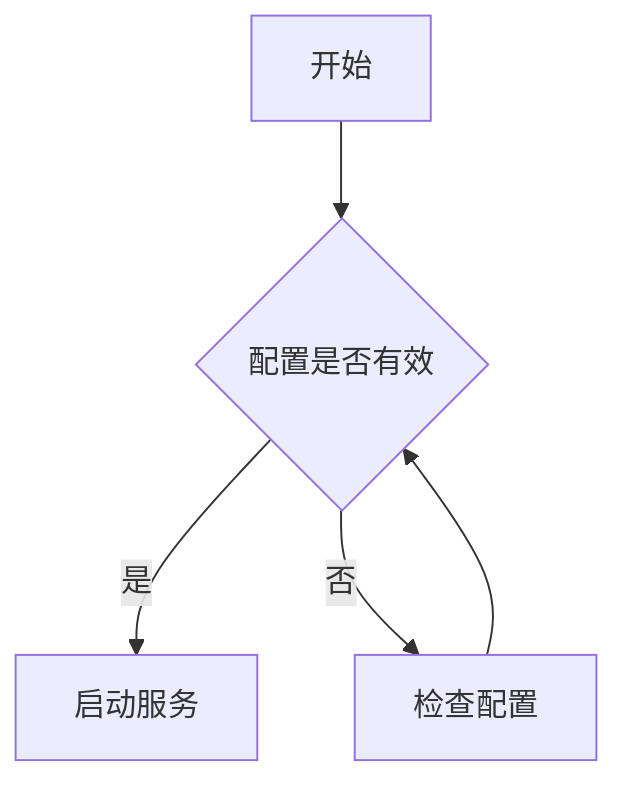

# Markdown Extension Examples

This page demonstrates some of the built-in markdown extensions provided by VitePress.

## Syntax Highlighting

VitePress provides Syntax Highlighting powered by [Shiki](https://github.com/shikijs/shiki), with additional features like line-highlighting:

**Input**

````md
```js{4}
export default {
  data () {
    return {
      msg: 'Highlighted!'
    }
  }
}
```
````

**Output**

```js{4}
export default {
  data () {
    return {
      msg: 'Highlighted!'
    }
  }
}
```

## Custom Containers

**Input**

```md
::: info
This is an info box.
:::

::: tip
This is a tip.
:::

::: warning
This is a warning.
:::

::: danger
This is a dangerous warning.
:::

::: details
This is a details block.
:::
```

**Output**

::: info
This is an info box.
:::

::: tip
This is a tip.
:::

::: warning
This is a warning.
:::

::: danger
This is a dangerous warning.
:::

::: details
This is a details block.
:::

## Mermaid 图表

使用 `mermaid` 代码块编写流程图、时序图等图表，页面会自动渲染并跟随浅色或深色主题。图表支持放大、缩小和重置，长图可在预览区域内滚动查看。

**输入**

````md

````

**效果**


## More

Check out the documentation for the [full list of markdown extensions](https://vitepress.dev/guide/markdown).
