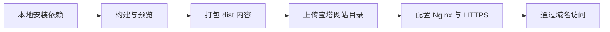

# VitePress 打包与 Linux 宝塔部署

本文部署当前 DevNook 文档站点，技术栈为 VitePress、Vue 和 Mermaid。采用**本地打包 → 上传构建产物 → 宝塔 Nginx 提供静态服务**的方式。

VitePress 会生成 HTML、JavaScript、CSS 和图片。服务器只需安装 Nginx，无需运行 Node.js、PM2 或 `pnpm docs:dev`；开发命令和预览命令用于本地验证。



## 1. 部署前的准备

| 项目 | 本文示例 |
| --- | --- |
| Linux 服务器 | 已安装宝塔 Linux 面板，且 Nginx 已运行 |
| 访问域名 | `docs.example.com`，请替换为自己的域名 |
| 网站根目录 | `/www/wwwroot/docs.example.com`，以宝塔实际设置为准 |
| 部署位置 | 域名根路径 `https://docs.example.com/` |
| 本地构建环境 | Node.js 24 LTS（24.12 或更新版本）、pnpm 10.20.0 |

在云服务器安全组和宝塔防火墙中，允许网站使用的 TCP `80`、`443` 端口。服务器位于中国大陆时，先完成域名备案等接入要求。

在域名服务商的 DNS 控制台添加解析记录：

| 类型 | 主机记录 | 记录值 |
| --- | --- | --- |
| A | `docs` | 服务器公网 IPv4 地址 |

域名解析生效后应指向当前服务器。如果还配置了 AAAA 记录，其 IPv6 地址也应能访问同一站点。

## 2. 在本地安装依赖

先进入项目根目录，也就是包含 `package.json` 和 `pnpm-lock.yaml` 的目录。

```bash
node --version
npm install --global pnpm@10.20.0
pnpm --version
pnpm install --frozen-lockfile
```

已经安装相应版本的 pnpm 时，可以跳过全局安装。`--frozen-lockfile` 使用仓库中的锁文件安装，避免构建时意外更新依赖。

如果遇到 `ERR_PNPM_UNEXPECTED_STORE`，说明现有 `node_modules` 使用的 pnpm store 与当前配置不一致。可按错误提示指定原来的 `--store-dir`，或在干净的项目副本中重新安装依赖；不要为此修改项目的依赖版本。

## 3. 构建并预览生产页面

### 3.1 先处理构建错误

VitePress 默认检查 Markdown 中的站内链接。当前仓库的 `docs/fastApi/index7.md` 有指向另一个 Python 项目源码的相对链接，例如 `../app/main.py`；这些文件不在本站点中，会触发 `dead link` 并阻止构建。

正式发布前，应将此类链接改为对应源码仓库中真实文件的完整 URL，并核对仓库分支；如果只是展示路径，也可改为行内代码 `app/main.py`。需要发布到站内的内容，则应补齐相应文档和正确链接。

保留死链检查，确保修复后常规构建能够通过。仅为了检查其他功能而临时跳过死链校验，不代表已经完成发布验证。

### 3.2 执行构建

```bash
pnpm docs:build
```

本项目对应的实际命令是 `vitepress build docs`。成功后，构建产物位于：

```text
docs/.vitepress/dist/
├── index.html
├── 404.html
├── hashmap.json
├── assets/
├── fastApi/
├── project/
└── ...
```

不要上传构建失败后留下的旧产物。先确认终端显示构建成功，再继续操作。

### 3.3 预览构建产物

```bash
pnpm docs:preview --host 127.0.0.1 --port 4173
```

在浏览器中打开 `http://127.0.0.1:4173/`，检查首页、侧边栏、图片、流程图和深色主题；再直接打开并刷新 `http://127.0.0.1:4173/fastApi/index7.html`，确认内页能够独立访问。

验证结束后，在运行预览命令的终端按 `Ctrl+C` 停止预览。

## 4. 将构建产物打包

在项目根目录执行：

```bash
tar -czf devnook-dist.tar.gz -C docs/.vitepress/dist .
```

这里打包的是 `dist` **目录里面的全部内容**。解压后应直接看到 `index.html` 和 `assets/`，而不是再嵌套一层 `dist/`。

部署包只需要构建产物。`node_modules`、项目源码和 `.git` 不需要上传到网站目录。

## 5. 在宝塔中创建静态站点

### 5.1 安装 Nginx

打开宝塔面板的「软件商店」，确认已安装并启动 Nginx。本文的配置以 Nginx 为准。

### 5.2 添加站点

进入「网站 → 添加站点」。部分宝塔版本将入口放在「PHP 项目」分类中，但仍可选择纯静态站点。

| 选项 | 设置 |
| --- | --- |
| 域名 | `docs.example.com` |
| 根目录 | `/www/wwwroot/docs.example.com` |
| FTP | 按需创建；通过宝塔文件管理上传时无需创建 |
| 数据库 | 不创建 |
| PHP 版本 | 纯静态 |

创建后，在「网站设置 → 网站目录」中确认运行目录就是网站根目录，默认文档包含 `index.html`。

### 5.3 上传并解压

1. 打开宝塔「文件」，进入网站根目录。
2. 上传 `devnook-dist.tar.gz`，在当前目录解压。
3. 确认根目录下的 `index.html` 已被构建产物替换，而不是宝塔默认欢迎页。
4. 确认 `assets/`、`fastApi/`、`project/` 等目录也已完整上传。
5. 解压确认后，将部署压缩包移出公开网站目录。

最终目录应类似：

```text
/www/wwwroot/docs.example.com/
├── index.html
├── 404.html
├── hashmap.json
├── assets/
├── fastApi/
│   └── index7.html
└── project/
    └── deploy-baota.html
```

## 6. 配置 Nginx 路由和缓存

当前项目没有开启 `cleanUrls`，构建后的内页使用 `.html` 地址，例如 `/fastApi/index7.html`。VitePress 已为这些页面生成独立 HTML，Nginx 应优先查找真实文件。

在宝塔「网站设置 → 配置文件」中，确认当前站点的 `server` 块已有下面的配置；如有不同，修改原值，不要重复添加 `root` 或 `index`：

```nginx
root /www/wwwroot/docs.example.com;
index index.html;
```

然后在同一个 `server` 块中加入下面的规则。如果已有 `location /`、`location ^~ /assets/` 或 `error_page 404`，应合并或替换相应规则，避免重复定义。

```nginx
# 页面入口及时向服务器确认更新。
location / {
    try_files $uri $uri/ $uri.html =404;
    add_header Cache-Control "no-cache";
}

# VitePress 生成的 assets 资源文件名包含内容哈希，可长期缓存。
location ^~ /assets/ {
    try_files $uri =404;
    add_header Cache-Control "public, max-age=31536000, immutable";
}

# 返回本站生成的 404 页面，同时保持 HTTP 404 状态。
error_page 404 /404.html;
```

宝塔「伪静态」配置可能已经包含 `location /`，保存前也要检查这一处。以上片段只调整路由和缓存，保留面板生成的域名、日志、证书及 `/.well-known/` 验证规则。

这里使用 `=404` 处理不存在的路径。不要套用把所有未知路径都返回 `/index.html` 的规则，否则文档不存在时可能仍然返回首页和 HTTP `200`，也会掩盖资源缺失。

保存后，可在宝塔终端中检查 Nginx 配置：

```bash
/www/server/nginx/sbin/nginx -t
```

确认出现 `syntax is ok` 和 `test is successful` 后，通过「软件商店 → Nginx → 服务」重载配置。若安装路径不同，使用实际的 Nginx 可执行文件路径。

## 7. 配置 HTTPS

先通过 `http://docs.example.com/` 确认域名已经到达当前站点，再进行证书申请。

1. 进入「网站设置 → SSL → Let's Encrypt」。
2. 选择站点域名，使用面板支持的文件验证或 DNS 验证申请证书。
3. 使用文件验证时，确保公网可以通过 HTTP 访问该域名的验证文件，且 `/.well-known/` 规则被保留；DNS 验证则按面板提示设置记录。
4. 申请并部署证书后，访问 `https://docs.example.com/` 验证证书和页面。
5. HTTPS 正常后，再开启「强制 HTTPS」，并确认面板的证书自动续签任务正常。

## 8. 发布后验证

以下域名均需替换为自己的实际域名：

```bash
curl -I https://docs.example.com/
curl -I https://docs.example.com/fastApi/index7.html
curl -I https://docs.example.com/a-page-that-does-not-exist
```

前两条应返回 HTTP `200`；最后一条应返回 HTTP `404`。同时在浏览器中检查：

- 首页、目录页和侧边栏可以跳转。
- 直接打开内页并刷新，仍能显示正确文档。
- 图片、代码高亮、Mermaid 流程图和时序图正常显示。
- 明暗主题与图表缩放可以使用。
- 开发者工具的 Network 中没有本站 JS、CSS、图片请求的 `404`。

Mermaid 会在浏览器中加载并生成图表，因此发布时必须完整上传 `assets/` 中的文件。服务器端无需安装 Mermaid，也无需运行单独的图表服务。

## 9. 后续更新与回滚

每次修改文档后，都需要重新构建并上传新的产物。完整流程为：

1. 本地执行 `pnpm docs:build`，通过后使用 `pnpm docs:preview` 检查。
2. 重新生成部署压缩包。
3. 在宝塔中备份当前网站内容，备份放在网站根目录以外，并记录对应版本。
4. 将新包先上传到临时目录并解压，确认内容完整。
5. 先将新 `assets/` 中的文件增量复制到网站的 `assets/`，保留已有资源。
6. 再覆盖新版本的 HTML、`hashmap.json` 及其他构建产物，随后验证线上页面。

保留上一版本带哈希的资源，可以减少已打开旧页面的用户在后续跳转时遇到资源 `404`。不要在发布前直接清空线上目录。新增资源和覆盖页面适合小型站点的手动更新；如需严格保证整站同一时刻切换版本，应进一步使用发布目录切换方案，并保留旧资源的访问能力。

如果新版本异常，先补回备份中的 `assets/` 文件，再恢复上一版本的页面及其他文件；如果 Nginx 配置也有改动，恢复原配置并检查、重载。确认新版本稳定并经过预定保留期后，再清理旧资源和已删除文档留下的旧 HTML。

如果使用 CDN，更新后刷新页面入口和 `hashmap.json` 的缓存，并检查 CDN 是否覆盖了这里设置的缓存策略。带哈希的新资源会使用新的 URL。

## 10. 部署到域名子目录

如果使用 `https://example.com/notes/`，需要在构建前修改 `docs/.vitepress/config.ts`：

```ts
export default {
  base: '/notes/',
  // 保留其他原有配置。
}
```

然后重新打包，将 `dist` 里面的内容放到网站根目录下的 `notes/`：

```text
/www/wwwroot/example.com/
└── notes/
    ├── index.html
    ├── 404.html
    ├── hashmap.json
    ├── assets/
    └── ...
```

在 `example.com` 对应的 `server` 块中，将本应用的规则放到 `/notes/` 前缀下：

```nginx
location = /notes {
    return 301 /notes/;
}

location /notes/ {
    try_files $uri $uri/ $uri.html =404;
    add_header Cache-Control "no-cache";
    error_page 404 /notes/404.html;
}

location ^~ /notes/assets/ {
    try_files $uri =404;
    add_header Cache-Control "public, max-age=31536000, immutable";
}
```

这里依赖站点已有的 `root /www/wwwroot/example.com`，无需额外设置 `alias`。主域名其他应用的配置保持独立。若已有正则 `location` 会匹配此子目录下的 HTML，应同步检查其路由和缓存行为。

`base` 必须与线上前缀一致，并保留首尾 `/`。只把文件移到 `notes/`、却仍用根路径配置构建，会导致资源请求走错地址。源码中自行编写的固定根路径资源引用也需要检查，例如原生 HTML 的 `src="/images/demo.png"`。

## 11. 常见问题排查

| 现象 | 重点检查 |
| --- | --- |
| 打包时报 `dead link` | 按报错定位 Markdown 链接；站外源码使用真实完整 URL，站内链接指向实际存在的文档 |
| 域名无法连接 | DNS 解析、服务器地址、安全组、防火墙、Nginx 服务以及 80/443 端口 |
| 显示宝塔默认欢迎页 | 域名是否绑定正确站点、网站根目录是否正确、默认 `index.html` 是否已被覆盖 |
| 目录里有文件但首页 403 | `index.html` 是否多嵌套在 `dist/` 中，运行目录是否正确，Nginx 用户是否具有读取和目录访问权限 |
| 首页正常，内页刷新 404 | 对应 `.html` 是否上传，`try_files` 是否生效，URL 大小写是否与文件一致 |
| 页面没有样式或 JS 加载失败 | `assets/` 是否完整，`base` 是否匹配，资源请求是否被错误返回成首页 HTML |
| 部署后仍显示旧内容 | 是否上传了本次成功构建的产物，页面缓存、CDN 缓存与浏览器缓存是否已更新 |
| 更新后跳转提示动态模块加载失败 | 旧页面引用的哈希资源是否被删除；保留旧资源，刷新页面以加载新版本 |
| 流程图一直加载或渲染失败 | Network 中 Mermaid 相关资源是否成功加载、控制台是否报错，以及图表语法是否有效 |
| Nginx 报 `duplicate location` | 网站配置文件和「伪静态」中是否重复定义了相同 `location` |
| 证书文件验证失败 | 域名是否指向当前服务器、80 端口是否可达、验证路径是否被其他规则拦截 |

排查权限时，让 Nginx 运行用户可以读取文件并访问目录即可，不要用统一设置 `777` 的方式处理。本文中构建工具运行在本地，网站运行在 Linux；线上文件名和路径严格区分大小写。
