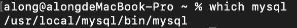
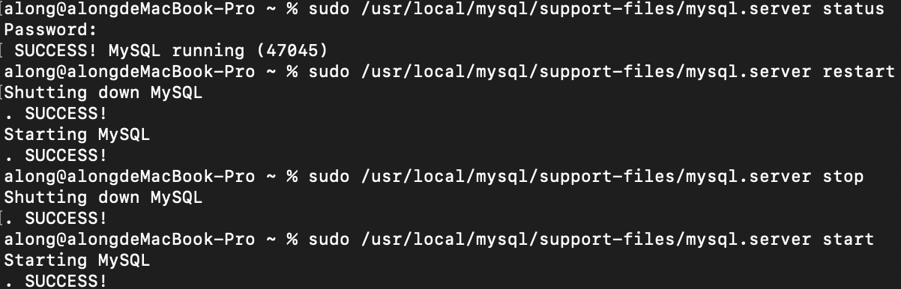
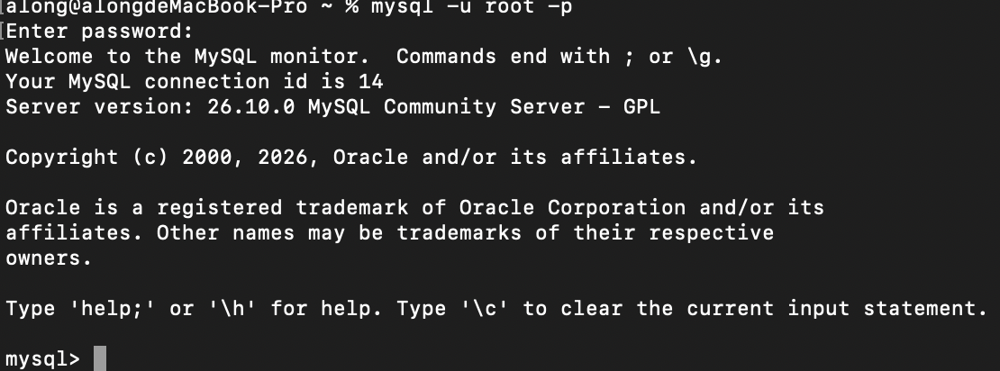

## 查看MySQL位置
```bash
which mysql
```


## 查看版本

```bash
mysql --version
```


## 启动关闭服务

- 使用`mysql.server`启用脚本来执行，默认在`/usr/local/mysql/support-files`这个目录中。
- 输入密码是mac电脑密码

```bash
# 启动服务
sudo /usr/local/mysql/support-files/mysql.server start

# 关闭服务
sudo /usr/local/mysql/support-files/mysql.server stop

# 重启服务
sudo /usr/local/mysql/support-files/mysql.server restart

# 查看服务状态
sudo /usr/local/mysql/support-files/mysql.server status
```



## 登录

```bash
mysql -u root -p
```

出现如图所示内容就代表登录成功了




### 指定主机和端口连接（适用于远程连接）

```bash
mysql -h 主机名或IP地址 -P 端口号 -u 用户名 -p
```

例如

```bash
mysql -h 127.0.0.1 -P 3306 -u root -p
```