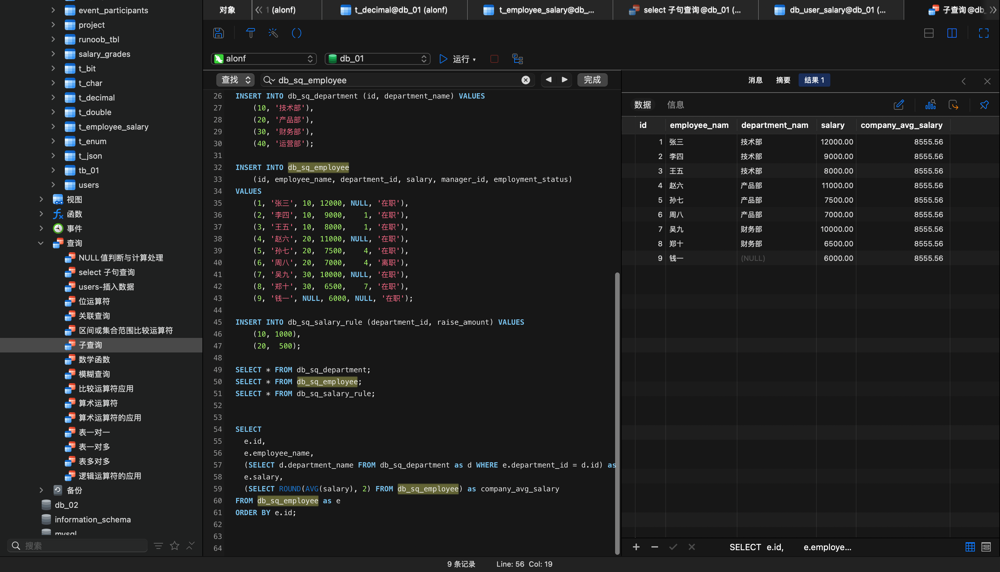
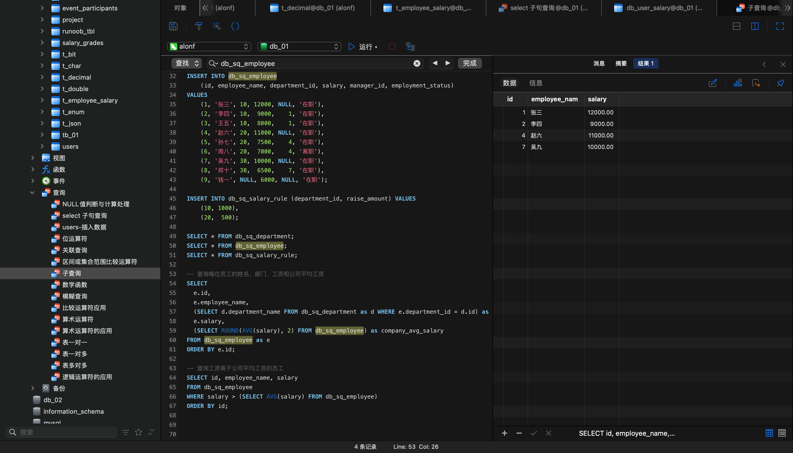
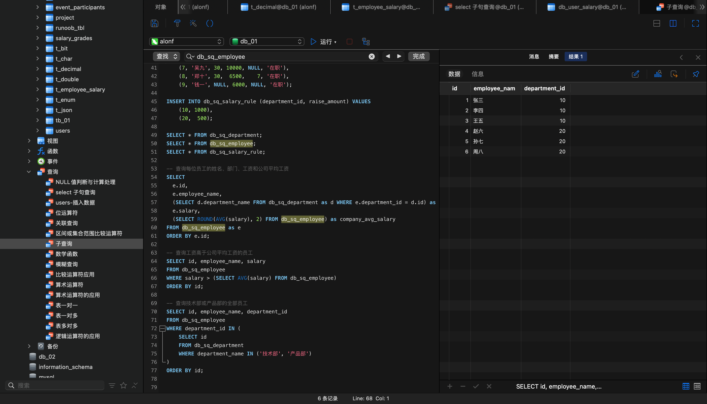
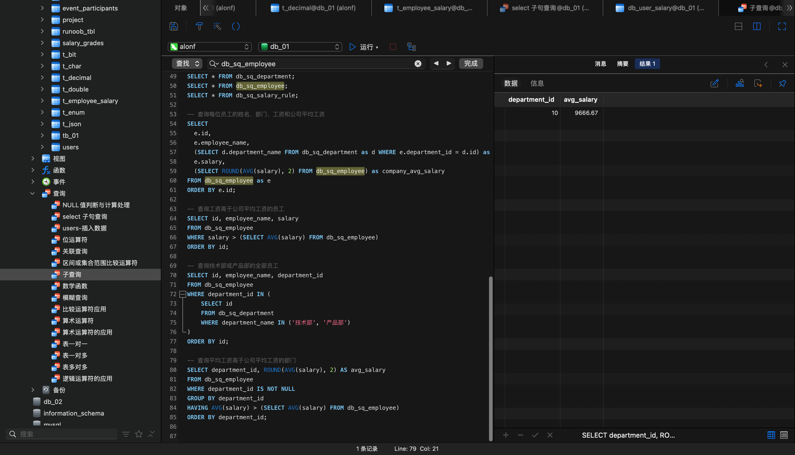
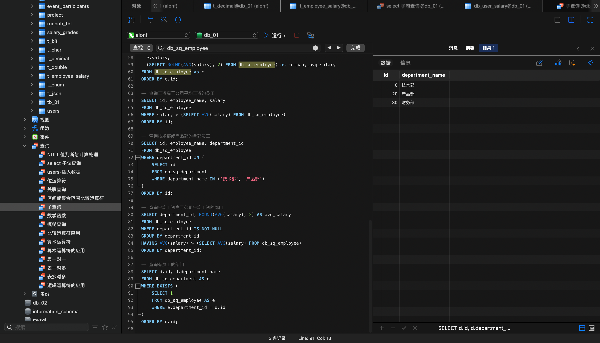
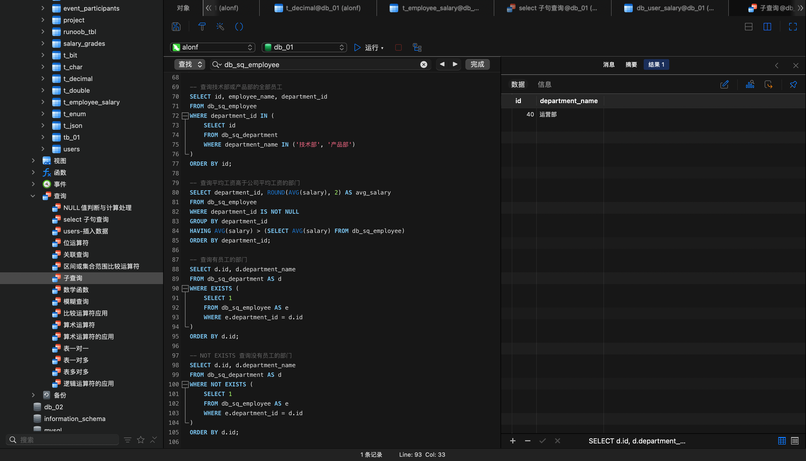

# 子查询

- 子查询：嵌套在另一个 SQL 语句中的查询。
- `SELECT` 语句可以嵌套在另一个 `SELECT`、`UPDATE`、`DELETE`、`INSERT`、`CREATE` 等语句中。

通过“部门、员工、调薪规则”这组数据演示各类子查询。所有工资统计都包含离职员工；如果只统计在职员工，需要在对应统计中添加 `employment_status = '在职'`。

## 准备：建表并插入数据

表名使用 `db_sq_` 前缀

| 表名 | 用途 | 关键字段 |
| --- | --- | --- |
| `db_sq_department` | 部门表 | `id` 主键，`department_name` 唯一 |
| `db_sq_employee` | 员工表 | 部门 ID、工资、直属领导 ID、在职状态 |
| `db_sq_salary_rule` | 部门调薪规则 | `department_id` 主键，每个部门至多一条规则 |

员工表的 `department_id` 关联部门表，`manager_id` 关联员工表自身；这两个字段均允许为 `NULL`。调薪规则表的 `department_id` 关联部门表。

```sql
CREATE DATABASE IF NOT EXISTS subquery_demo CHARACTER SET utf8mb4;
USE subquery_demo;

CREATE TABLE db_sq_department (
    id INT PRIMARY KEY,
    department_name VARCHAR(50) NOT NULL UNIQUE
) ENGINE = InnoDB DEFAULT CHARSET = utf8mb4;

CREATE TABLE db_sq_employee (
    id INT PRIMARY KEY,
    employee_name VARCHAR(50) NOT NULL,
    department_id INT,
    salary DECIMAL(10, 2) NOT NULL,
    manager_id INT,
    employment_status VARCHAR(10) NOT NULL,
    FOREIGN KEY (department_id) REFERENCES db_sq_department(id),
    FOREIGN KEY (manager_id) REFERENCES db_sq_employee(id)
) ENGINE = InnoDB DEFAULT CHARSET = utf8mb4;

CREATE TABLE db_sq_salary_rule (
    department_id INT PRIMARY KEY,
    raise_amount DECIMAL(10, 2) NOT NULL,
    FOREIGN KEY (department_id) REFERENCES db_sq_department(id)
) ENGINE = InnoDB DEFAULT CHARSET = utf8mb4;

INSERT INTO db_sq_department (id, department_name) VALUES
    (10, '技术部'),
    (20, '产品部'),
    (30, '财务部'),
    (40, '运营部');

INSERT INTO db_sq_employee
    (id, employee_name, department_id, salary, manager_id, employment_status)
VALUES
    (1, '张三', 10, 12000, NULL, '在职'),
    (2, '李四', 10,  9000,    1, '在职'),
    (3, '王五', 10,  8000,    1, '在职'),
    (4, '赵六', 20, 11000, NULL, '在职'),
    (5, '孙七', 20,  7500,    4, '在职'),
    (6, '周八', 20,  7000,    4, '离职'),
    (7, '吴九', 30, 10000, NULL, '在职'),
    (8, '郑十', 30,  6500,    7, '在职'),
    (9, '钱一', NULL, 6000, NULL, '在职');

INSERT INTO db_sq_salary_rule (department_id, raise_amount) VALUES
    (10, 1000),
    (20,  500);
```


数据中专门保留了几种情况：运营部没有员工；钱一没有分配部门；周八已经离职；财务部没有调薪规则。它们分别用于观察空结果、`NULL`、删除条件和更新范围。

部门表数据如下：
| id | department_name |
| --- | --- |
| 20 | 产品部 |
| 10 | 技术部 |
| 30 | 财务部 |
| 40 | 运营部 |

原始员工数据如下，后续结果都基于这份数据：

| id | employee_name | department_id | salary | manager_id | employment_status |
| --- | --- | --- | --- | --- | --- |
| 1 | 张三 | 10 | 12000.00 | NULL | 在职 |
| 2 | 李四 | 10 | 9000.00 | 1 | 在职 |
| 3 | 王五 | 10 | 8000.00 | 1 | 在职 |
| 4 | 赵六 | 20 | 11000.00 | NULL | 在职 |
| 5 | 孙七 | 20 | 7500.00 | 4 | 在职 |
| 6 | 周八 | 20 | 7000.00 | 4 | 离职 |
| 7 | 吴九 | 30 | 10000.00 | NULL | 在职 |
| 8 | 郑十 | 30 | 6500.00 | 7 | 在职 |
| 9 | 钱一 | NULL | 6000.00 | NULL | 在职 |

部门调薪规则表如下：

| department_id | raise_amount |
| --- | --- |
| 10 | 1000.00 |
| 20 | 500.00 |

核对用的统计值：

| 范围 | 人数 | 工资总额 | 平均工资（四舍五入） |
| --- | --- | --- | --- |
| 全公司 | 9 | 77000 | 8555.56 |
| 技术部 | 3 | 29000 | 9666.67 |
| 产品部 | 3 | 25500 | 8500.00 |
| 财务部 | 2 | 16500 | 8250.00 |
| 运营部 | 0 | 无工资记录 | NULL |

公司平均工资直接对全部员工计算，包含钱一；不能用各部门平均工资的简单平均来代替。

## select中嵌套子查询

**案例 1：查询每位员工的姓名、部门、工资和公司平均工资。**

```sql
SELECT
    e.id,
    e.employee_name,
    (SELECT d.department_name
     FROM db_sq_department AS d
     WHERE d.id = e.department_id) AS department_name,
    e.salary,
    (SELECT ROUND(AVG(salary), 2)
     FROM db_sq_employee) AS company_avg_salary
FROM db_sq_employee AS e
ORDER BY e.id;
```


- 部门子查询通过 `e.department_id` 引用当前员工，属于**关联子查询**。部门 ID 是主键，因此最多匹配一行。
- 平均工资子查询不引用外层员工，属于**非关联子查询**，各行显示相同的公司平均工资。



## where或having中嵌套子查询

### 案例 2：WHERE + 标量子查询

查询工资高于公司平均工资的员工。

```sql
SELECT id, employee_name, salary
FROM db_sq_employee
WHERE salary > (SELECT AVG(salary) FROM db_sq_employee)
ORDER BY id;
```



### 案例 3：WHERE + IN 多行子查询

查询技术部或产品部的全部员工。

```sql
SELECT id, employee_name, department_id
FROM db_sq_employee
WHERE department_id IN (
    SELECT id
    FROM db_sq_department
    WHERE department_name IN ('技术部', '产品部')
)
ORDER BY id;
```


内层返回部门 ID 集合 `10、20`，外层用 `IN` 判断是否属于这个集合。结果为张三、李四、王五、赵六、孙七、周八，共 6 人。

多行子查询常搭配 `IN`、`ANY`、`ALL`：`> ANY (...)` 表示大于至少一个结果值；`> ALL (...)` 表示大于所有结果值。例如，将条件改为 `salary > ALL (SELECT salary FROM db_sq_employee WHERE department_id = 30)`，本例会筛出张三和赵六。上述直观比较以子查询结果非空且不含 `NULL` 为前提。

### 案例 4：WHERE + 关联子查询

查询工资高于本部门平均工资的员工。

```sql
SELECT e.id, e.employee_name, e.salary
FROM db_sq_employee AS e
WHERE e.salary > (
    SELECT AVG(e2.salary)
    FROM db_sq_employee AS e2
    WHERE e2.department_id = e.department_id
)
ORDER BY e.id;
```


结果为张三、赵六、吴九。外层 `e` 表示当前员工，内层 `e2` 表示参与部门平均工资计算的员工，`e2.department_id = e.department_id` 把两者关联起来。

钱一的部门 ID 为 `NULL`，普通等号无法将 `NULL` 匹配为一个部门；其子查询平均值为 `NULL`，`salary > NULL` 不是 TRUE，因此不会入选。



### 案例 5：HAVING + 子查询

查询平均工资高于公司平均工资的部门。

```sql
SELECT department_id, ROUND(AVG(salary), 2) AS avg_salary
FROM db_sq_employee
WHERE department_id IS NOT NULL
GROUP BY department_id
HAVING AVG(salary) > (SELECT AVG(salary) FROM db_sq_employee)
ORDER BY department_id;
```

`WHERE` 先排除没有部门的员工，`GROUP BY` 再按部门分组，`HAVING` 最后筛选分组结果。公司平均值仍包含全部 9 名员工。



## exists型子查询

`EXISTS` 判断子查询是否返回至少一行。子查询中的 `SELECT 1` 只是常见写法，是否成立取决于有没有符合条件的行。

### 案例 6：EXISTS 查询有员工的部门

```sql
SELECT d.id, d.department_name
FROM db_sq_department AS d
WHERE EXISTS (
    SELECT 1
    FROM db_sq_employee AS e
    WHERE e.department_id = d.id
)
ORDER BY d.id;
```




### 案例 7：NOT EXISTS 查询没有员工的部门

```sql
SELECT d.id, d.department_name
FROM db_sq_department AS d
WHERE NOT EXISTS (
    SELECT 1
    FROM db_sq_employee AS e
    WHERE e.department_id = d.id
)
ORDER BY d.id;
```




注意：如果改写成下面这样，本例会得不到任何部门，因为员工表的 `department_id` 包含 `NULL`。

```sql
-- 反例：子查询结果包含 NULL 时，NOT IN 容易产生非预期结果。
SELECT id, department_name
FROM db_sq_department
WHERE id NOT IN (SELECT department_id FROM db_sq_employee);
```

对于不匹配的部门，包含 `NULL` 的 `NOT IN` 判断会得到 UNKNOWN，无法通过 `WHERE`；其他部门的判断为 FALSE。可以使用上面的 `NOT EXISTS`，也可以在 `NOT IN` 的子查询中增加 `WHERE department_id IS NOT NULL`。

## from中嵌套子查询

**案例 8：统计每个部门的员工人数和平均工资，保留没有员工的部门。**

```sql
SELECT
    d.id,
    d.department_name,
    COALESCE(s.employee_count, 0) AS employee_count,
    s.avg_salary
FROM db_sq_department AS d
LEFT JOIN (
    SELECT department_id, COUNT(*) AS employee_count,
           ROUND(AVG(salary), 2) AS avg_salary
    FROM db_sq_employee
    WHERE department_id IS NOT NULL
    GROUP BY department_id
) AS s ON s.department_id = d.id
ORDER BY d.id;
```


| id | department_name | employee_count | avg_salary |
| --- | --- | --- | --- |
| 10 | 技术部 | 3 | 9666.67 |
| 20 | 产品部 | 3 | 8500.00 |
| 30 | 财务部 | 2 | 8250.00 |
| 40 | 运营部 | 0 | NULL |

`FROM` / `JOIN` 中的子查询称为**派生表**，MySQL 要求为它指定别名，这里是 `s`。内层先按部门统计，外层将统计结果与部门表关联。

`LEFT JOIN` 保留运营部，`COALESCE(s.employee_count, 0)` 将缺失人数显示为 0。运营部没有工资记录，因此平均工资保留为 `NULL`。钱一没有分配部门，不计入上述部门人数。

## update中嵌套子查询

**案例 9：按部门规则给在职员工加薪，技术部加 1000 元，产品部加 500 元。**

本案例使用事务：执行更新、查看结果，再用 `ROLLBACK` 恢复原始工资。表使用 InnoDB 引擎，支持事务回滚。请在同一个数据库连接中依次执行整段 SQL；若需要保存这次调薪，可将最后的 `ROLLBACK` 改为 `COMMIT`。

```sql
START TRANSACTION;

UPDATE db_sq_employee AS e
SET salary = salary + (
    SELECT r.raise_amount
    FROM db_sq_salary_rule AS r
    WHERE r.department_id = e.department_id
)
WHERE e.employment_status = '在职'
  AND EXISTS (
      SELECT 1
      FROM db_sq_salary_rule AS r
      WHERE r.department_id = e.department_id
  );

SELECT id, employee_name, salary
FROM db_sq_employee
ORDER BY id;

ROLLBACK;
```


发生变化的员工如下：

| 姓名 | 原工资 | 更新后工资 |
| --- | --- | --- |
| 张三 | 12000 | 13000 |
| 李四 | 9000 | 10000 |
| 王五 | 8000 | 9000 |
| 赵六 | 11000 | 11500 |
| 孙七 | 7500 | 8000 |

`SET` 中的子查询取出当前员工对应的加薪金额；`EXISTS` 限定必须有调薪规则。调薪规则表以部门 ID 为主键，保证标量子查询最多返回一行。

周八已经离职，不符合更新条件；财务部员工和钱一没有匹配的调薪规则，也不符合更新条件。如果没有 `EXISTS` 保护，未匹配规则的子查询会得到 `NULL`，工资表达式也会变成 `NULL`，从而违反本例工资列的 `NOT NULL` 约束。

MySQL 对更新目标表同时又在子查询中读取该表存在限制，某些写法会触发错误 1093。本例的子查询读取独立的调薪规则表，可以避开这个问题；外层员工字段用于关联条件。

## delete中嵌套子查询

**案例 10：删除产品部已经离职的员工。**

同样使用事务，在同一个连接中删除并查看剩余数据，再回滚恢复，方便继续练习。

```sql
START TRANSACTION;

DELETE FROM db_sq_employee
WHERE employment_status = '离职'
  AND department_id IN (
      SELECT id
      FROM db_sq_department
      WHERE department_name = '产品部'
  );

SELECT id, employee_name, employment_status
FROM db_sq_employee
ORDER BY id;

ROLLBACK;
```


子查询先查出产品部 ID，外层根据部门和离职状态删除员工。本例只删除周八（ID 6），查询时剩余 8 人；`ROLLBACK` 后恢复为 9 人。

本例被删除的员工没有下属，因此不会触发员工表的领导外键限制。实际业务中的删除仍需符合表的外键约束。

## 使用子查询复制表结构和数据

下面使用三个不同的目标表名，每段可以依次执行。前面的更新、删除都已经回滚，因此复制时原表仍有 9 行。

### 案例 11：复制查询列及全部数据

```sql
CREATE TABLE db_sq_employee_copy AS
SELECT * FROM db_sq_employee;

SELECT COUNT(*) AS copied_rows FROM db_sq_employee_copy;
```


结果：`copied_rows = 9`。也可以在 `SELECT` 后增加 `WHERE`，只复制满足条件的数据，例如只复制在职员工。

`CREATE TABLE ... AS SELECT`（常写作 CTAS）根据查询结果创建列并插入数据，但**不会完整复制原表的主键、外键、索引等定义**。它只生成执行时的一份数据副本，原表之后改变时，副本不会自动同步。

### 案例 12：只复制查询列，不复制数据

```sql
CREATE TABLE db_sq_employee_empty AS
SELECT * FROM db_sq_employee WHERE 1 = 0;

SELECT COUNT(*) AS copied_rows FROM db_sq_employee_empty;
```


结果：`copied_rows = 0`。`WHERE 1 = 0` 永远为假，因此没有数据写入新表；新表仍有查询产生的列。这也不是完整复制原表定义。

### 案例 13：先复制表定义，再插入查询结果

```sql
CREATE TABLE db_sq_employee_like LIKE db_sq_employee;

INSERT INTO db_sq_employee_like
    (id, employee_name, department_id, salary, manager_id, employment_status)
SELECT id, employee_name, department_id, salary, manager_id, employment_status
FROM db_sq_employee;

SELECT COUNT(*) AS copied_rows FROM db_sq_employee_like;
```


结果：`copied_rows = 9`。`INSERT INTO ... SELECT ...` 将查询结果直接写入已存在的表，源列和目标列应在数量、顺序和类型上对应。

MySQL 的 `CREATE TABLE ... LIKE` 会保留列定义、主键和索引等信息，**但不会复制外键**。如果需要完全相同的约束，应核对 `SHOW CREATE TABLE` 的结果并补充外键。

MySQL 中 `CREATE TABLE` 等 DDL 会隐式提交，不能依赖 `ROLLBACK` 撤销这里的建表操作；因此这些案例放在前面的更新、删除事务结束后执行。

## 通用表达式

这里通常称为**公用表表达式**（Common Table Expression，**CTE**），用 `WITH` 声明。它为当前 SQL 语句中的查询结果命名，不会创建一张永久表；作用域仅限紧随其后的这一条语句。

### 案例 14：使用普通 CTE 组织部门平均工资查询

```sql
WITH department_avg AS (
    SELECT department_id, AVG(salary) AS avg_salary
    FROM db_sq_employee
    WHERE department_id IS NOT NULL
    GROUP BY department_id
)
SELECT e.id, e.employee_name, e.salary, ROUND(a.avg_salary, 2) AS department_avg_salary
FROM db_sq_employee AS e
INNER JOIN department_avg AS a ON a.department_id = e.department_id
WHERE e.salary > a.avg_salary
ORDER BY e.id;
```


| id | employee_name | salary | department_avg_salary |
| --- | --- | --- | --- |
| 1 | 张三 | 12000.00 | 9666.67 |
| 4 | 赵六 | 11000.00 | 8500.00 |
| 7 | 吴九 | 10000.00 | 8250.00 |

这与案例 4 的需求相同，也可以用案例 8 那样的派生表组织。CTE 将部门统计命名为 `department_avg`，便于阅读；同一条语句中也可以多次引用这个名称。

### 案例 15：使用递归 CTE 查询员工层级

查询张三及其所有层级的下属，而不只是固定层级的一次自关联。

```sql
WITH RECURSIVE employee_tree AS (
    SELECT id, employee_name, manager_id, 1 AS level_no
    FROM db_sq_employee
    WHERE id = 1

    UNION ALL

    SELECT e.id, e.employee_name, e.manager_id, t.level_no + 1
    FROM db_sq_employee AS e
    INNER JOIN employee_tree AS t ON e.manager_id = t.id
)
SELECT id, employee_name, manager_id, level_no
FROM employee_tree
ORDER BY level_no, id;
```


| id | employee_name | manager_id | level_no |
| --- | --- | --- | --- |
| 1 | 张三 | NULL | 1 |
| 2 | 李四 | 1 | 2 |
| 3 | 王五 | 1 | 2 |

递归分为两部分：前半段找起点张三，后半段根据上一轮结果继续找下属，`UNION ALL` 合并各轮结果；没有新下属时停止。本例的领导关系没有环，实际层级数据也需要避免循环引用，否则可能触发递归深度限制。

