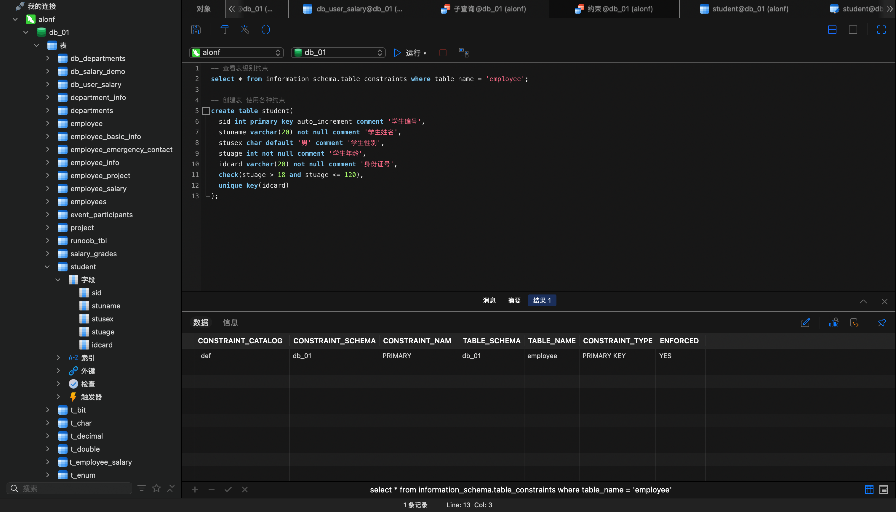

## 约束的作用

约束是为了保证数据的完整性，数据完整性（Data Integrity）是指数据的精确性（Accuracy）和可靠性（Reliability）。它是应防止数据库中存在不符合语义规定的数据和防止因错误信息的输入输出造成无效操作或错误信息而提出的。

数据的完整性要从以下四个方面考虑：
- 实体完整性（Entity Integrity）：例如，同一个表中，不能存在两条完全相同无法区分的记录
- 域完整性（Domain Integrity）：例如，年龄范围0-120，性别范围“男/女”
- 引用完整性（Referential Integrity）：例如，员工所在部门，在部门表中要能找到这个部门
- 用户自定义完整性（User-defined Integrity）：例如，用户名唯一、密码不能为空等，本部门经理的工资不得高于本部门职工的平均工资的5倍

可以在创建表时规定约束（通过create table语句），或者在表创建之后也可以添加约束（通过alter table语句）。

## 约束的类型

- 键约束：主键约束、外键约束、唯一键约束
- Not NULL约束：非空约束
- Check约束：检查约束
- Default约束：默认值约束
- 自增是键约束字段的一个额外的属性

## 查看表级别约束

```SQL
SELECT *
FROM information_schema.TABLE_CONSTRAINTS
WHERE TABLE_SCHEMA = 'db_01'
  AND TABLE_NAME = 'employee';
```


| 列名 | 含义 | 截图中的值及解释 |
|---|---|---|
| `CONSTRAINT_CATALOG` | 约束所属的目录 | `def`：MySQL 中固定为这个值，一般不用关注 |
| `CONSTRAINT_SCHEMA` | 约束所属的数据库 | `db_01`：该约束定义在 db_01 数据库中 |
| `CONSTRAINT_NAME` | 约束名称 | `PRIMARY`：MySQL 的主键约束统一使用这个名称，**不是字段名** |
| `TABLE_SCHEMA` | 被约束的表所属的数据库 | `db_01`：employee 表位于 db_01 中 |
| `TABLE_NAME` | 被约束的表名 | `employee` |
| `CONSTRAINT_TYPE` | 约束类型 | `PRIMARY KEY`：主键约束 |
| `ENFORCED` | 是否实际执行约束检查 | `YES`：数据库会检查并拒绝违反规则的数据 |

`CONSTRAINT_TYPE` 常见取值有：

| 值 | 含义 |
|---|---|
| `PRIMARY KEY` | 主键约束 |
| `UNIQUE` | 唯一约束 |
| `FOREIGN KEY` | 外键约束 |
| `CHECK` | 检查约束 |


## 创建表使用各种约束

```SQL
-- 1. 班级表：供学生表的外键引用
CREATE TABLE demo_class (
    class_id INT PRIMARY KEY,
    class_name VARCHAR(30) NOT NULL,

    CONSTRAINT uk_demo_class_name UNIQUE (class_name)
) ENGINE = InnoDB DEFAULT CHARSET = utf8mb4;


-- 2. 学生表：综合使用各种约束
CREATE TABLE demo_student (
    student_id INT AUTO_INCREMENT,
    student_no VARCHAR(20) NOT NULL,
    student_name VARCHAR(30) NOT NULL,
    gender CHAR(1) NOT NULL DEFAULT '男',
    age TINYINT UNSIGNED NOT NULL,
    email VARCHAR(100) NULL,
    class_id INT NOT NULL,
    seat_no INT NOT NULL,
    tuition DECIMAL(10, 2) NOT NULL DEFAULT 0.00,

    -- 主键：唯一标识一名学生
    PRIMARY KEY (student_id),

    -- 唯一：学号、非 NULL 邮箱不能重复
    CONSTRAINT uk_demo_student_no UNIQUE (student_no),
    CONSTRAINT uk_demo_student_email UNIQUE (email),

    -- 联合唯一：同一班级不能出现重复座位号
    CONSTRAINT uk_demo_student_class_seat
        UNIQUE (class_id, seat_no),

    -- 检查：限制字段取值
    CONSTRAINT chk_demo_student_name
        CHECK (CHAR_LENGTH(TRIM(student_name)) > 0),
    CONSTRAINT chk_demo_student_gender
        CHECK (gender IN ('男', '女')),
    CONSTRAINT chk_demo_student_age
        CHECK (age BETWEEN 18 AND 60),
    CONSTRAINT chk_demo_student_seat
        CHECK (seat_no BETWEEN 1 AND 60),
    CONSTRAINT chk_demo_student_tuition
        CHECK (tuition >= 0),

    -- 外键：学生所属班级必须存在
    CONSTRAINT fk_demo_student_class
        FOREIGN KEY (class_id)
        REFERENCES demo_class(class_id)
        ON DELETE RESTRICT
        ON UPDATE CASCADE
) ENGINE = InnoDB DEFAULT CHARSET = utf8mb4;
```

各项约束的作用如下：

| 定义 | 作用 | 本例中的效果 |
|---|---|---|
| `PRIMARY KEY` | 唯一标识一行，同时保证非空和不重复 | 学生 ID 不能重复 |
| `AUTO_INCREMENT` | 自动生成编号，是列属性 | 插入时省略 `student_id`，自动生成 ID |
| `NOT NULL` | 禁止字段为 NULL | 姓名、年龄、班级等必须提供值，或使用已定义的默认值 |
| `UNIQUE` | 保证指定值不重复 | 学号不能重复；非 NULL 邮箱不能重复 |
| `UNIQUE (class_id, seat_no)` | 保证多列组成的整体不重复 | 101 班和 102 班都可以有 1 号座位，但同一班不能有两个 1 号 |
| `DEFAULT` | 未提供字段值时使用默认值 | 性别默认为“男”，学费默认为 0 |
| `CHECK` | 检查字段是否满足条件 | 姓名不能全是空白；年龄为 18～60；座位为 1～60；学费不能为负数 |
| `FOREIGN KEY` | 保证引用的记录存在 | 学生的班级必须能在班级表中找到 |
| `ON DELETE RESTRICT` | 父记录被引用时禁止删除 | 班级还有学生，就不能删除该班级 |
| `ON UPDATE CASCADE` | 父表被引用的键值改变时同步更新子表 | 班级编号从 101 改为 201，学生的班级编号也随之修改 |


## 复合唯一约束

复合唯一约束，也叫联合唯一约束，要求多个字段组成的“组合值”不能重复。每个字段单独出现重复值是允许的。

例如：同一个班级的座位号不能重复，不同班级可以使用相同的座位号。

```SQL
UNIQUE (class_id, seat_no)
```

数据库检查的是 (班级编号, 座位号) 这个整体。

| class_id | seat_no | 能否同时存在 | 原因 |
|---|---|---|---|
| 101 | 1 | 可以 | 第一个组合 |
| 101 | 2 | 可以 | 班级相同，座位不同 |
| 102 | 1 | 可以 | 座位相同，班级不同 |
| 101 | 1 | 不可以 | 与第一行的整个组合重复 |


下面用一张简化的学生座位表演示：

```SQL
CREATE TABLE student_seat (
    id INT AUTO_INCREMENT PRIMARY KEY,
    student_name VARCHAR(30) NOT NULL,
    class_id INT NOT NULL,
    seat_no INT NOT NULL,

    CONSTRAINT uk_class_seat UNIQUE (class_id, seat_no)
) ENGINE = InnoDB DEFAULT CHARSET = utf8mb4;
```

其中：
- CONSTRAINT uk_class_seat：给约束起名，方便查看和删除。
- UNIQUE (class_id, seat_no)：要求班级和座位号的组合唯一。


案例一：插入不同组合，成功

```SQL
INSERT INTO student_seat (student_name, class_id, seat_no)
VALUES
    ('张三', 101, 1),
    ('李四', 101, 2),
    ('王五', 102, 1);
```
结果：

| id | student_name | class_id | seat_no |
|---|---|---|---|
| 1 | 张三 | 101 | 1 |
| 2 | 李四 | 101 | 2 |
| 3 | 王五 | 102 | 1 |

张三和李四可以在同一个班；张三和王五可以使用相同座位号，因为班级不同。

案例二：插入重复组合，失败

```SQL
-- 预期报错：101 班的 1 号座位已经属于张三。
INSERT INTO student_seat (student_name, class_id, seat_no)
VALUES ('赵六', 101, 1);
```

MySQL 会报 1062：Duplicate entry，并指出违反了 uk_class_seat 唯一约束。这条记录不会插入。


## 外键约束

外键约束（FOREIGN KEY）用于保证表与表之间的引用关系正确。

例如：学生属于某个班级，那么学生填写的班级编号，必须能在班级表中找到。不能把学生分配给一个不存在的班级。

1. 先理解父表和子表

| 概念 | 本例中的表 | 作用 |
|---|---|---|
| 父表，也叫被引用表 | 班级表 | 提供可以引用的班级编号 |
| 子表，也叫引用表 | 学生表 | 通过班级编号引用班级表 |
| 外键列 | 学生表的 `class_id` | 保存学生所属班级的编号 |
| 被引用列 | 班级表的 `class_id` | 本例使用班级主键 |

一个班级可以被多名学生引用，因此，外键列允许重复。只有再添加 UNIQUE，才会限制该列不能重复。

2. 建表案例

下面适用于 MySQL，使用支持外键的 InnoDB 引擎：

```SQL
-- 父表：班级
CREATE TABLE fk_class_demo (
    class_id INT PRIMARY KEY,
    class_name VARCHAR(30) NOT NULL
) ENGINE = InnoDB DEFAULT CHARSET = utf8mb4;


-- 子表：学生
CREATE TABLE fk_student_demo (
    student_id INT PRIMARY KEY,
    student_name VARCHAR(30) NOT NULL,
    class_id INT NULL,

    CONSTRAINT fk_student_class_demo
        FOREIGN KEY (class_id)
        REFERENCES fk_class_demo(class_id)
        ON DELETE RESTRICT
        ON UPDATE CASCADE
) ENGINE = InnoDB DEFAULT CHARSET = utf8mb4;
```

外键定义逐项解释：

| 写法 | 含义 |
|---|---|
| `CONSTRAINT fk_student_class_demo` | 给外键约束起名，便于查看和删除 |
| `FOREIGN KEY (class_id)` | 指定学生表中的外键列 |
| `REFERENCES fk_class_demo(class_id)` | 引用班级表的班级编号 |
| `ON DELETE RESTRICT` | 班级被学生引用时，禁止删除该班级 |
| `ON UPDATE CASCADE` | 班级编号修改时，同步修改学生的班级编号 |

这里的 ON UPDATE 指的是被引用的班级编号变化。修改班级名称，不会触发班级编号的级联更新。

3. 案例一：先有班级，再添加学生

```SQL
INSERT INTO fk_class_demo (class_id, class_name)
VALUES
    (10, 'SQL一班'),
    (20, 'SQL二班');

INSERT INTO fk_student_demo
    (student_id, student_name, class_id)
VALUES
    (1, '张三', 10),
    (2, '李四', 10),
    (3, '王五', 20),
    (4, '赵六', NULL);
```

这些数据都能插入：

| 学生 | class_id | 原因 |
|---|---|---|
| 张三 | 10 | 班级 10 存在 |
| 李四 | 10 | 同一个班级可以有多名学生 |
| 王五 | 20 | 班级 20 存在 |
| 赵六 | NULL | 外键列允许 NULL，表示暂未分配班级 |

外键不会自动要求字段必填。 如果学生必须属于某个班级，需要将该列定义为：

```SQL
class_id INT NOT NULL
```

4. 案例二：引用不存在的班级，失败

```SQL
-- 预期报错：班级 99 不存在。
INSERT INTO fk_student_demo
    (student_id, student_name, class_id)
VALUES
    (5, '钱七', 99);
```

MySQL 会报 1452，表示子表数据找不到对应的父表记录。

更新时也会检查：

```SQL
-- 同样失败，张三不能转入不存在的班级。
UPDATE fk_student_demo
SET class_id = 99
WHERE student_id = 1;
```

可以先创建班级 99，再将学生分配过去。

5. 案例三：删除仍有学生的班级，失败

```SQL
-- 预期报错：班级 10 仍被张三、李四引用。
DELETE FROM fk_class_demo
WHERE class_id = 10;
```

MySQL 会报 1451，因为本例设置了：

```SQL
ON DELETE RESTRICT
```

如果确实需要删除该班级，可以先将学生转到其他班级，或在业务允许时取消其班级关联，再删除班级。