## 什么是SQL

结构化查询语言(Structure Query Language)，专门用来操作/访问数据库的通用语言。

## SQL的分类

SQL语句的三种类型

- DDL：数据定义语句（Data Define Language）如创建（create），修改（alter），删除（drop）等。
- DML：数据操作语句，如增（insert)，删（delete），改（update），查（select）。因为查询语句使用的非常频繁，因此很多人把查询语句单独划分为DQL（数据查询语句）。
- DCL：数据控制语句，如grant，commit，rollback等。
- 其他语句：use语句，show语句，set语句等。这类的官方文档中一般称为命令。

| 缩写 | SQL 语句 | 作用说明 |
| --- | --- | --- |
| DQL | SELECT | 用于从数据库表中查询数据，可以返回特定列、所有列或通过计算得到的结果，也可以结合 WHERE、ORDER BY、GROUP BY 等子句对查询结果进行过滤、排序和分组。 |
| DDL | CREATE | 用于创建新的数据库、表、索引、视图等对象。 |
| DDL | ALTER | 用于修改已存在的数据库对象的结构，例如修改表结构，增加、删除或修改列。 |
| DDL | DROP | 用于删除数据库、表、索引、视图等对象。 |
| DDL | TRUNCATE | 用于清空表中的所有行，但保留表结构；具体日志记录和事务回滚行为因数据库而异。 |
| DML | INSERT | 用于向表中插入新的行。 |
| DML | UPDATE | 用于更新表中已存在的行。 |
| DML | DELETE | 用于从表中删除行。 |
| DCL | GRANT | 用于授予用户或角色对数据库对象的访问权限。 |
| DCL | REVOKE | 用于撤销用户或角色之前被授予的权限。 |
| TCL | COMMIT | 用于提交当前事务，使事务中的更改持久化。 |
| TCL | ROLLBACK | 用于回滚当前事务，撤销尚未提交的更改。 |
| TCL | SAVEPOINT | 用于在事务中设置保存点，以便在需要时回滚到该保存点。 |


## SQL语法规范

- mysql的sql语法不区分大小写
  - 数据库的表中的数据是否区分大小写。这个的话要看表格的字段的数据类型、编码方式以及校对规则
  - ci（大小写不敏感），cs（大小写敏感），_bin（二元，即比较是基于字符编码的值而与language无关，区分大小写）
  - sql中的关键字，比如：create,insert等，不区分大小写。但是大家习惯上把关键字都“大写”。
- 命名时：尽量使用26个英文字母大小写，数字0-9，下划线，不要使用其他符号，不要使用纯数字来命名
- 建议不要使用MySQL的关键字等来作为表名、字段名、数据库名等，如果不小心使用，请在SQL语句中使用`（飘号）引起来。
- 同一个MySQL软件中，数据库不能同名，同一个库中，表不能重名，同一个表中，字段不能重名。

## SQL脚本中的注释

- 单行注释
```bash

## 我是注释
-- 我是注释
```

- 多行注释

```bash
/*
我是多行注释
*/
```

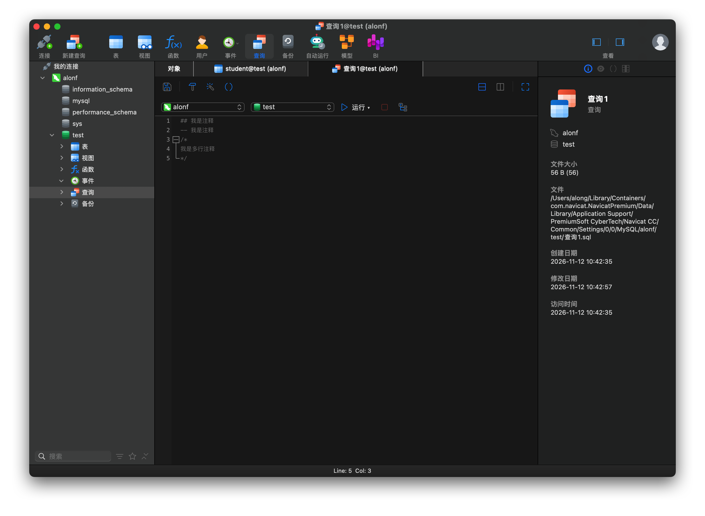


## 数据库的相关语法(DDL)

### 查看所有库
```bash
show databases;
```
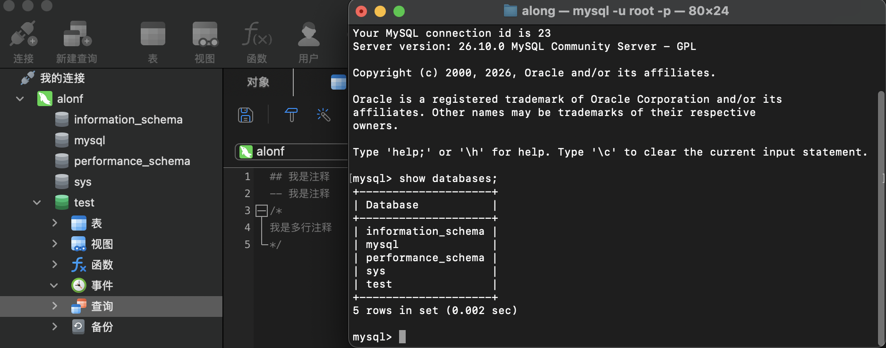

### 创建库

```bash
create database 数据库名;
```

创建后刷新数据库就可以看到
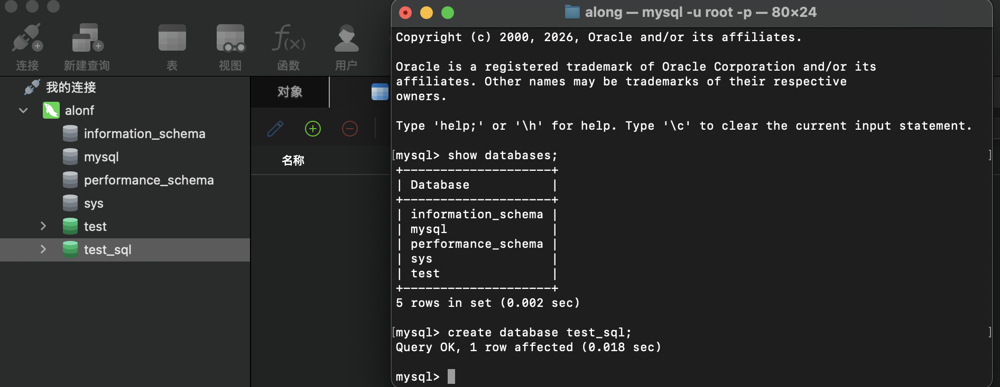

如果你希望在创建数据库时指定一些选项，可以使用 create database 语句的其他参数，例如，你可以指定字符集和排序规则：

```bash
create database 数据库名
  create set utf8mb4
  create utf8mb4_general_ci;
```

如果数据库已经存在，执行 create database 将导致错误。

为了避免这种情况，你可以在 create database 语句中添加 if not exists 子句：

```bash
create database if not exists 数据库名;
```

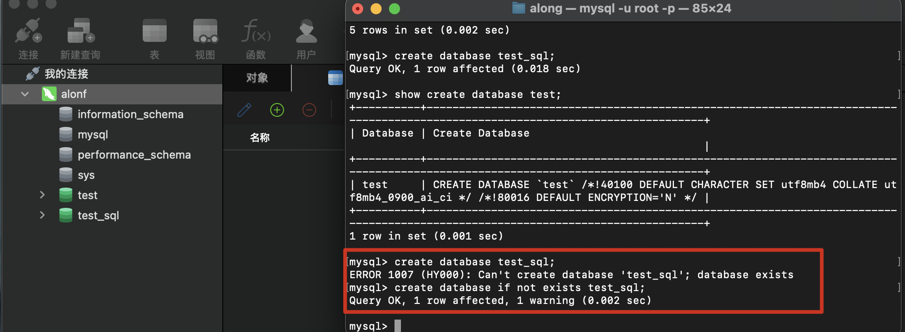

### 查看某个数据库的详细定义语句

```bash
show create database 数据库名;
```
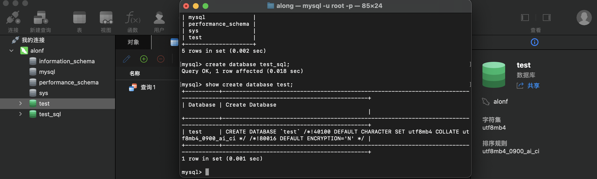

### 修改库编码
  - 修改数据库编码只会影响之后新创建的表的默认编码，之前创建的表不会受影响。
```bash
alter database 数据库名 character set 字符集名称 colate 字符集对应校对规则;
```

### 使用库

选择来数据库后，你的后续 SQL 查询和操作在指定的数据库上执行
```bash
use 数据库名;
```


或者在登录数据库时可以直接选择对应库：

```bash
mysql -u root -p -D 数据库名
```

### 删除库


```bash
drop database 数据库名;
```

id exists 是一个可选的子句，表示如果数据库存在才执行删除操作，避免因为数据库不存在而引发错误。

```bash
drop database if exists 数据库名;
```

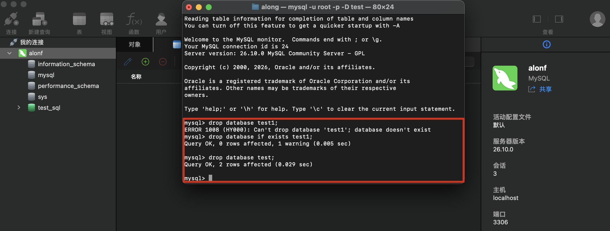

> 注意： 在执行删除数据库操作前，请确保你确实想要删除数据库及其所有数据，因为该操作是不可逆的。为了避免误操作，通常建议在执行删除之前备份数据库。

- 使用 mysqladmin 删除数据库

```bash
mysqladmin -u your_username -p drop your_database
```
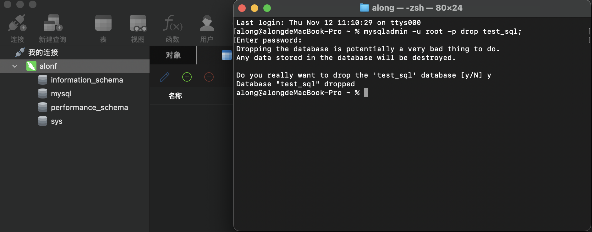

### 库操作语法汇总

| 操作 | 语法 | 说明 |
| --- | --- | --- |
| 查看所有数据库 | `SHOW DATABASES;` | 查看当前用户有权限查看的数据库。 |
| 创建数据库 | `CREATE DATABASE 数据库名;` | 创建数据库；如果已存在则报错。 |
| 创建数据库并指定字符集和排序规则 | `CREATE DATABASE 数据库名 CHARACTER SET utf8mb4 COLLATE utf8mb4_general_ci;` | 设置数据库默认的字符集和排序规则。 |
| 数据库不存在时创建 | `CREATE DATABASE IF NOT EXISTS 数据库名;` | 数据库已存在时不重复创建，避免报错。 |
| 查看数据库定义 | `SHOW CREATE DATABASE 数据库名;` | 查看数据库的创建语句，包括字符集和排序规则等。 |
| 修改数据库默认字符集和排序规则 | `ALTER DATABASE 数据库名 CHARACTER SET utf8mb4 COLLATE utf8mb4_general_ci;` | 修改数据库默认设置，不会转换已有表及字段的字符集。 |
| 选择数据库 | `USE 数据库名;` | 将指定数据库设为当前默认数据库。 |
| 登录时选择数据库 | `mysql -u 用户名 -p -D 数据库名` | 在终端执行，登录时指定默认数据库，随后根据提示输入密码。 |
| 删除数据库 | `DROP DATABASE 数据库名;` | 删除数据库及其中所有表和数据，执行前应确认并备份。 |
| 数据库存在时删除 | `DROP DATABASE IF EXISTS 数据库名;` | 数据库不存在时不报错；存在时删除数据库及其中的数据。 |
| 使用 mysqladmin 删除数据库 | `mysqladmin -u 用户名 -p drop 数据库名` | 在终端执行，根据提示输入密码并确认删除。 |


## 表相关语法 

我们首先创建两个数据库，`db_01`, `db_02`。
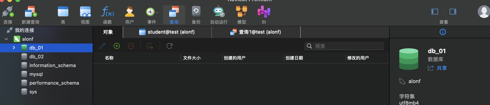

### 查看数据库中的所有表

```bash
use 数据库名;
show tables;
```

如果是查看前面use的数据库中的所有表格，可以省略“from 数据库名”
```bash
show tables from 数据库名;
```

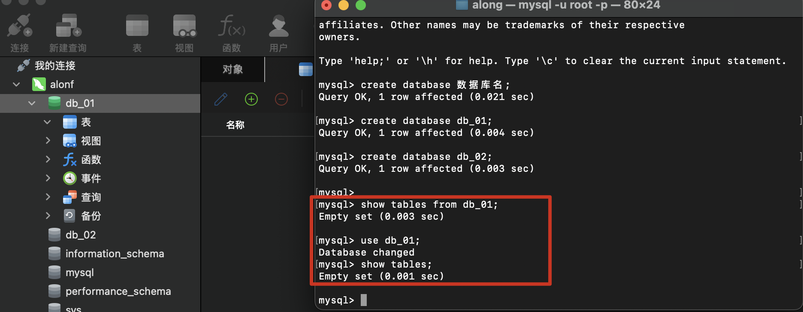


###  创建表

```bash
create table [if not exists] 表名(
    字段名 数据类型,
    字段名 数据类型
);
```

例如创建一个用户表users:

```bash
create table if not exists users (
    id int auto_increment primary key,
    username varchar(50) not null,
    email varchar(100) not null,
    birthdate date,
    is_active boolean default true
);
```

- 实例解析：
- id: 用户 id，整数类型，自增长，作为主键。
- username: 用户名，变长字符串，不允许为空。
- email: 用户邮箱，变长字符串，不允许为空。
- birthdate: 用户的生日，日期类型。
- is_active: 用户是否已经激活，布尔类型，默认值为 true。

如果你希望在创建表时指定数据引擎，字符集和排序规则等，可以使用 CHARACTER SET 和 COLLATE 子句：

```bash
create table mytable (
    id int primary key,
    name varchar(50)
) character set utf8mb4 collate utf8mb4_general_ci;
```

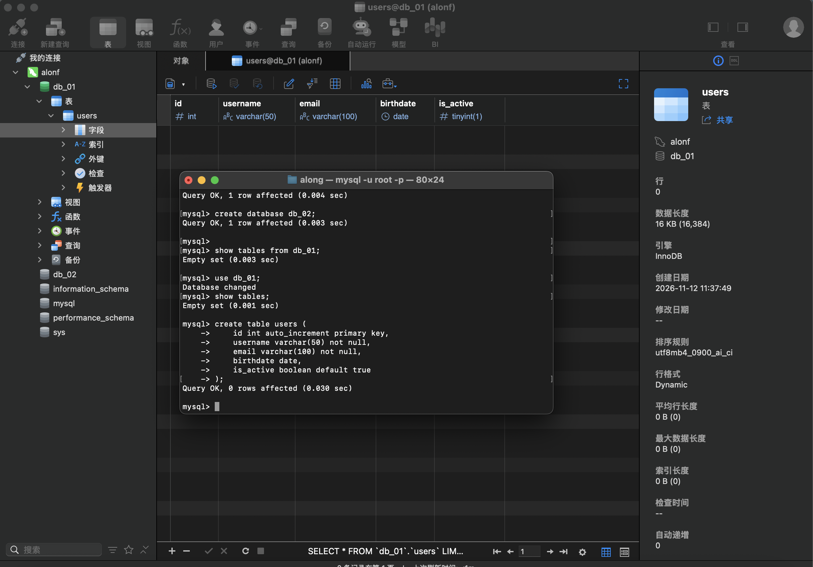

在查看表有没有创建成功

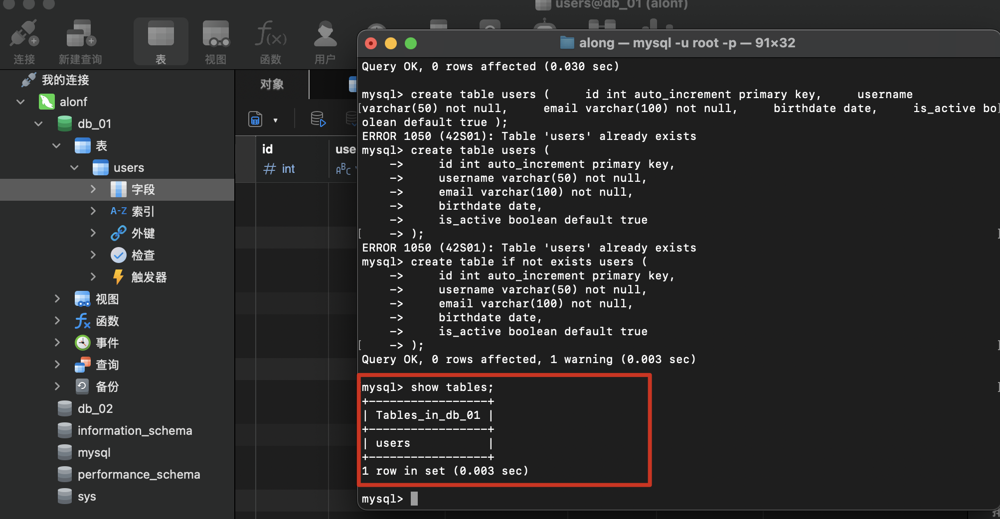

###  查看表的定义

```bash
show create table 表名;
```
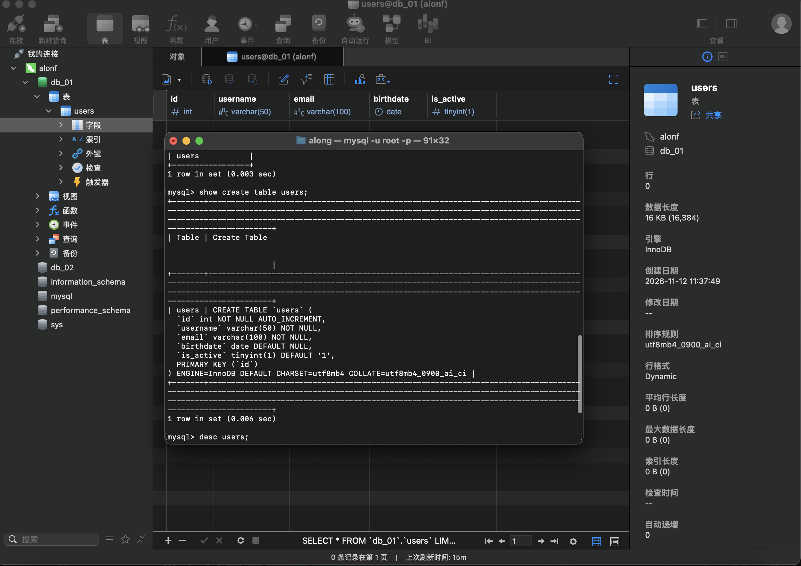

###  查看表的结构

```bash
desc 表名;
```

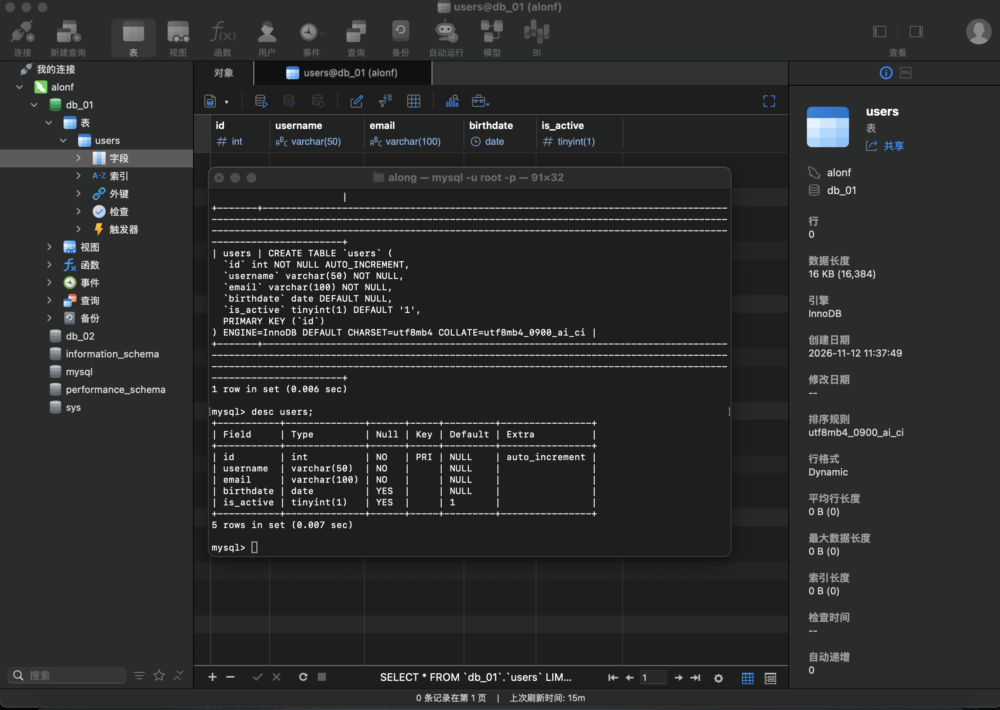

###  修改表编码

```bash
alter table 表名 character set 字符集 collate 校对规则;
```

修改前
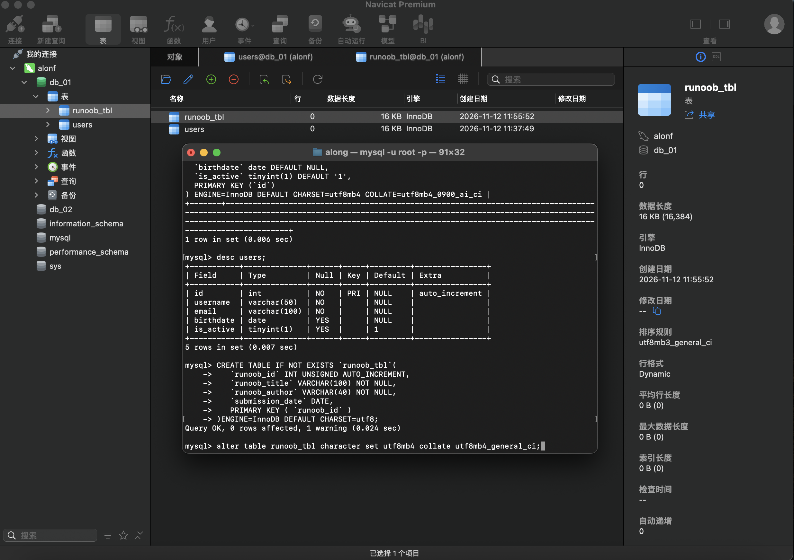

修改后

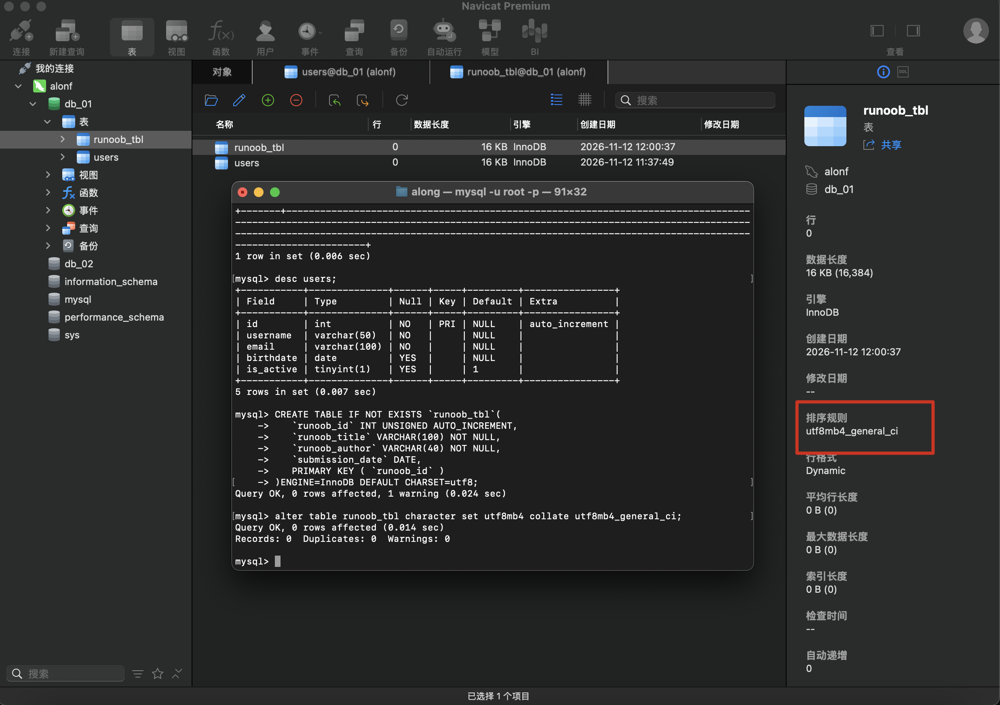

###  修改表结构

####  添加字段

```bash
alter table 表名 add 字段名 数据类型;  ## 在表末尾添加字段
alter table 表名 add 字段名 数据类型 first; ## 在表开头添加字段
alter table 表名 add 字段名 数据类型 after 另一个字段; ## 在另一个字段后添加字段
```

#### 删除字段

```bash
alter table 表名 drop 字段名; 
```

#### 修改字段数据类型

```bash
alter table 表名 modify 字段名 新的数据类型; 
```

#### 修改字段名

```bash
alter table 表名 change 旧字段名 新字段名 新的数据类型;
```

#### 修改字段位置

```bash
alter table 表名 modify 字段名 数据类型 first; ## 将字段移动到表的开头
alter table 表名 modify 字段名 数据类型 after 另一个字段; ## 将字段移动到表的另一个字段之后
```

### 删除表

```bash
drop table if exists 表名; ## 删除表，如果存在的话，不存在不会报错
drop table 表名; ## 直接删除表
```
如果你只是想删除表中的所有数据，但保留表的结构，可以使用 truncate table 语句：

```bash
truncate table 表名;
```
- 注意事项：
  - 备份数据：在删除表之前，确保已经备份了数据，如果你需要的话。
  - 外键约束：如果该表与其他表有外键约束，可能需要先删除外键约束，或者确保依赖关系被处理好。

### 表操作语法汇总

| 操作 | 语法 | 说明 |
| --- | --- | --- |
| 查看当前数据库中的所有表 | `SHOW TABLES;` | 先使用 `USE 数据库名;` 选择数据库，再查看其中的表。 |
| 查看指定数据库中的所有表 | `SHOW TABLES FROM 数据库名;` | 无需切换当前数据库。 |
| 创建表 | `CREATE TABLE 表名 (字段名 数据类型, 字段名 数据类型);` | 定义表名、字段及其数据类型；表已存在时会报错。 |
| 表不存在时创建 | `CREATE TABLE IF NOT EXISTS 表名 (字段名 数据类型, 字段名 数据类型);` | 表已存在时不重复创建，也不会修改已有表的结构。 |
| 创建表并指定字符集和排序规则 | `CREATE TABLE 表名 (字段名 数据类型) CHARACTER SET utf8mb4 COLLATE utf8mb4_general_ci;` | 设置表的默认字符集和排序规则；字符型字段默认继承该设置。 |
| 创建表并指定存储引擎 | `CREATE TABLE 表名 (字段名 数据类型) ENGINE = InnoDB;` | 使用 `ENGINE` 指定存储引擎，可与字符集、排序规则选项一起使用。 |
| 查看表的定义 | `SHOW CREATE TABLE 表名;` | 查看建表语句，包括字段、约束、索引和表选项等。 |
| 查看表的结构 | `DESC 表名;` | 查看字段名、类型、是否允许为空、键和默认值等；也可使用 `DESCRIBE 表名;`。 |
| 修改表的默认字符集和排序规则 | `ALTER TABLE 表名 CHARACTER SET 字符集 COLLATE 排序规则;` | 修改表的默认设置，不会转换已有字符型字段的字符集。 |
| 在表末尾添加字段 | `ALTER TABLE 表名 ADD 字段名 数据类型;` | 默认将新字段添加到表的末尾。 |
| 在表开头添加字段 | `ALTER TABLE 表名 ADD 字段名 数据类型 FIRST;` | 将新字段添加到第一列。 |
| 在指定字段后添加字段 | `ALTER TABLE 表名 ADD 字段名 数据类型 AFTER 另一个字段;` | 将新字段添加到指定字段之后。 |
| 删除字段 | `ALTER TABLE 表名 DROP 字段名;` | 删除字段及该字段中保存的数据。 |
| 修改字段数据类型 | `ALTER TABLE 表名 MODIFY 字段名 新的数据类型;` | 修改字段类型；已有数据需要能够转换为新类型。 |
| 修改字段名 | `ALTER TABLE 表名 CHANGE 旧字段名 新字段名 数据类型;` | 修改字段名时需同时写出数据类型及要保留的字段属性。 |
| 将字段移动到表开头 | `ALTER TABLE 表名 MODIFY 字段名 数据类型 FIRST;` | 将已有字段调整为第一列。 |
| 将字段移动到指定字段后 | `ALTER TABLE 表名 MODIFY 字段名 数据类型 AFTER 另一个字段;` | 调整已有字段的排列顺序。 |
| 删除表 | `DROP TABLE 表名;` | 删除表结构及全部数据；表不存在时会报错。 |
| 表存在时删除 | `DROP TABLE IF EXISTS 表名;` | 表不存在时不报错；存在时删除表结构及全部数据。 |
| 清空表数据 | `TRUNCATE TABLE 表名;` | 删除全部数据并保留表结构；通常会重置自增计数器，在 MySQL 中会隐式提交，不能通过 `ROLLBACK` 撤销。 |

> 使用 `MODIFY` 或 `CHANGE` 时，需要重新写出要保留的字段属性，例如 `NOT NULL`、`DEFAULT`、`AUTO_INCREMENT`、`COMMENT`，否则未写出的属性可能丢失。删除表、删除字段或清空数据前，应确认备份及外键依赖。

## 表数据的增删改查(DML)

### 插入数据

```bash
insert into 表名(字段列表，逗号分隔) values (值列表，逗号分隔，和字段一一对应),(值列表，逗号分隔，和字段一一对应);
```
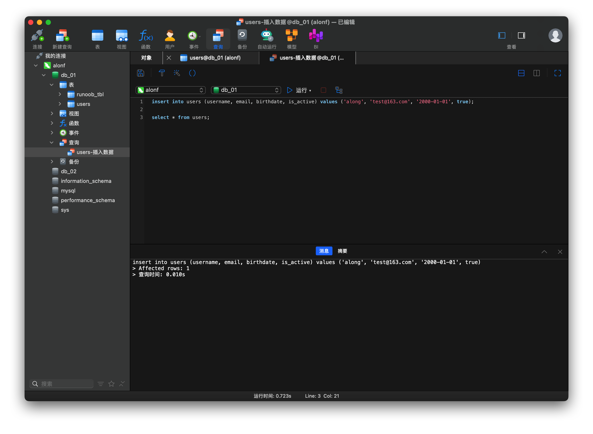

查询该表数据看下，已经插入成功

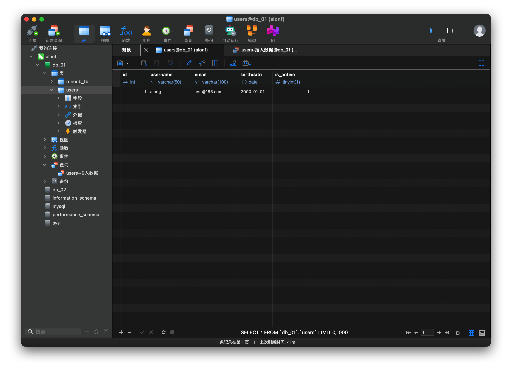

还有另外一种插入数据，可以省略字段列表，只需要写值

```bash
insert into 表名 values(值列表，用逗号分隔),(值列表，用逗号分隔); # 值列表中的值的顺序、类型、个数必须与表结构一一对应
```

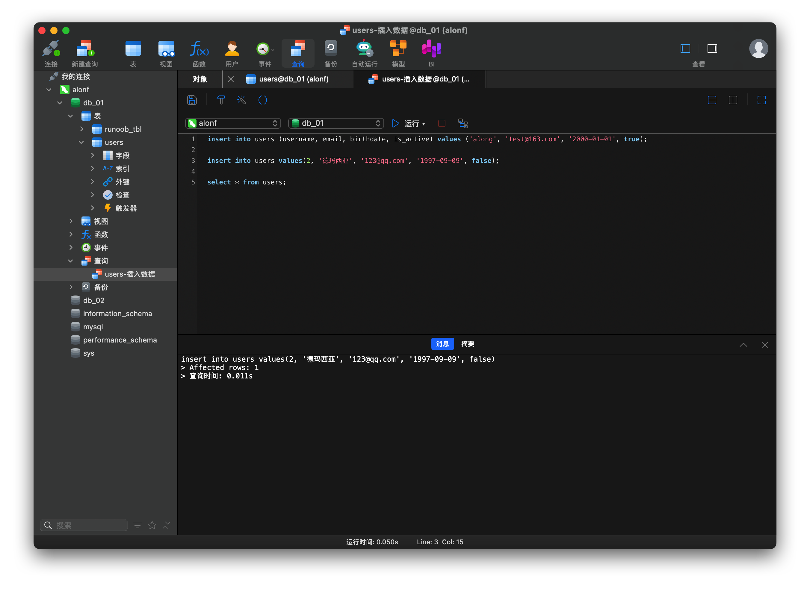

插入多条数据

```bash
insert into users (username, email, birthdate, is_active) values ('卡特', 'test2@163.com', '2001-01-01', true),('诺克', 'test3@163.com', '2002-01-01', true);
```
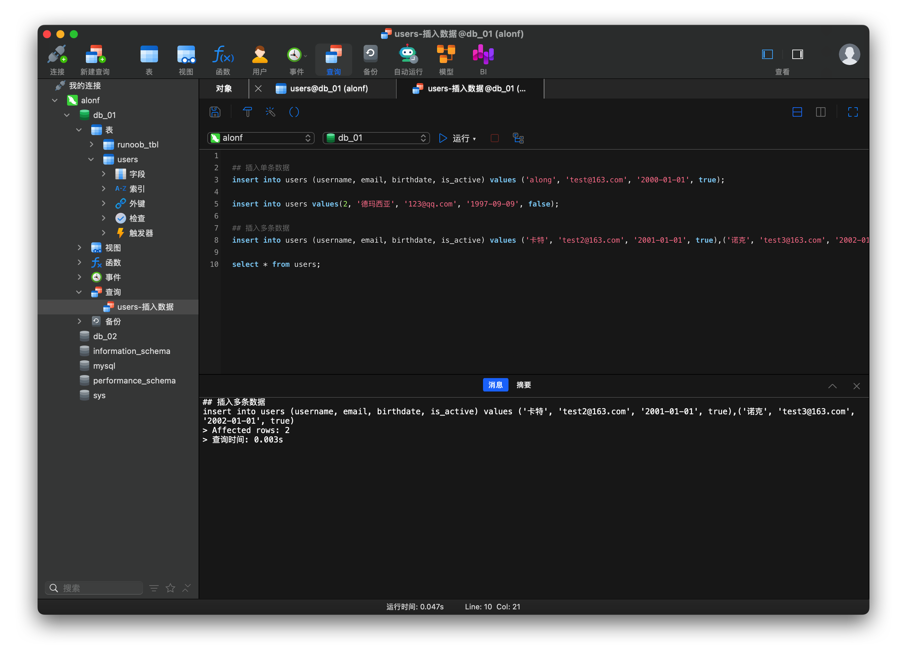
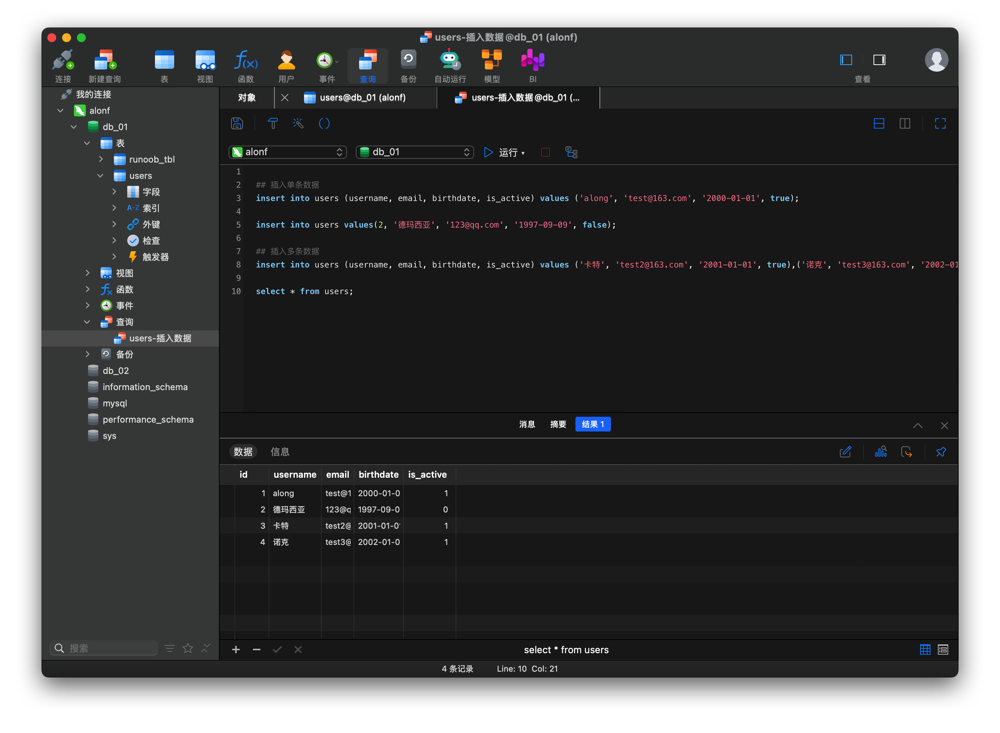

```bash
insert into users values (5, '皇子', '1234@qq.com', '1997-09-09', false),(6, '大嘴', '12345@qq.com', '1998-09-09', false);

```

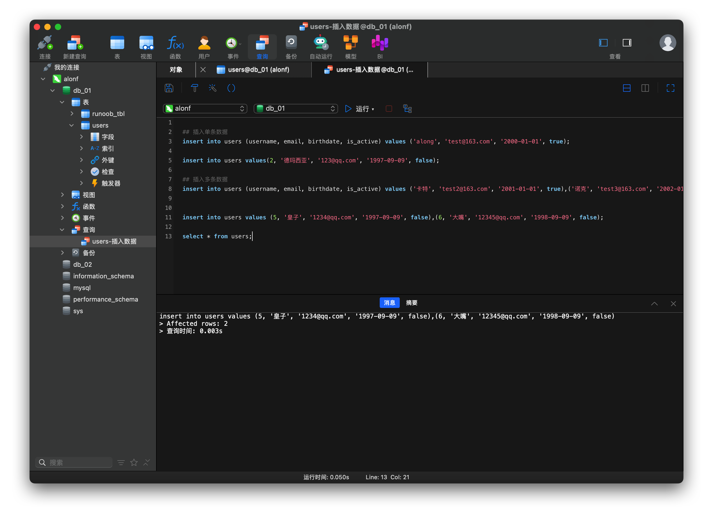


### 删除数据

#### 删除多条数据

```bash
delete from 表名 where 条件;
```

> 如果没有指定 WHERE 子句，MySQL 表中的所有记录将被删除。

例：删除id=6的这条数据

删除前查询
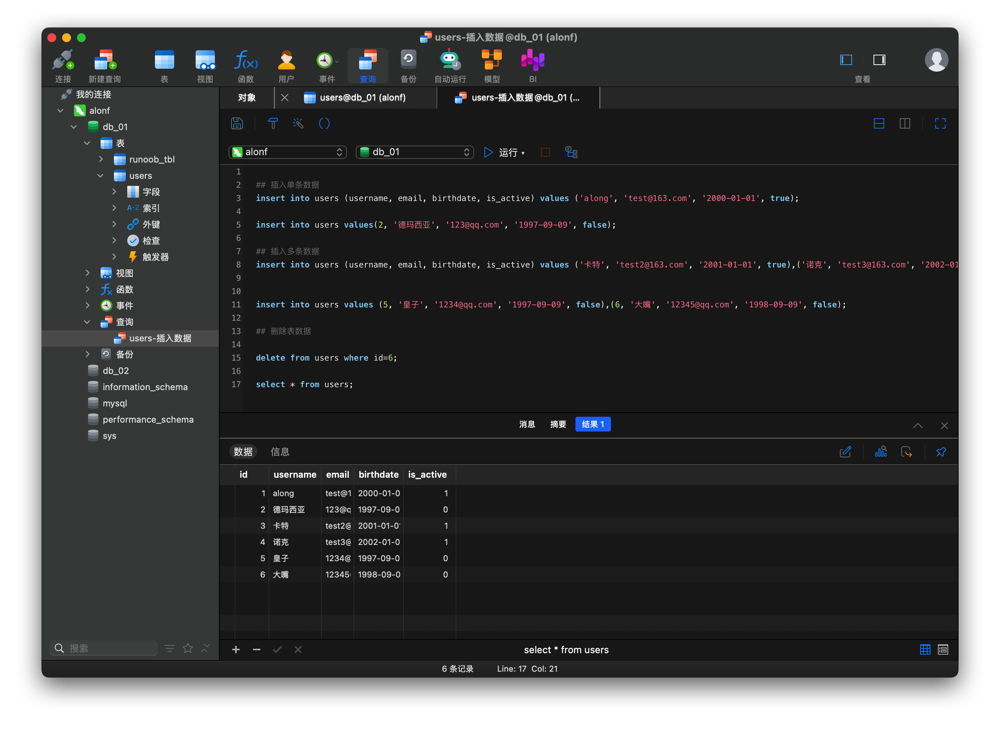

执行删除语句


再执行查询语句，已经可以看待id=6的这条数据被删除了。
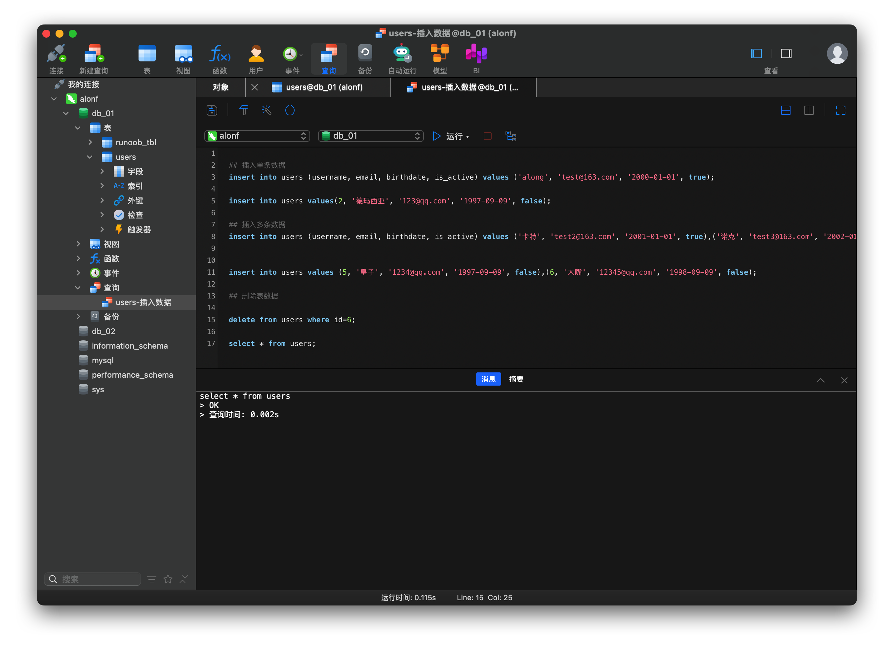


#### 删除表中的所有数据

表结构会保留下来，只删除数据

```bash
delete from 表名;
```

#### 截断表
表结构会保留下来

```bash
truncate 表名;
```
- truncate表和delete表的区别：
  - delete是一条一条删除记录的。如果在事务中，事务提交之前支持回滚
  - truncate是把整个表drop，新建一张，效率更高。就算在事务中，也无法回滚


### 修改数据

#### 修改部分行数据

```bash
update 表名 set 字段名 = 值, 字段名 = 值 where 条件; # 修改满足条件的行
```

如图所示修改前
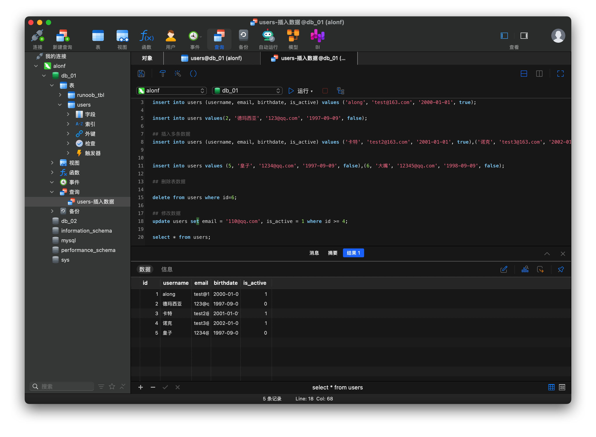

执行修改语句，查询语句，修改后数据如图所示


#### 修改所有行数据

```bash
update 表名 set 字段名 = 值, 字段名 = 值;
```


### 查询数据

```bash
SELECT column1, column2, ...
FROM table_name
[WHERE condition]
[ORDER BY column_name [ASC | DESC]]
[LIMIT number];
```

- 参数说明：
  - column1, column2, ... 是你想要选择的列的名称，如果使用 * 表示选择所有列。
  - table_name 是你要从中查询数据的表的名称。
  - WHERE condition 是一个可选的子句，用于指定过滤条件，只返回符合条件的行。
  - ORDER BY column_name [ASC | DESC] 是一个可选的子句，用于指定结果集的排序顺序，默认是升序（ASC）。
  - LIMIT number 是一个可选的子句，用于限制返回的行数。

1. 选择所有行所有列数据进行查询

```bash
select * from users;
```
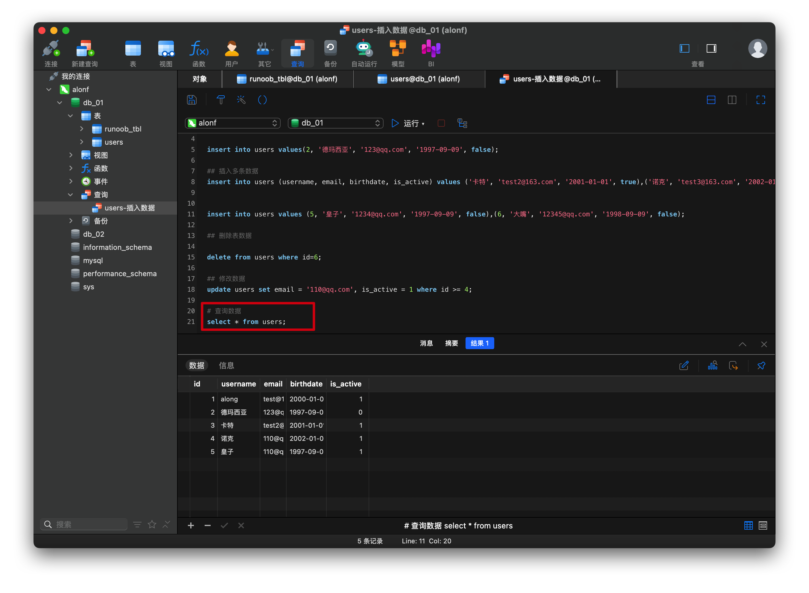

2. 选择特定列的所有行
```bash
select username,email from users;
```
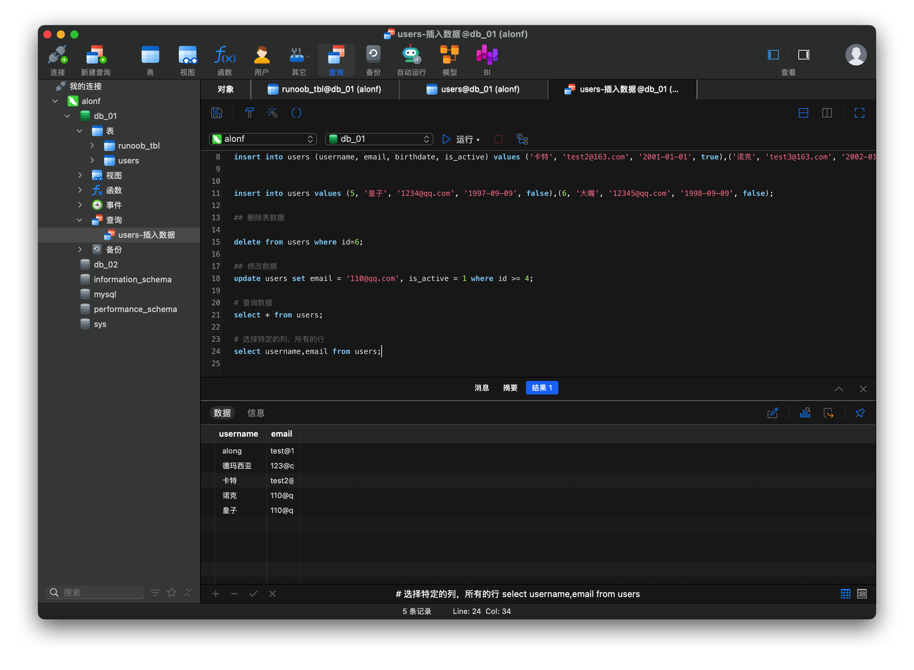

3. 添加 WHERE 子句，选择满足条件的行

```bash
select * from users where is_active = true;
```
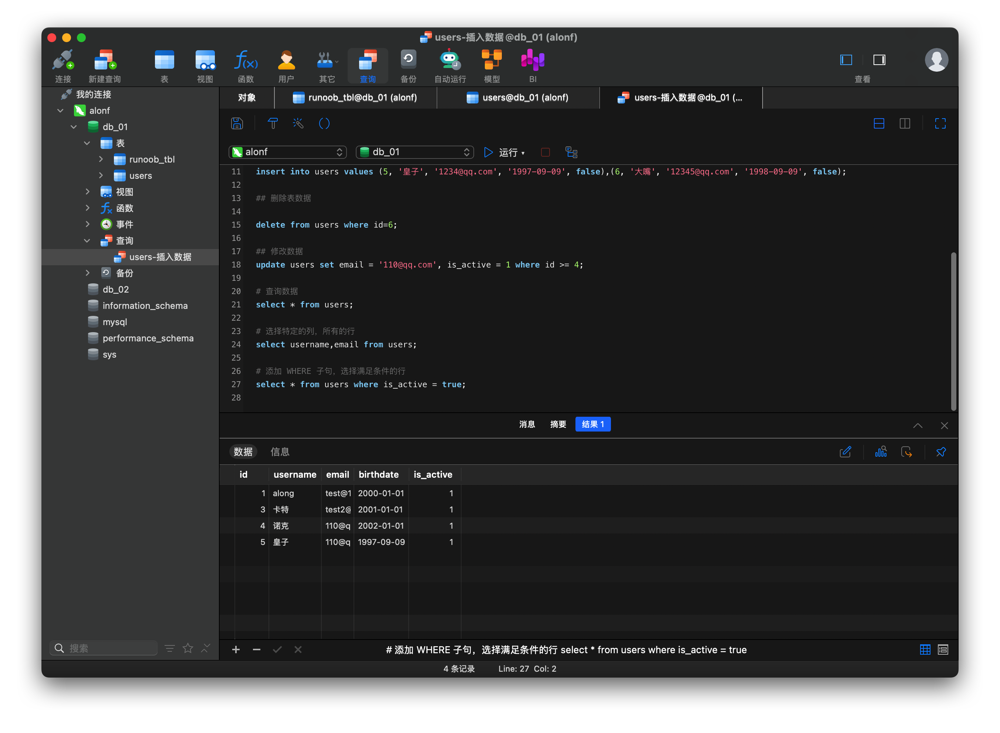

4. 添加 ORDER BY 子句，按照某列的升序排序
```bash
select * from users order by birthdate desc;
```
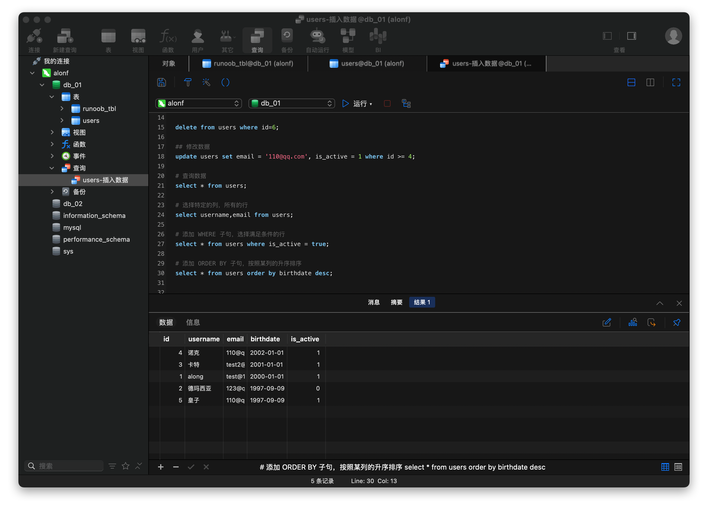

5. 添加 LIMIT 子句，限制返回的行数

```bash
select * from users limit 3;
```
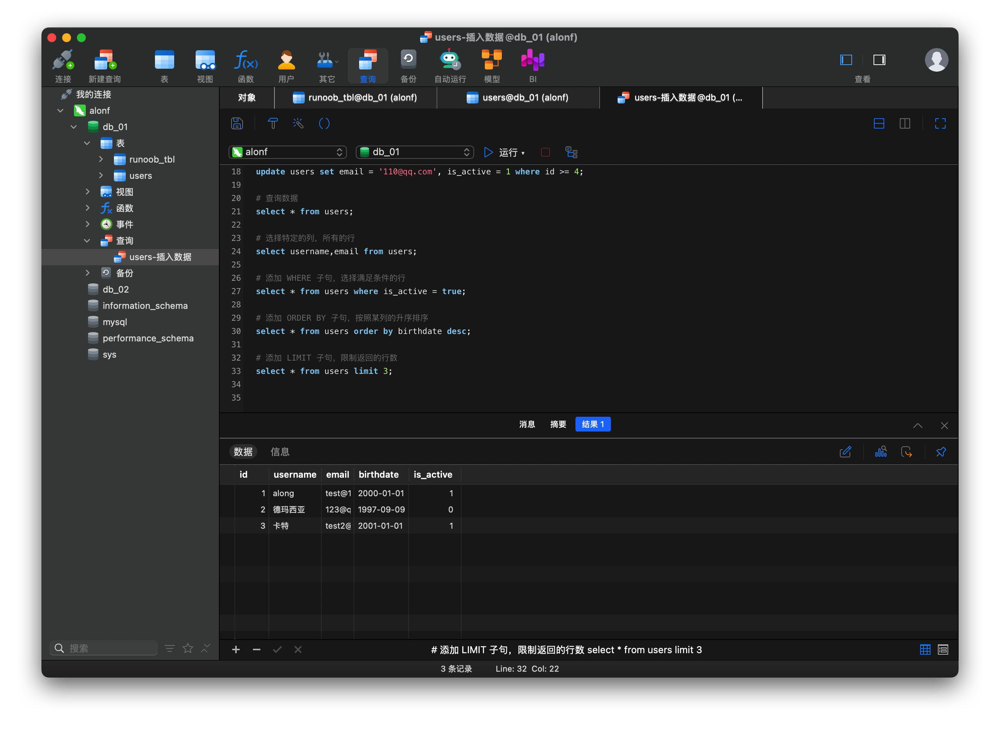

### 表数据操作语法汇总

按增、删、改、查汇总本节语法，便于快速查阅。`SELECT` 通常单独归为 DQL；`TRUNCATE` 属于 DDL，这里一并列出，便于比较清空数据的方式。

| 操作 | 语法 | 说明 |
| --- | --- | --- |
| 插入一条数据 | `INSERT INTO 表名 (字段1, 字段2) VALUES (值1, 值2);` | 值的顺序和类型应与指定字段一一对应；省略的字段需允许为空、具有默认值或可自动生成。 |
| 插入多条数据 | `INSERT INTO 表名 (字段1, 字段2) VALUES (值1, 值2), (值3, 值4);` | 多组值用逗号分隔，每组值都与字段列表对应。 |
| 省略字段列表插入数据 | `INSERT INTO 表名 VALUES (值1, 值2, ...);` | 值的顺序、类型、个数必须与表结构对应，也可使用多组值批量插入；建议显式指定字段列表。 |
| 删除满足条件的数据 | `DELETE FROM 表名 WHERE 条件;` | 删除所有满足条件的行；条件应准确限定需要删除的数据。 |
| 删除表中的所有数据 | `DELETE FROM 表名;` | 保留表结构；对 InnoDB 表，在事务提交前可回滚，通常不会重置自增计数器。 |
| 截断表、清空全部数据 | `TRUNCATE TABLE 表名;` | 保留表结构，通常会重置自增计数器；在 MySQL 中会隐式提交，不能通过 `ROLLBACK` 撤销。 |
| 修改满足条件的数据 | `UPDATE 表名 SET 字段1 = 值1, 字段2 = 值2 WHERE 条件;` | 修改所有满足条件的行，可同时更新多个字段。 |
| 修改所有行的数据 | `UPDATE 表名 SET 字段1 = 值1, 字段2 = 值2;` | 未指定 `WHERE`，会更新表中的所有行。 |
| 查询所有行、所有列 | `SELECT * FROM 表名;` | 返回表中的全部数据。 |
| 查询指定列 | `SELECT 字段1, 字段2 FROM 表名;` | 仅返回指定字段，多个字段用逗号分隔。 |
| 按条件查询 | `SELECT * FROM 表名 WHERE 条件;` | 仅返回满足条件的行，也可将 `*` 替换为指定字段。 |
| 按字段升序查询 | `SELECT * FROM 表名 ORDER BY 字段 ASC;` | 按指定字段升序排列，`ASC` 可省略。 |
| 按字段降序查询 | `SELECT * FROM 表名 ORDER BY 字段 DESC;` | 按指定字段降序排列。 |
| 限制查询结果数量 | `SELECT * FROM 表名 LIMIT 行数;` | 最多返回指定行数；需要稳定的返回顺序时，应配合 `ORDER BY` 使用，必要时用唯一字段打破并列。 |

查询子句可按以下顺序组合，方括号表示可选部分，实际执行时不写方括号：

```sql
SELECT 字段1, 字段2
FROM 表名
[WHERE 条件]
[ORDER BY 排序字段 ASC 或 DESC]
[LIMIT 行数];
```

## 使用别名

```bash
select 字段名1 as "别名1", 字段名2 as "别名2" from 表名 as 表别名;
```

- 列的别名有空格时需要加双引号。列的别名中没有空格时双引号可以不加
- 表的别名不能加双引号，表的别名中间不能包含空格
- as大小写都可以，as也完全可以省略

```bash
select username as 用户名, email as 邮箱 from users as 用户表;
```
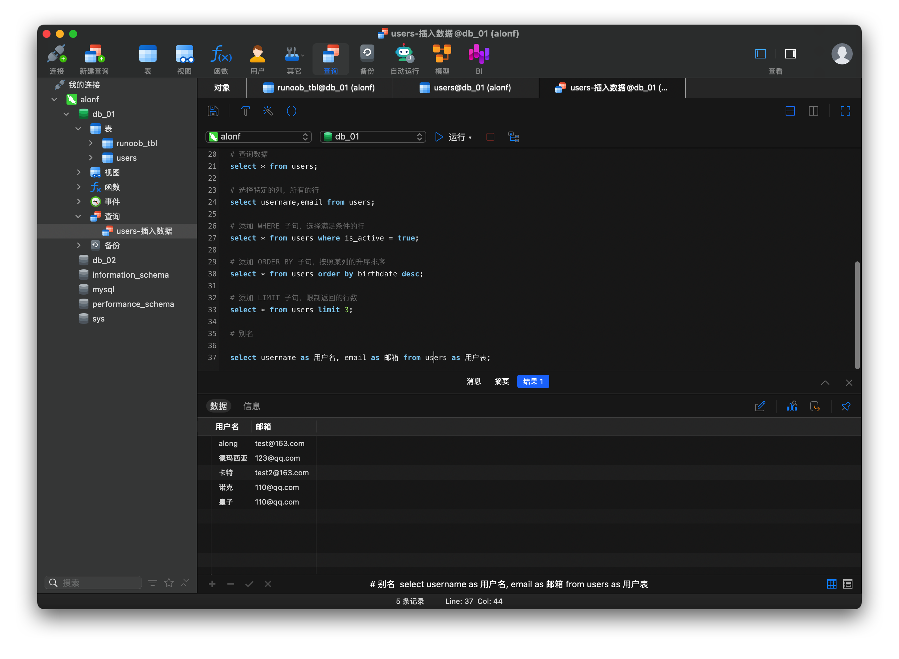


## 查询结果去重

mysql可以在查询结果中使用distinct关键字去重。

```bash
select distinct 字段列表 from 表名; 
```