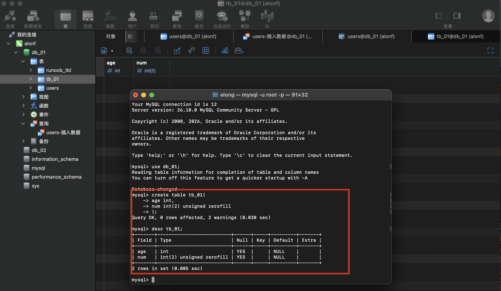
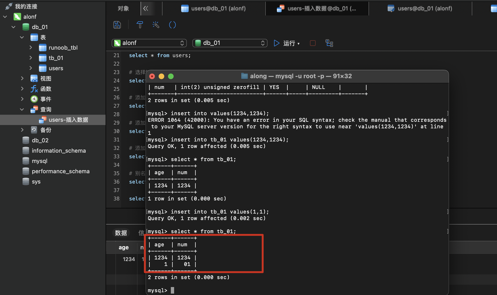
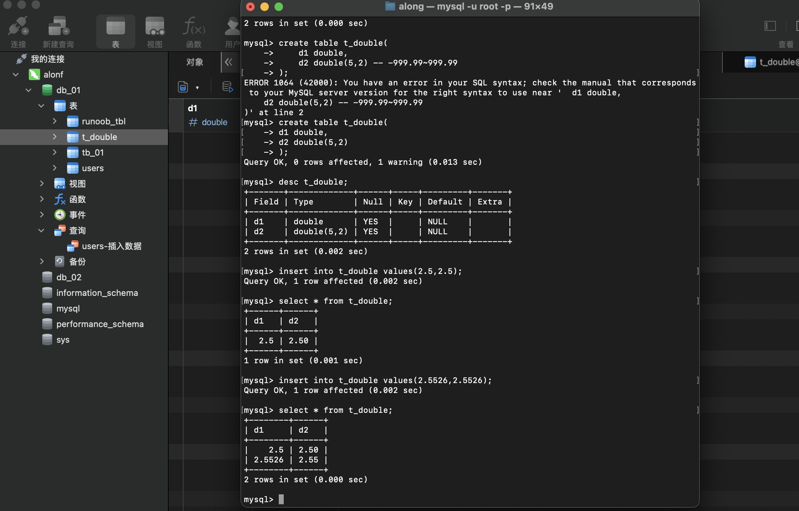
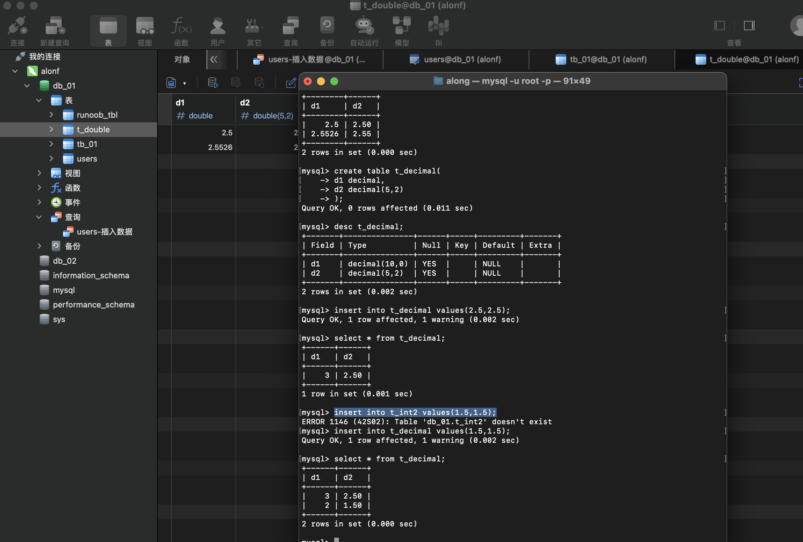
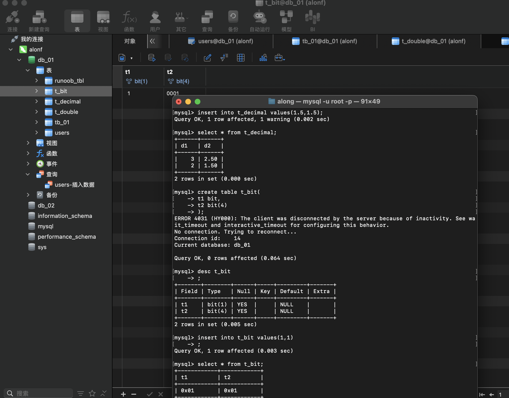
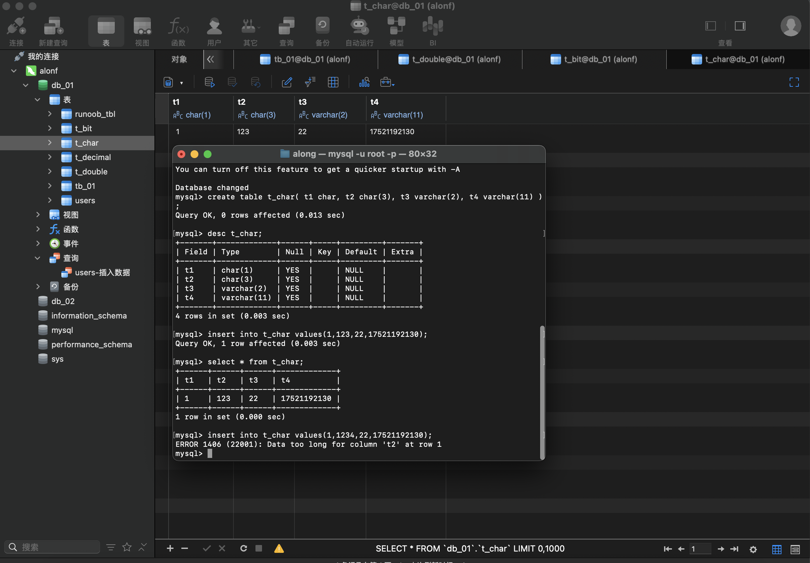
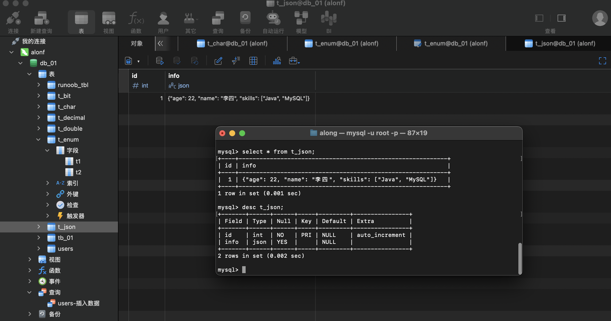

## 数值类型

#### 整数类型

| 数据类型 | 字节 | 范围（有符号） | 范围（无符号） | 说明 |
| --- | --- | --- | --- | --- |
| TINYINT | 1 | -128 ~ 127 | 0 ~ 255 | 小范围整数 |
| SMALLINT | 2 | -32,768 ~ 32,767 | 0 ~ 65,535 | 中小范围整数 |
| MEDIUMINT | 3 | -8,388,608 ~ 8,388,607 | 0 ~ 16,777,215 | 中范围整数 |
| INT/INTEGER | 4 | -2,147,483,648 ~ 2,147,483,647 | 0 ~ 4,294,967,295 | 标准整数类型 |
| BIGINT | 8 | -2^63 ~ 2^63-1 | 0 ~ 2^64-1 | 大范围整数 |

对于整数类型，MySQL还支持在类型名称后面加小括号(M)，而小括号中的M表示显示宽度，M的取值范围是(0, 255)。int(M)这个M在字段的属性中指定了unsigned（无符号）和zerofill（零填充）的情况下才有意义。表示当整数值不够M位时，用0填充。

```bash
create table tb_01(
  age int,
  num int(2) unsigned zerofill
);
```



```bash
insert into values(1234,1234);
insert into values(1,1);
select * from tb_01;
```

可以看到`unsigned zerofill`整数值不够2位，用0进行填充。


#### 浮点数类型

| 数据类型 | 字节 | 范围 | 说明 |
| --- | --- | --- | --- |
| FLOAT | 4 | ±3.402823466E+38（约 7 位精度） | 单精度浮点数 |
| DOUBLE | 8 | ±1.7976931348623157E+308（约 16 位精度） | 双精度浮点数 |
| DECIMAL/NUMERIC | 可变 | 用户定义精度和范围 | 精确小数，常用于财务计算 |

MySQL中使用浮点数和定点数来表示小数。浮点数有两种类型：单精度浮点数（FLOAT）和双精度浮点数（DOUBLE），定点数只有DECIMAL。

浮点数和定点数都可以用（M，D）来表示：

- M是精度，表示该值总共显示M位，包括整数位和小数位，对于FLOAT和DOUBLE类型来说，M取值范围为0~255，而对于DECIMAL来说，M取值范围为0~65。
- D是标度，表示小数的位数，取值范围为0~30，同时必须<=M。
- FLOAT和DOUBLE类型在不指定（M，D）时，默认会按照实际的精度来显示。DECIMAL类型在不指定（M，D）时，默认为（10，0），即只保留整数部分。例如，定义DECIMAL（5,2）的类型，表示该列取值范围是-999.99~999.99。如果用户插入数据的小数部分位数超过D位，MySQL会四舍五入处理，但是如果用户插入数据的整数部分位数超过M-D位，则会报Out of range的错误。
- DECIMAL实际是以字符串形式存放的，在对精度要求比较高的时候（如货币、科学数据等）使用DECIMAL类型会比较好。浮点数相对于定点数的优点是在长度一定的情况下，浮点数能够表示更大的数据范围，它的缺点是会引起精度问题。

```bash
create table t_double(
  d1 double,
  d2 double(5,2)
);
desc t_double;
insert into t_double values(2.5,2.5);
insert into t_double values(2.5526,2.5526);
select * from t_double;
```




- decimal类型的数据

decimal默认是`(10,0)`，如果小数有位数会四舍五入。


```bash
creat table t_decimal(
  d1 decimal,
  d2 decimal(5,2)
);
desc t_decimal;
insert into t_decimal values(2.5,2.5);
insert into t_int2 values(1.5,1.5);
select * from t_decimal;
```



#### BIT类型
BIT是一种存储位数据的类型，每个字段的长度可以指定为1到64位。数据以位流的形式存储，并以字节（byte）对齐。即使只存储1位，最小存储单元也是1字节。

可以使用十六进制、二进制或整数形式插入数据。插入值的位数不能超过定义的位数，否则会报错。

查询BIT字段时，MySQL会以二进制格式显示数据。如果需要以整数形式显示，可以使用BIN()或CONV()。

可以对BIT数据进行逻辑运算，例如AND，OR，XOR等。

```bash
create table t_bit(
  t1 bit,
  t2 bit(4)
);

desc t_bit;
insert into t_bit values(1,1);
select * from t_bit;
```


## 字符串类型

| 数据类型 | 最大长度 | 说明 |
| --- | --- | --- |
| CHAR(M) | 0 ~ 255 字符 | 定长字符串，长度不足会补空格 |
| VARCHAR(M) | 0 ~ 65535 字节 | 变长字符串，存储长度需加 1 或 2 字节 |

#### 定长与变长字符串

- CHAR(M)为固定长度的字符串， M表示最多能存储的字符数，取值范围是0~255个字符，如果未指定(M)表示只能存储1个字符。例如CHAR(4)定义了一个固定长度的字符串列，其包含的字符个数最大为4，如果存储的值少于4个字符，右侧将用空格填充以达到指定的长度，当查询显示CHAR值时，尾部的空格将被删掉。

- VARCHAR(M)为可变长度的字符串，M表示最多能存储的字符数，M的范围由最长的行的大小（通常是65535）和使用的字符集确定。例如utf8mb4字符编码单个字符所需最长字节值为4个字节，所以M的范围是[0, 16383]。而VARCHAR类型的字段实际占用的空间为字符串的实际长度加1或2个字节，这1或2个字节用于描述字符串值的实际字节数，即字符串值在[0,255]个字节范围内，那么额外增加1个字节，否则需要额外增加2个字节。在VARCHAR后面的M必须指定。

- 例如，身份证号、手机号码、QQ号、用户名username、密码password、银行卡号等固定长度的文本字符串适合使用CHAR类型，而评论、朋友圈、微博不定长度的文本字符串更适合使用VARCHAR类型。

```bash
create table t_char( t1 char, t2 char(3), t3 varchar(2), t4 varchar(11) );
desc t_char;
insert into t_char values(1,123,22,17521192130);
select * from t_char;
insert into t_char values(1,1234,22,17521192130); # 报错 ERROR 1406 (22001): Data too long for column 't2' at row 1
```



#### 枚举与集合

| 特性 | ENUM | SET |
| --- | --- | --- |
| 存储值个数 | 单选（一个值） | 多选（一个或多个值） |
| 存储方式 | 数字索引 | 位图 |
| 选项个数限制 | 最多 65,535 个 | 最多 64 个 |
| 插入非法值 | 转为空字符串或报错 | 忽略非法值 |
| 适用场景 | 需要单选的状态字段（如性别） | 多选标签（如用户角色） |

有时候我们指定在固定的几个值范围内选择一个或多个，那么就需要使用ENUM枚举类型和SET集合类型了。比如性别只有“男”或“女”；上下班交通方式可以有“地铁”、“公交”、“出租车”、“自行车”、“步行”等。

枚举和集合类型字段声明的语法格式如下：
- 字段名 ENUM(值1,值2,值3)
- 字段名 SET(值1,值2,值3)

ENUM类型的字段在赋值时，只能在指定的枚举列表中取值，而且一次只能取一个。枚举列表最多可以有65535个成员。ENUM值在内部用整数表示，每个枚举值均有一个索引值， MySQL存储的就是这个索引编号。

SET类型的字段在赋值时，可从定义的值列表中选择1个或多个值的组合。SET列最多可以有64个成员。SET值在内部也用整数表示，分别是1，2，4，8……，都是2的n次方值，因为这些整数值对应的二进制都是只有1位是1，其余是0。

```bash
create table t_enum( t1 enum('男', '女'), t2 set('公交车', '自行车', '摩托车', '小轿车') );
desc t_enum;

insert into t_enum values('男', '公交车'); # 中文插入单个
insert into t_enum values('男', '公交车, 摩托车'); # 中文插入单个多个
insert into t_enum values(1, 1); # 插入数据为 男 公交车
insert into t_enum values(2, 3); # 插入数据为 男 公交车和自行车  3对应的是 1 + 2
insert into t_enum values(2, 20); # ERROR 1265 (01000): Data truncated for column 't2' at row 1
```

| 数值 | 对应选项 |
| --- | --- |
| 1 | 男 |
| 2 | 女 |


| 选项 | 二进制 | 对应数值 |
| --- | --- | --- |
| 公交车 | 0001 | 1 |
| 自行车 | 0010 | 2 |
| 摩托车 | 0100 | 4 |
| 小轿车 | 1000 | 8 |

#### 文本类型

| 数据类型 | 最大长度 | 说明 |
| --- | --- | --- |
| TINYTEXT | 255 字节 | 小文本 |
| TEXT | 65,535 字节（64 KB） | 常规文本 |
| MEDIUMTEXT | 16,777,215 字节 | 中等大小文本 |
| LONGTEXT | 4,294,967,295 字节 | 超大文本 |

#### 二进制类型

| 数据类型 | 最大数据长度 | 额外长度字节 | 说明 |
| --- | --- | --- | --- |
| BINARY(M) | 255 字节 | 无 | 定长二进制数据，长度不足 M 字节时在末尾补 0x00 |
| VARBINARY(M) | 65,535 字节，实际受行大小限制 | 1 或 2 字节 | 变长二进制数据，M 表示最大字节数，不自动填充 |
| TINYBLOB | 255 字节 | 1 字节 | 小型二进制对象 |
| BLOB | 65,535 字节，约 64 KiB | 2 字节 | 普通二进制大对象 |
| MEDIUMBLOB | 16,777,215 字节，约 16 MiB | 3 字节 | 中型二进制大对象 |
| LONGBLOB | 4,294,967,295 字节，约 4 GiB | 4 字节 | 大型二进制大对象 |

## 日期时间类型

| 数据类型 | 存储字节 | 取值范围 | 常用格式 | 说明 |
| --- | --- | --- | --- | --- |
| DATE | 3 字节 | 1000-01-01 ~ 9999-12-31 | YYYY-MM-DD | 仅存储日期，例如生日 |
| TIME[(fsp)] | 3 ~ 6 字节 | -838:59:59 ~ 838:59:59 | hh:mm:ss[.小数秒] | 存储一天中的时间或时间间隔，允许负数及超过 24 小时 |
| DATETIME[(fsp)] | 5 ~ 8 字节 | 1000-01-01 00:00:00 ~ 9999-12-31 23:59:59 | YYYY-MM-DD hh:mm:ss[.小数秒] | 存储日期和时间，不随会话时区自动转换 |
| TIMESTAMP[(fsp)] | 4 ~ 7 字节 | 1970-01-01 00:00:01 ~ 2038-01-19 03:14:07（UTC） | YYYY-MM-DD hh:mm:ss[.小数秒] | 存储时间戳，写入时转换为 UTC，读取时转换为当前会话时区 |
| YEAR | 1 字节 | 1901 ~ 2155，以及 0000 | YYYY | 仅存储年份，建议使用完整的四位年份 |

fsp 表示小数秒精度，取值为 0～6，默认 0。例如 DATETIME(3) 保留毫秒，`DATETIME(6)` 保留微秒。方括号表示可选部分，实际建表时不写方括号。


如果仅仅是表示年份信息，可以只使用YEAR类型，这样更节省空间，格式为“YYYY”，例如“2022”。YEAR允许的值范围是1901~2155。YEAR还有格式为“YY”2位数字的形式，值是00~69，表示2000~2069年，值是70~99，表示1970~1999年，从MySQL5.5.27开始，2位格式的YEAR已经不推荐使用。YEAR默认格式就是“YYYY”，没必要写成YEAR(4)，从MySQL 8.0.19开始，不推荐使用指定显示宽度的YEAR(4)数据类型。这个0年，如果是以整数的0添加的话，那么是0000年，如果是以日期/字符串的'0'添加的话，是2000年。

如果要表示年月日，可以使用DATE类型，格式为“YYYY-MM-DD”，例如“2022-02-04”。

如果要表示时分秒，可以使用TIME类型，格式为“HH:MM:SS”，例如“10:08:08”。

如果要表示年月日时分秒的完整日期时间，可以使用DATATIME类型，格式为“YYYY-MM-DD HH:MM:SS”，例如“2022-02-04 10:08:08”。

如果需要经常插入或更新日期时间为系统日期时间，则通常使用TIMESTAMP类型，格式为“YYYY-MM-DD HH:MM:SS”，例如“2022-02-04 10:08:08”。TIMESTAMP与DATETIME的区别在于TIMESTAMP的取值范围小，只支持1970-01-01 00:00:01 UTC至2038-01-19 03:14:07 UTC范围的日期时间值，其中UTC是世界标准时间，并且TIMESTAMP类型的日期时间值在存储时会将当前时区的日期时间值转换为时间标准时间值，检索时再转换回当前时区的日期时间值，这会更友好。而DATETIME则只能反映出插入时当地的时区，其他时区的人查看数据必然会有误差的。另外，TIMESTAMP的属性受MySQL版本和服务器SQLMode的影响很大。


#### JSON类型

MySQL 的 JSON 类型用于存储结构化数据，适合保存用户配置、商品扩展属性、接口返回数据等。MySQL 从 5.7.8 开始支持原生 JSON 类型。

| 特性 | 说明 |
| --- | --- |
| 支持的数据 | 对象、数组、字符串、数字、布尔值和 JSON `null` |
| 格式校验 | 写入时自动检查 JSON 格式，格式不合法会报错 |
| 存储方式 | 使用内部二进制格式存储，方便读取内部字段 |
| 存储大小 | 随内容变化，实际大小受 `max_allowed_packet` 等限制 |
| 字段访问 | 可以通过 JSON 路径访问对象属性、数组元素 |
| 索引 | JSON 列不能直接建立普通索引，通常提取属性到生成列后建立索引 |


例如，创建一张保存用户资料的表：
```bash
CREATE TABLE t_json (
    id INT PRIMARY KEY AUTO_INCREMENT,
    info JSON
);
```

插入 JSON 数据，整个 JSON 用 SQL 单引号包裹，内部的属性名和字符串用双引号：

```bash
INSERT INTO t_json (info)
VALUES (
    '{
        "name": "张三",
        "age": 20,
        "is_active": true,
        "skills": ["MySQL", "Vue"]
    }'
);
```
也可以使用函数创建 JSON，减少手动拼接字符串：

```bash
INSERT INTO t_json (info)
VALUES (
    JSON_OBJECT(
        'name', '李四',
        'age', 22,
        'skills', JSON_ARRAY('Java', 'MySQL')
    )
);
```


查询内部属性时，使用 $ 表示整个 JSON，`.` 访问属性，`[下标]` 访问数组元素，数组下标从 0 开始：

```SQL
SELECT
    info->>'$.name' AS name,
    info->'$.age' AS age,
    info->>'$.skills[0]' AS first_skill
FROM t_json;
```

| 写法 | 作用 | 读取 `"张三"` 时的结果 |
| --- | --- | --- |
| `->` | 提取属性，返回 JSON 值 | `"张三"`，保留 JSON 双引号 |
| `->>` | 提取属性并返回去掉引号的文本 | `张三` |

修改或添加属性，可以使用 JSON_SET()：

```SQL
-- 将年龄改为 21，并添加城市属性
UPDATE t_json
SET info = JSON_SET(info, '$.age', 21, '$.city', '上海')
WHERE id = 1;
```

删除内部属性，可以使用 JSON_REMOVE()：

```SQL
-- 删除 city 属性，保留其他内容
UPDATE t_json
SET info = JSON_REMOVE(info, '$.city')
WHERE id = 1;
```

#### 空间类型

MySQL 的空间类型用于保存点、线、面等几何数据，适合处理门店位置、车辆轨迹、行政区域、配送范围等信息，还能计算距离、判断包含关系和相交关系。

| 数据类型 | 含义 | 常见用途 |
| --- | --- | --- |
| `GEOMETRY` | 通用几何类型，可以存储任意受支持的几何对象 | 同一列需要存储不同类型的几何数据 |
| `POINT` | 一个点 | 门店位置、用户位置、车辆当前位置 |
| `LINESTRING` | 由多个点按顺序连接形成的一条折线 | 道路、行驶轨迹、河流 |
| `POLYGON` | 多边形区域，可以包含内部空洞 | 配送区域、行政区、地块 |
| `MULTIPOINT` | 多个点组成的集合 | 一组采样点、一组站点 |
| `MULTILINESTRING` | 多条折线组成的集合 | 路网、包含多段路线的线路 |
| `MULTIPOLYGON` | 多个多边形组成的集合 | 群岛、由多个独立地块组成的区域 |
| `GEOMETRYCOLLECTION` | 多种几何对象组成的集合 | 同时包含点、线、面的复杂对象 |

GEOMETRY 表示这个列可以存储任意几何类型；`GEOMETRYCOLLECTION` 表示一条几何数据内部包含多个对象。

空间数据采用内部二进制格式存储，所占空间随几何类型和坐标数量变化。

几何数据通常用 WKT 表示。 WKT 是一种可读的文本格式，下面的坐标先按普通平面坐标理解：

```bash
点：
POINT(10 20)

折线：
LINESTRING(0 0, 10 10, 20 5)

多边形：
POLYGON((0 0, 10 0, 10 10, 0 10, 0 0))

多个点：
MULTIPOINT((1 1), (2 2))

多条折线：
MULTILINESTRING((0 0, 1 1), (2 2, 3 3))

多个多边形：
MULTIPOLYGON(
    ((0 0, 2 0, 2 2, 0 0)),
    ((3 3, 5 3, 5 5, 3 3))
)

混合几何集合：
GEOMETRYCOLLECTION(
    POINT(1 1),
    LINESTRING(0 0, 2 2)
)
```

需要留意这些规则：
- 一组坐标内部用空格分隔，例如 10 20。
- 多个坐标之间用英文逗号分隔。
- LINESTRING 至少需要两个点。
- 多边形的环必须闭合，第一个点和最后一个点相同。
- 一个有效的多边形环至少需要三个不同的顶点，加上最后重复的起点，共四组坐标。
- 多边形可以有空洞，第一个环表示外边界，后续环表示内部空洞。