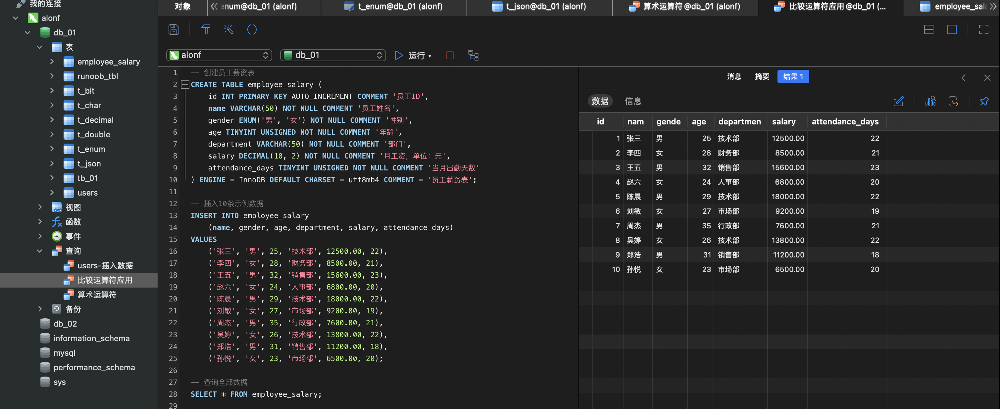
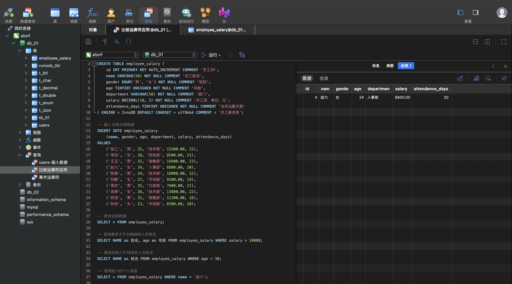
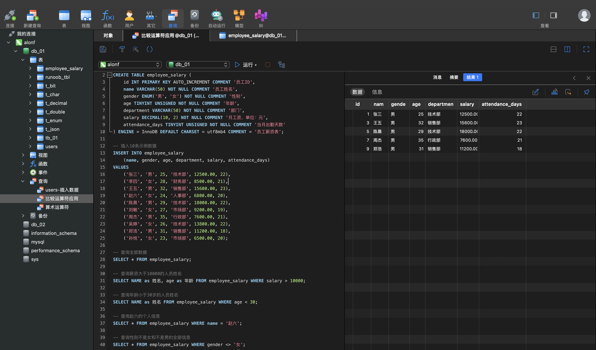
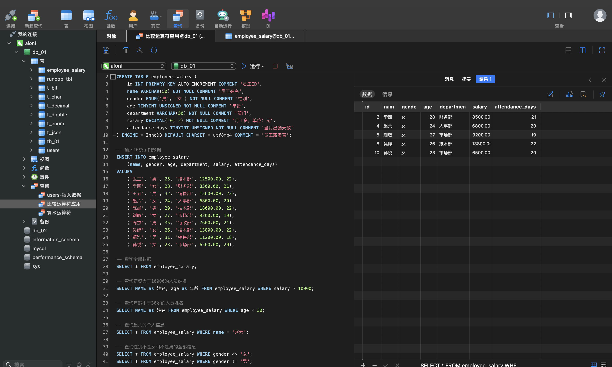

## 算术运算符

| 运算符 | 说明 |
| --- | --- |
| `+` | 加法；MySQL 中不用于字符串拼接 |
| `-` | 减法 |
| `*` | 乘法 |
| `/` | 除法 |
| `DIV` | 整除，只保留整数部分 |
| `%` | 取模，即取余数 |

```bash
select 1+2; ## 3
select 2 - 4; ## -2
select 2 * 3; ## 6
select 4 / 3; ## 1.3333
select 4 div 2; ## 2
select 4 mod 2; ## 0
select 2 + null; ## null NULL与其他数据类型的运算结果为NULL
select 'hello' + 'world'; ## 0, 'hello' 没有可识别的数字前缀，转换为 0,'world' 同样转换为 0。
select 'hello' + 2; ## 2
```

## 比较运算符

| 运算符 | 说明 |
| --- | --- |
| `>` | 大于 |
| `<` | 小于 |
| `>=` | 大于等于 |
| `<=` | 小于等于 |
| `=` | 等于；判断是否为 NULL 应使用 `IS NULL` |
| `!=` 或 `<>` | 不等于；判断是否不为 NULL 应使用 `IS NOT NULL` |

下面看这个案例应用，我们首先创造一个员工薪资表，然后根据对应条件进行查询：

```SQL
-- 创建员工薪资表
CREATE TABLE employee_salary (
    id INT PRIMARY KEY AUTO_INCREMENT COMMENT '员工ID',
    name VARCHAR(50) NOT NULL COMMENT '员工姓名',
    gender ENUM('男', '女') NOT NULL COMMENT '性别',
    age TINYINT UNSIGNED NOT NULL COMMENT '年龄',
    department VARCHAR(50) NOT NULL COMMENT '部门',
    salary DECIMAL(10, 2) NOT NULL COMMENT '月工资，单位：元',
    attendance_days TINYINT UNSIGNED NOT NULL COMMENT '当月出勤天数'
) ENGINE = InnoDB DEFAULT CHARSET = utf8mb4 COMMENT = '员工薪资表';

-- 插入10条示例数据
INSERT INTO employee_salary
    (name, gender, age, department, salary, attendance_days)
VALUES
    ('张三', '男', 25, '技术部', 12500.00, 22),
    ('李四', '女', 28, '财务部', 8500.00, 21),
    ('王五', '男', 32, '销售部', 15600.00, 23),
    ('赵六', '女', 24, '人事部', 6800.00, 20),
    ('陈晨', '男', 29, '技术部', 18000.00, 22),
    ('刘敏', '女', 27, '市场部', 9200.00, 19),
    ('周杰', '男', 35, '行政部', 7600.00, 21),
    ('吴婷', '女', 26, '技术部', 13800.00, 22),
    ('郑浩', '男', 31, '销售部', 11200.00, 18),
    ('孙悦', '女', 23, '市场部', 6500.00, 20);

-- 查询全部数据
SELECT * FROM employee_salary;
```



1. 查询薪资大于10000的人员姓名

```SQL
SELECT NAME as 姓名, age as 年龄 FROM employee_salary WHERE salary > 10000;
```


2. 查询年龄小于30岁的人员姓名

```SQL
SELECT NAME as 姓名 FROM employee_salary WHERE age < 30;
```


3. 查询赵六的个人信息

```SQL
SELECT * FROM employee_salary WHERE name = '赵六';

```


4. 查询性别不是女和不是男的全部信息

```SQL
SELECT * FROM employee_salary WHERE gender <> '女';
SELECT * FROM employee_salary WHERE gender != '男';
```




## 逻辑运算符

## 范围和集合

## 模糊查询

## NULL值判断与计算处理

## 位运算符