## 算术运算符

| 运算符 | 说明 |
| --- | --- |
| `+` | 加法；MySQL 中不用于字符串拼接 |
| `-` | 减法 |
| `*` | 乘法 |
| `/` | 除法 |
| `DIV` | 整除，只保留整数部分 |
| `%` | 取模，即取余数 |

```bash
select 1+2; ## 3
select 2 - 4; ## -2
select 2 * 3; ## 6
select 4 / 3; ## 1.3333
select 4 div 2; ## 2
select 4 mod 2; ## 0
select 2 + null; ## null NULL与其他数据类型的运算结果为NULL
select 'hello' + 'world'; ## 0, 'hello' 没有可识别的数字前缀，转换为 0,'world' 同样转换为 0。
select 'hello' + 2; ## 2
```

## 比较运算符

| 运算符 | 说明 |
| --- | --- |
| `>` | 大于 |
| `<` | 小于 |
| `>=` | 大于等于 |
| `<=` | 小于等于 |
| `=` | 等于；判断是否为 NULL 应使用 `IS NULL` |
| `!=` 或 `<>` | 不等于；判断是否不为 NULL 应使用 `IS NOT NULL` |

下面看这个案例应用，我们首先创造一个员工薪资表，然后根据对应条件进行查询：

```SQL
-- 创建员工薪资表
CREATE TABLE employee_salary (
    id INT PRIMARY KEY AUTO_INCREMENT COMMENT '员工ID',
    name VARCHAR(50) NOT NULL COMMENT '员工姓名',
    gender ENUM('男', '女') NOT NULL COMMENT '性别',
    age TINYINT UNSIGNED NOT NULL COMMENT '年龄',
    department VARCHAR(50) NOT NULL COMMENT '部门',
    salary DECIMAL(10, 2) NOT NULL COMMENT '月工资，单位：元',
    attendance_days TINYINT UNSIGNED NOT NULL COMMENT '当月出勤天数'
) ENGINE = InnoDB DEFAULT CHARSET = utf8mb4 COMMENT = '员工薪资表';

-- 插入10条示例数据
INSERT INTO employee_salary
    (name, gender, age, department, salary, attendance_days)
VALUES
    ('张三', '男', 25, '技术部', 12500.00, 22),
    ('李四', '女', 28, '财务部', 8500.00, 21),
    ('王五', '男', 32, '销售部', 15600.00, 23),
    ('赵六', '女', 24, '人事部', 6800.00, 20),
    ('陈晨', '男', 29, '技术部', 18000.00, 22),
    ('刘敏', '女', 27, '市场部', 9200.00, 19),
    ('周杰', '男', 35, '行政部', 7600.00, 21),
    ('吴婷', '女', 26, '技术部', 13800.00, 22),
    ('郑浩', '男', 31, '销售部', 11200.00, 18),
    ('孙悦', '女', 23, '市场部', 6500.00, 20);

-- 查询全部数据
SELECT * FROM employee_salary;
```


1. 查询薪资大于10000的人员姓名

```SQL
SELECT NAME as 姓名, age as 年龄 FROM employee_salary WHERE salary > 10000;
```

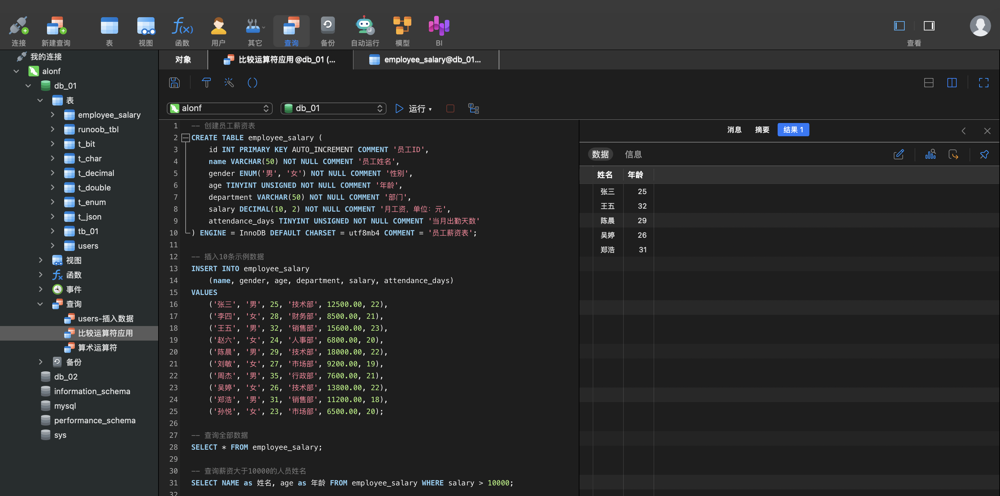

2. 查询年龄小于30岁的人员姓名

```SQL
SELECT NAME as 姓名 FROM employee_salary WHERE age < 30;
```
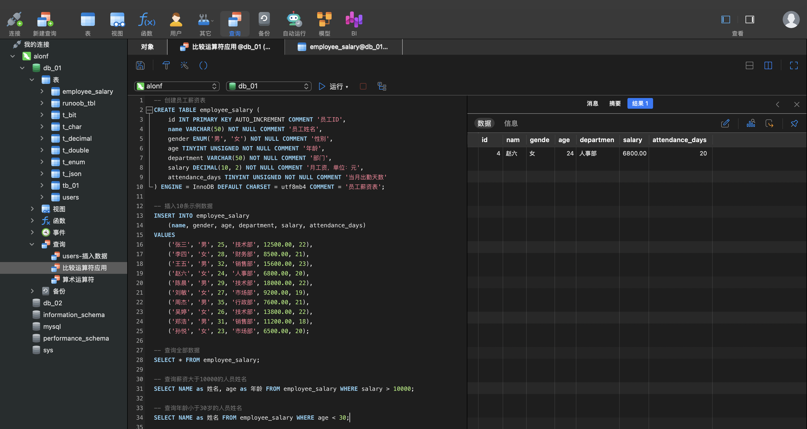

3. 查询赵六的个人信息

```SQL
SELECT * FROM employee_salary WHERE name = '赵六';

```


4. 查询性别不是女和不是男的全部信息

```SQL
SELECT * FROM employee_salary WHERE gender <> '女';
SELECT * FROM employee_salary WHERE gender != '男';
```


## 逻辑运算符

| 运算符 | 说明 |
| --- | --- |
| `&&` 或 `AND` | 逻辑与 |
| `\|\|` 或 `OR` | 逻辑或 |
| `!` 或 `NOT` | 逻辑非 |
| `XOR` | 逻辑异或(两个条件中恰好满足一个) |

1. 查询技术部，并且月工资不少于 13000 元的员工

```SQL
SELECT name as 姓名, department as 部门, salary as 工资 
FROM employee_salary 
WHERE department = '技术部' AND salary >= 13000;
```
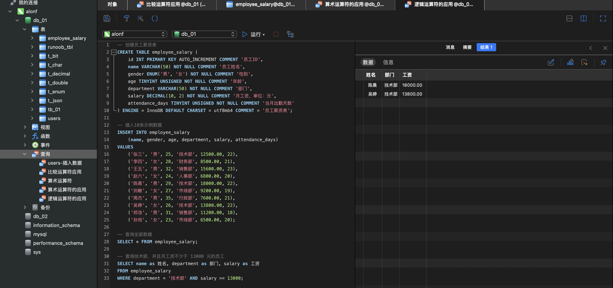

2. 查询财务部或者人事部的员工

```SQL
SELECT name as 姓名, department as 部门, salary as 工资 
FROM employee_salary
WHERE department = '财务部' OR department = '技术部';
```

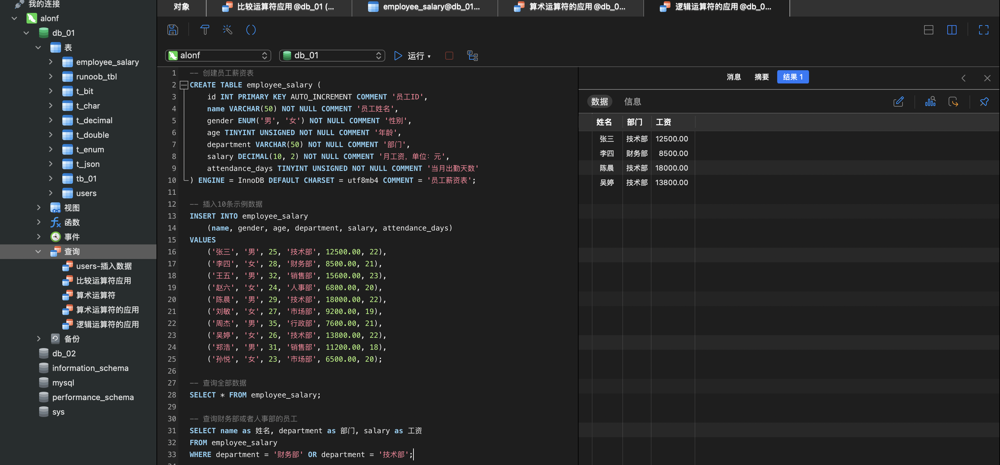

3. 查询不属于技术部的员工

```SQL
SELECT name as 姓名, department as 部门, salary as 工资 
FROM employee_salary
WHERE NOT department = '技术部';
```
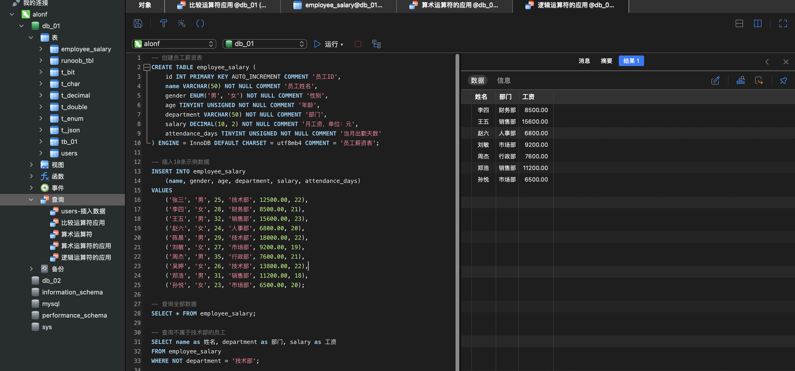

4. 查询以下两个条件中，只满足一个的员工
  - 月工资不少于 10000 元。
  - 出勤天数不少于 22 天。

```SQL
SELECT name, salary, attendance_days
FROM employee_salary
WHERE (salary >= 10000)
  XOR (attendance_days >= 22);
```
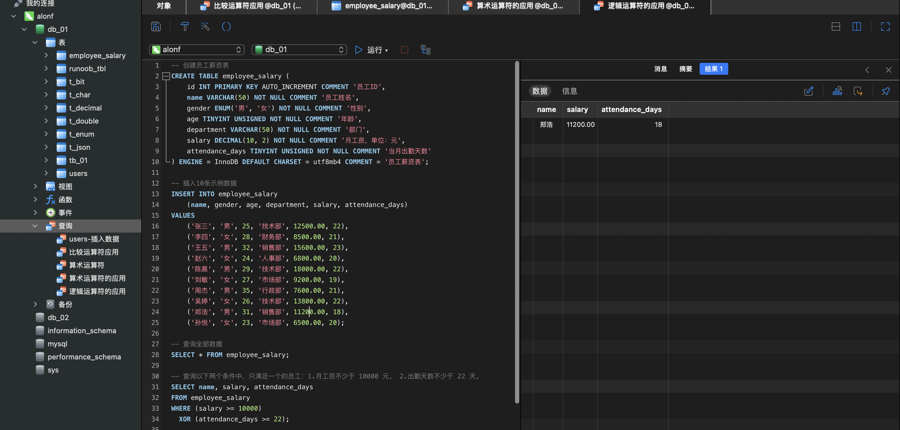

## 区间或集合范围比较运算符

| 运算符 | 说明 |
| --- | --- |
| `BETWEEN x AND y` | 处于区间内，包含边界值 x 和 y |
| `NOT BETWEEN x AND y` | 不处于区间内，即小于 x 或大于 y |
| `IN (x, y, z)` | 属于集合，即等于其中任意一个值 |
| `NOT IN (x, y, z)` | 不属于集合，即不等于其中任何一个值 |

1. 查询月工资在 8000～13000 元之间的员工，包含两个边界值

```SQL
-- 用逻辑运算符我们可以这样写
SELECT name as 姓名, department as 部门, salary as 工资 
FROM employee_salary
WHERE salary >= 8000 AND salary <= 13000;

-- 用范围比较运算符写
SELECT name as 姓名, department as 部门, salary as 工资 
FROM employee_salary
WHERE salary BETWEEN 8000 AND 13000;
```

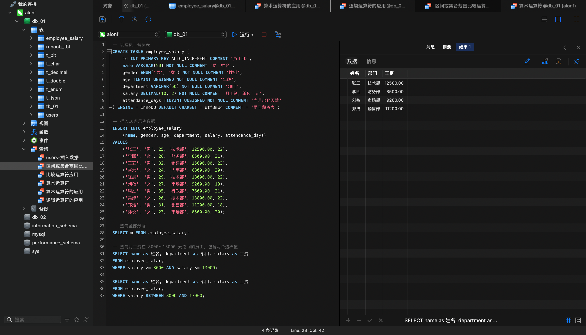

2. 查询出勤天数不在 20～22 天之间的员工

```SQL
SELECT name as 姓名, department as 部门, attendance_days as 出勤天数 
FROM employee_salary
WHERE attendance_days NOT BETWEEN 20 AND 22;
```
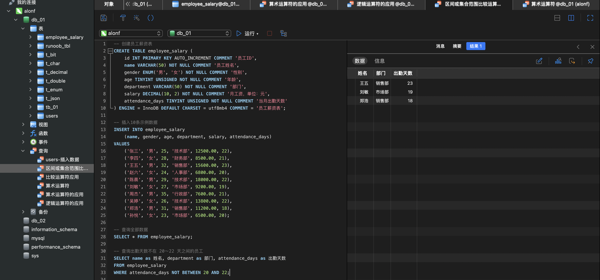

3. 查询部门属于技术部、财务部的员工

```SQL
SELECT name as 姓名, department as 部门
FROM employee_salary
WHERE department IN ('技术部', '财务部');
```
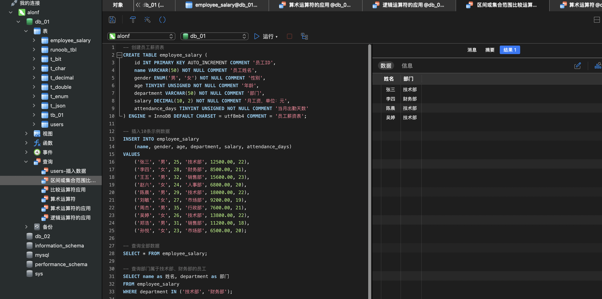

4. 查询部门既不是技术部，也不是销售部的员工

```SQL
SELECT name as 姓名, department as 部门
FROM employee_salary
WHERE department NOT IN ('技术部', '销售部');
```
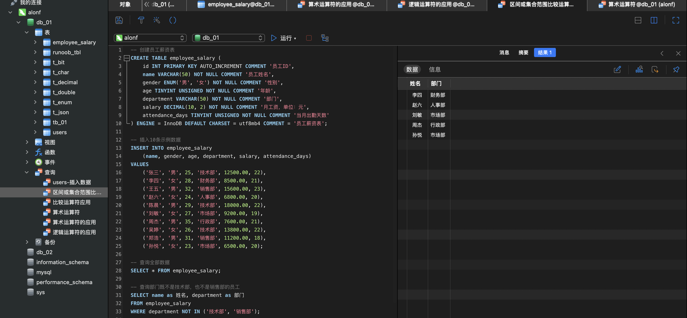

5. 查询技术部或销售部中，月工资在 10000～16000 元之间的员工

```SQL
SELECT name as 姓名, department as 部门, salary as 工资
FROM employee_salary
WHERE department IN ('技术部', '销售部') AND salary BETWEEN 10000 AND 16000;
```
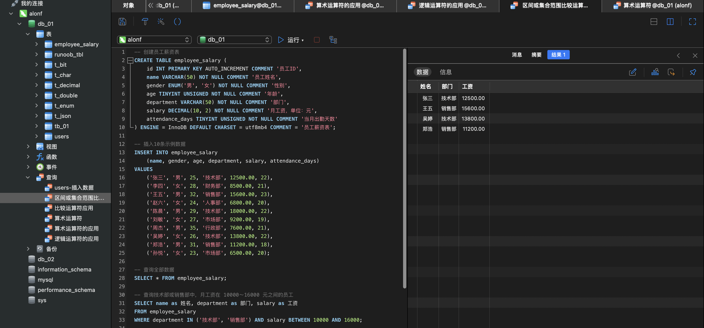

## 模糊查询

| 通配符 | 说明 |
| --- | --- |
| `%` | 匹配零个或多个任意字符 |
| `_` | 匹配一个任意字符；两个下划线 `__` 匹配两个字符 |

1. 查询姓“张”的员工
```SQL
SELECT name, department FROM employee_salary WHERE name LIKE '张%';
```

2. 查询姓名以“敏”结尾的员工

```SQL
SELECT name, department FROM employee_salary WHERE name LIKE '%敏';
```

3. 查询部门名称中包含“术”的员工

```SQL
SELECT name, department FROM employee_salary WHERE department LIKE '%术%';
```

4. 查询姓名恰好两个字符，且第二个字符为“晨”的员工

```SQL
SELECT name, department FROM employee_salary WHERE name LIKE '_晨';
```

5. 查询姓名恰好为两个字符的员工

```SQL
SELECT name, department FROM employee_salary WHERE name LIKE '__';
```

6. 查询部门名称不以“技术”开头的员工

```SQL
SELECT name, department FROM employee_salary WHERE department NOT LIKE '技术%';
```

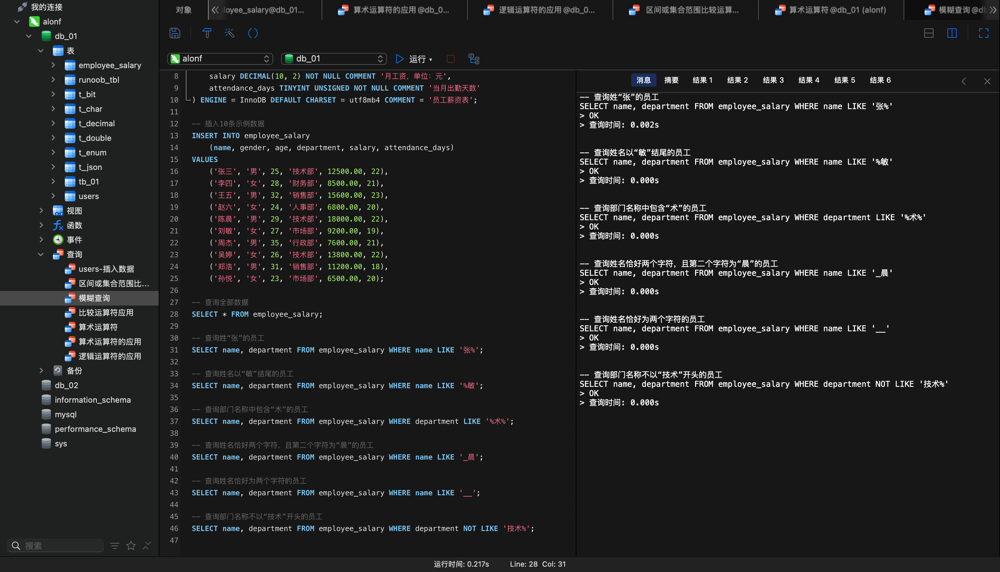

## NULL值判断与计算处理

| 运算符或函数 | 说明 |
| --- | --- |
| `IS NULL` 或 `<=> NULL` | 判断是否为 NULL |
| `IS NOT NULL` | 判断是否不为 NULL |
| `IFNULL(x, y)` | 当 x 为 NULL 时返回 y，否则返回 x |

首先我们新建一个新的员工薪资部门信息表
```SQL
-- 创建员工薪资表
CREATE TABLE employee_salary (
    id INT PRIMARY KEY AUTO_INCREMENT COMMENT '员工ID',
    name VARCHAR(50) NOT NULL COMMENT '员工姓名',
    gender ENUM('男', '女') NOT NULL COMMENT '性别',
    age TINYINT UNSIGNED NOT NULL COMMENT '年龄',
    department VARCHAR(50) NOT NULL COMMENT '部门',
    salary DECIMAL(10, 2) NOT NULL COMMENT '月工资，单位：元',
    attendance_days TINYINT UNSIGNED NOT NULL COMMENT '当月出勤天数',
    bonus DECIMAL(10, 2) NULL DEFAULT NULL COMMENT '奖金，NULL表示未填写',
    phone VARCHAR(20) NULL DEFAULT NULL COMMENT '联系电话，NULL表示未填写'
) ENGINE = InnoDB DEFAULT CHARSET = utf8mb4 COMMENT = '员工薪资表';

-- 插入10条示例数据，部分奖金和联系电话为NULL
INSERT INTO employee_salary
    (name, gender, age, department, salary, attendance_days, bonus, phone)
VALUES
    ('张三', '男', 25, '技术部', 12500.00, 22, 1000.00, '13800000001'),
    ('李四', '女', 28, '财务部', 8500.00, 21, 500.00, '13800000002'),
    ('王五', '男', 32, '销售部', 15600.00, 23, 500.00, NULL),
    ('赵六', '女', 24, '人事部', 6800.00, 20, NULL, NULL),
    ('陈晨', '男', 29, '技术部', 18000.00, 22, 1000.00, '13800000005'),
    ('刘敏', '女', 27, '市场部', 9200.00, 19, 0.00, NULL),
    ('周杰', '男', 35, '行政部', 7600.00, 21, NULL, NULL),
    ('吴婷', '女', 26, '技术部', 13800.00, 22, 1000.00, '13800000008'),
    ('郑浩', '男', 31, '销售部', 11200.00, 18, 500.00, NULL),
    ('孙悦', '女', 23, '市场部', 6500.00, 20, NULL, NULL);

-- 查询全部数据
SELECT * FROM employee_salary;
```
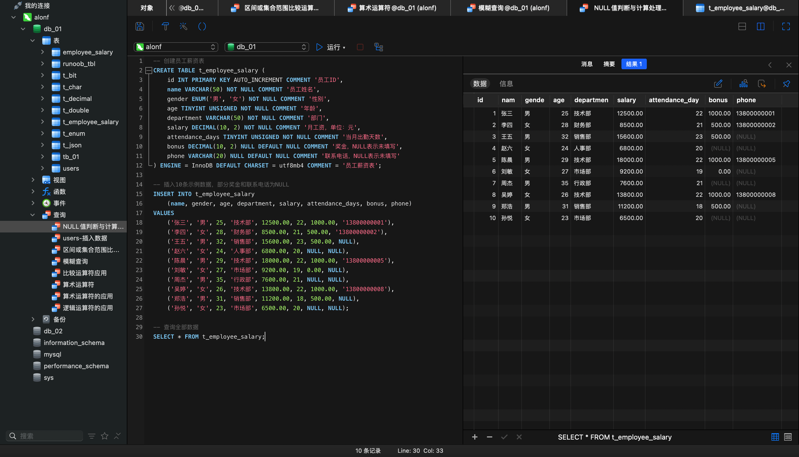

1. 查询尚未填写奖金的员工

```SQL
SELECT * FROM t_employee_salary WHERE bonus IS NULL;
```
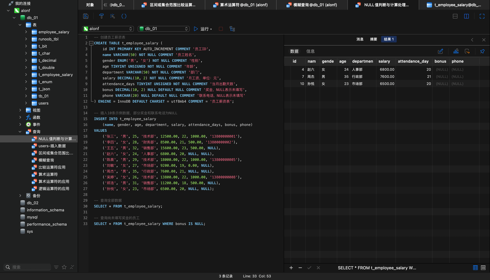

2. 查询已填写联系电话的员工

```SQL
SELECT * FROM t_employee_salary WHERE phone IS NOT NULL;
```
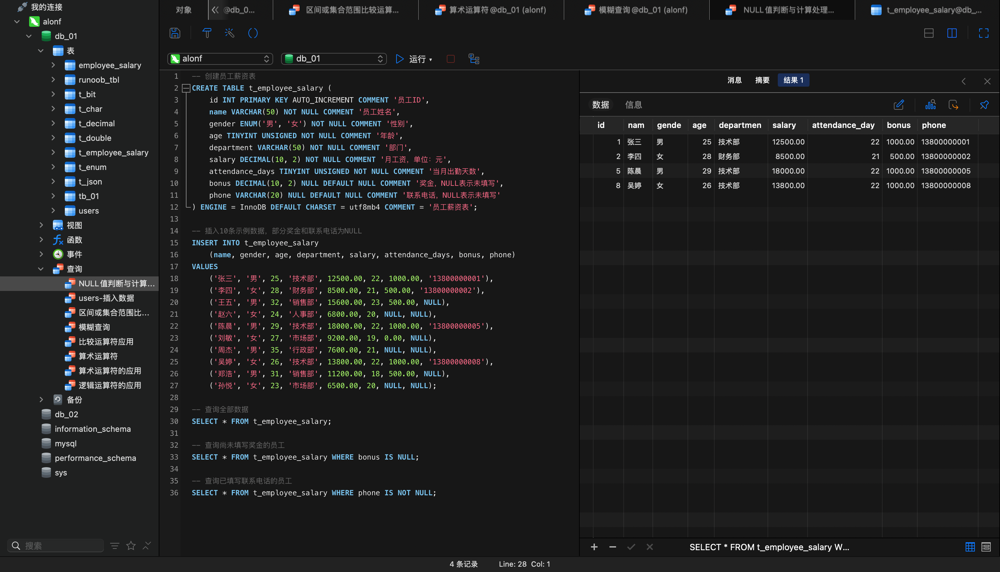

3. `IFNULL()`：为缺失数据设置默认显示值

```SQL
SELECT name as 姓名, IFNULL(bonus,0) as 奖金, IFNULL(phone,'未填写') FROM t_employee_salary;
```
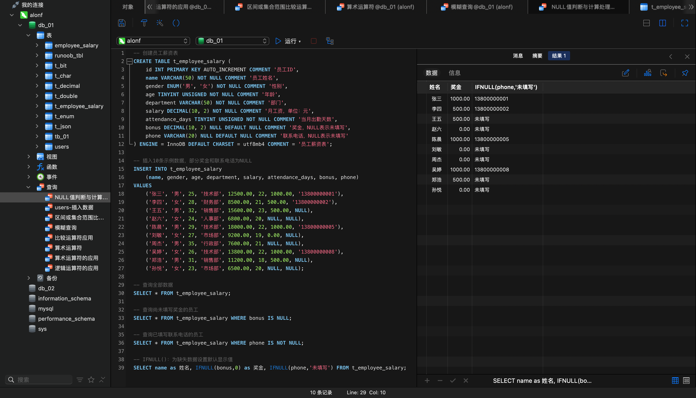

4. 计算工资实发(工资 + 奖金)

```SQL
SELECT name as 姓名, salary as 工资, bonus as 奖金, salary + bonus as 工资直接加奖金, salary + IFNULL(bonus,0) as 实发工资 FROM t_employee_salary;
```
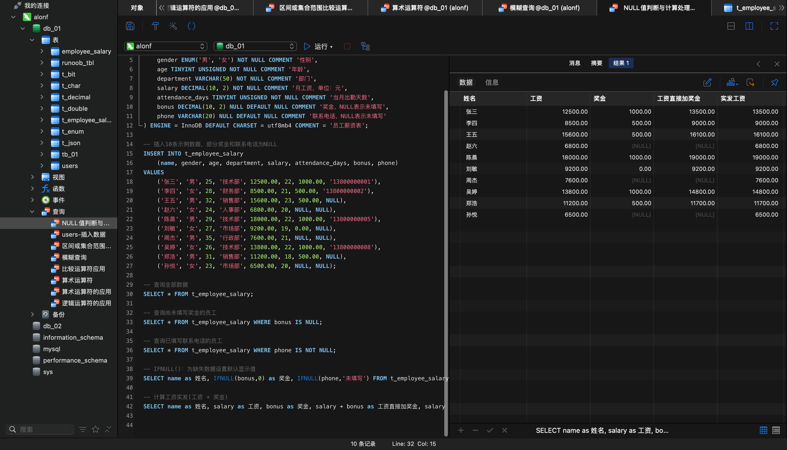

5. 区分“没有奖金”和“奖金未填写”

```SQL
SELECT * FROM t_employee_salary WHERE bonus = 0;
```
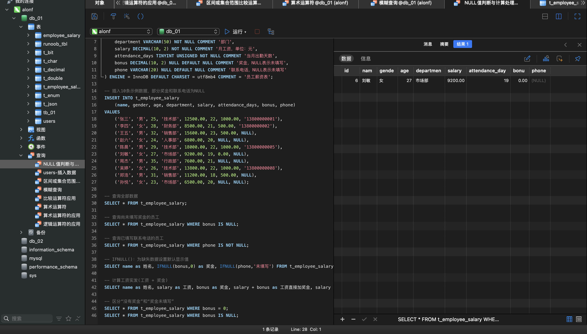

```SQL
SELECT * FROM t_employee_salary WHERE bonus IS NULL;
```
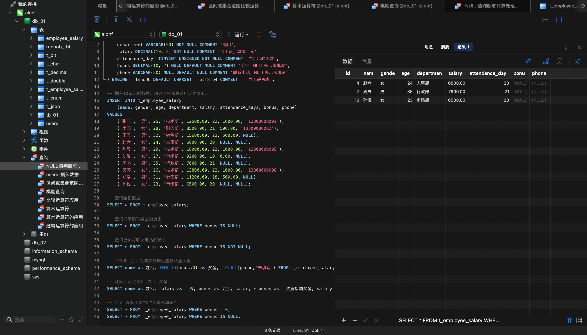

6. 统计奖金填写情况和奖金总额

```SQL
SELECT
    COUNT(*) AS 员工总人数,
    COUNT(bonus) AS 奖金已填写人数,
    COUNT(*) - COUNT(bonus) AS 奖金未填写人数,
    IFNULL(SUM(bonus), 0) AS 奖金总额
FROM t_employee_salary;
```
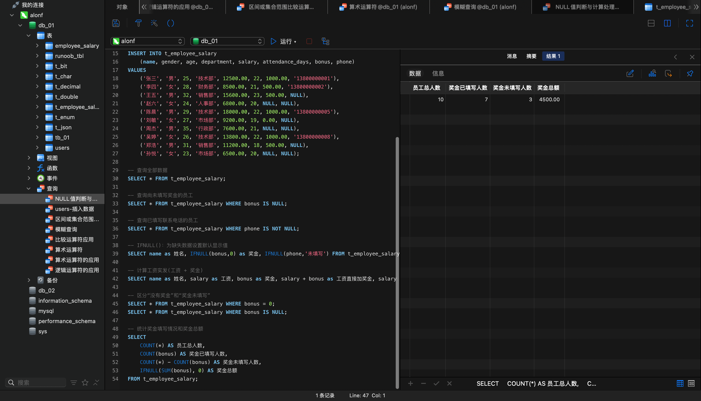

## 位运算符

| 运算符 | 说明 |
| --- | --- |
| `<<` | 按位左移 |
| `>>` | 按位右移 |
| `&` | 按位与 |
| `\|` | 按位或 |
| `^` | 按位异或 |
| `~` | 按位取反 |

位运算常用于权限管理、状态标记、开关控制。下面延续员工表，以“员工权限管理”为例演示全部位运算符。

假设使用一个整数保存员工的多个权限，每个二进制位代表一种权限：

| 权限 | 二进制 | 对应数值 |
| --- | --- | --- |
| 查看员工信息 | `0001` | 1 |
| 查看薪资 | `0010` | 2 |
| 修改薪资 | `0100` | 4 |
| 导出报表 | `1000` | 8 |

例如，`3 = 1 + 2`，表示同时拥有“查看员工信息”和“查看薪资”权限。

先给员工表新增权限字段并设置示例数据：

```SQL
-- 新增字段，只需执行一次
-- 默认值1表示拥有“查看员工信息”权限
ALTER TABLE t_employee_salary
ADD COLUMN permissions TINYINT UNSIGNED NOT NULL DEFAULT 1
COMMENT '权限位：1查看员工，2查看薪资，4修改薪资，8导出报表';

-- 设置员工权限
UPDATE t_employee_salary
SET permissions = CASE name
    WHEN '张三' THEN 3   -- 0011：查看员工、查看薪资
    WHEN '李四' THEN 11  -- 1011：查看员工、查看薪资、导出报表
    WHEN '陈晨' THEN 15  -- 1111：全部四项权限
    WHEN '吴婷' THEN 7   -- 0111：查看员工、查看薪资、修改薪资
    ELSE 1              -- 0001：仅查看员工
END;
```

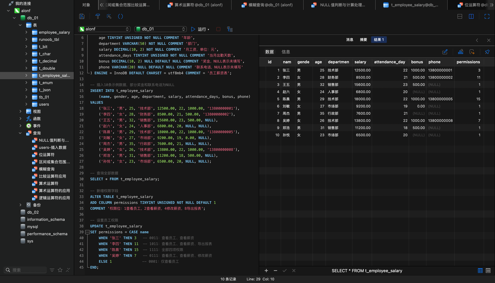

1. 1. & 按位与：检查是否拥有某项权限

查询拥有“查看薪资”权限的员工：

```SQL
SELECT name, permissions
FROM t_employee_salary
WHERE (permissions & 2) = 2;
```

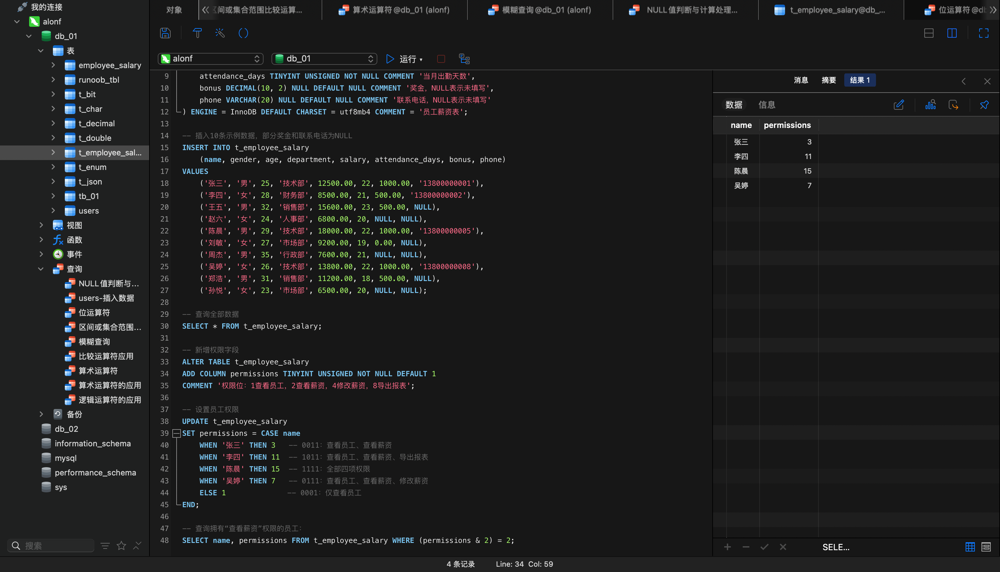

也可以检查是否同时拥有多项权限：

```SQL
-- 6 = 2 + 4：同时拥有“查看薪资”和“修改薪资”
-- 初始化后的结果：陈晨、吴婷
SELECT name, permissions
FROM t_employee_salary
WHERE (permissions & 6) = 6;
```

2. | 按位或：添加权限

给张三增加“导出报表”权限，保留原有权限
```SQL
UPDATE t_employee_salary SET permissions = permissions | 8 WHERE name = '张三';
```

> 重复执行这条语句，仍然是 11，不会重复累加权限。

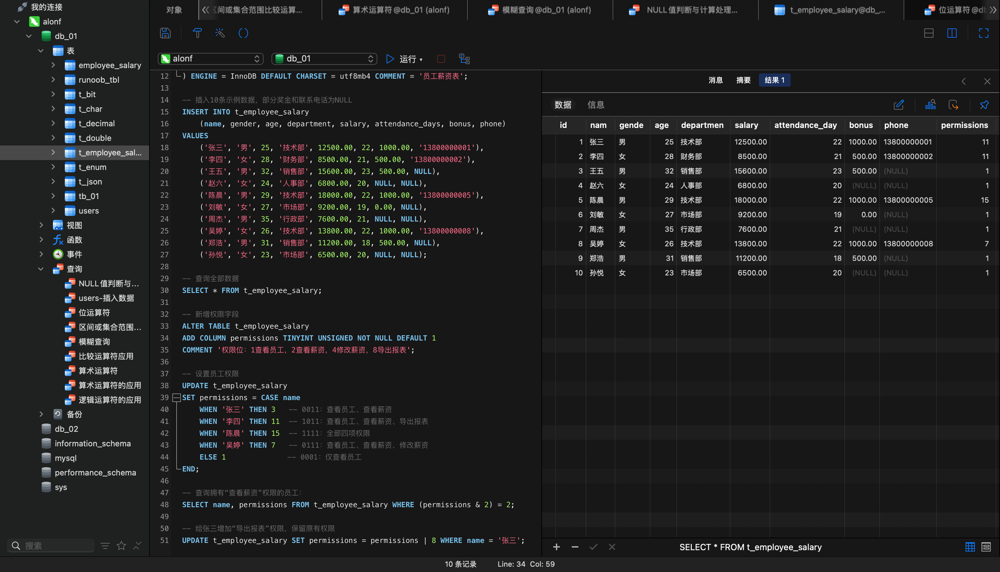

3. & 配合 ~：移除指定权限

取消吴婷的“修改薪资”权限，保留其他权限

```SQL
UPDATE t_employee_salary SET permissions = permissions & (~4) WHERE name = '吴婷';
```

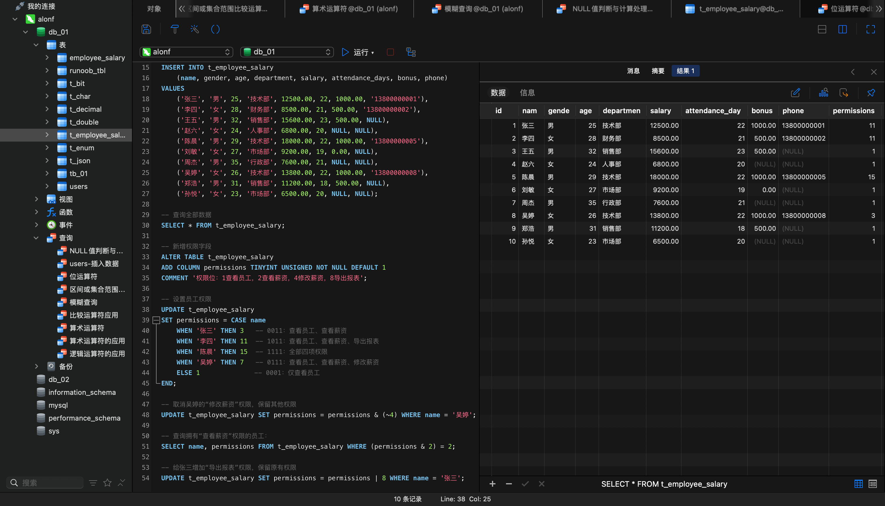

4. ^ 按位异或：切换权限状态

切换李四的“导出报表”权限：
  - 原来有这个权限，就取消。
  - 原来没有这个权限，就添加。

```SQL
UPDATE t_employee_salary SET permissions = permissions ^ 8 WHERE name = '李四';
```

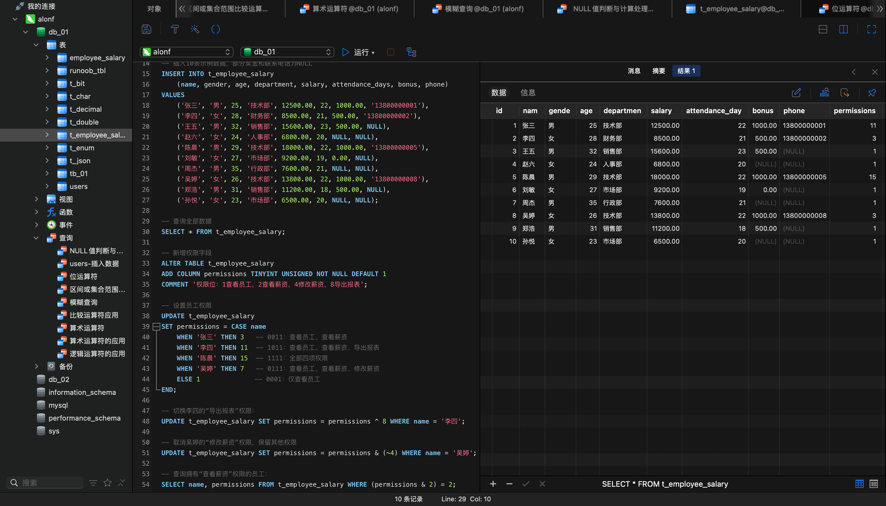