MySQL 中，表与表之间主要有 一对一、一对多、多对多三种关系。关系由业务规则决定，通常通过外键、唯一约束、中间表来实现。


| 关系类型 | 含义 | 业务案例 | 常见实现方式 |
| --- | --- | --- | --- |
| 一对一 | A 中一条记录最多对应 B 中一条记录，反过来也一样 | 员工与员工详细资料 | 外键加唯一约束，或让外键同时作为主键 |
| 一对多 | A 中一条记录可以对应 B 中多条记录，B 中一条记录只对应一个 A | 部门与员工 | 在“多”的一方设置外键 |
| 多对多 | A 中一条记录可以对应多个 B，B 中一条记录也可以对应多个 A | 员工与项目 | 创建中间表，分别关联两张表 |


## 一对一

该关系中第一个表中的一个行只可以与第二个表中的一个行相关，且第二个表中的一个行也只可以与第一个表中的一个行相关。

例如，“员工基本信息表”和“员工紧急情况联系信息表”。“员工基本信息表”中存储的是频繁使用的信息，“员工紧急情况联系信息表”中存储的是不常用的信息，这两个表中的一条记录都代表一个员工的信息。“员工基本信息表”中的一条记录在“员工紧急情况联系信息表”中只能找到唯一的一条对应记录，反过来也一样，即它们是一一对应关系。这两个表存在相同意义的“员工编号”字段，使它们建立了一对一关系。

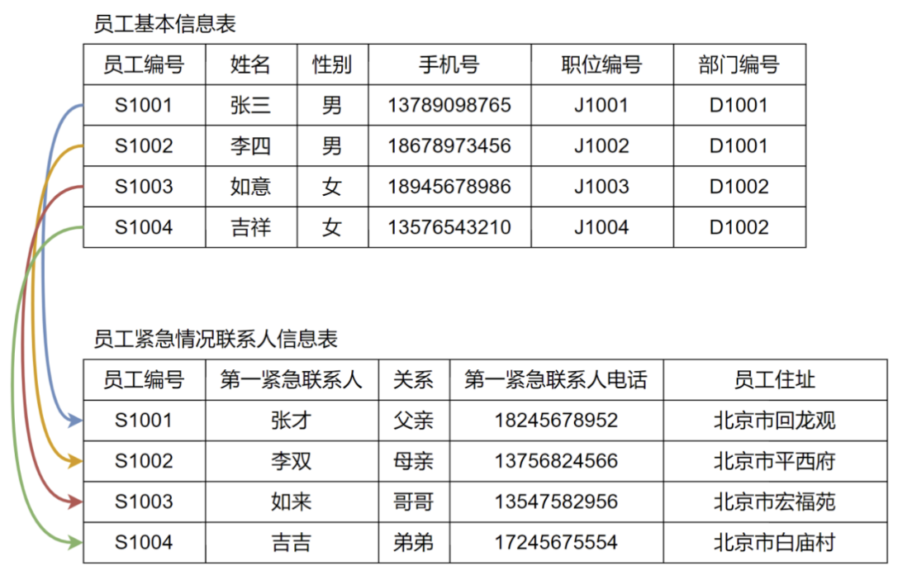


根据图片，可以建立两张表：
- 员工基本信息表：保存姓名、性别、手机号、职位编号、部门编号。
- 员工紧急联系人信息表：保存第一紧急联系人、关系、联系电话、员工住址。

两张表通过 员工编号关联。联系人表中的员工编号同时作为主键和外键，保证每名员工最多只有一条紧急联系人记录。

1. 创建两张表

```SQL
-- 员工基本信息表
CREATE TABLE employee_basic_info (
    employee_id VARCHAR(10) PRIMARY KEY COMMENT '员工编号',
    name VARCHAR(50) NOT NULL COMMENT '姓名',
    gender ENUM('男', '女') NOT NULL COMMENT '性别',
    phone VARCHAR(20) NOT NULL COMMENT '手机号',
    job_id VARCHAR(10) NOT NULL COMMENT '职位编号',
    department_id VARCHAR(10) NOT NULL COMMENT '部门编号'
) ENGINE = InnoDB
  DEFAULT CHARSET = utf8mb4
  COMMENT = '员工基本信息表';


-- 员工紧急联系人信息表
CREATE TABLE employee_emergency_contact (
    employee_id VARCHAR(10) PRIMARY KEY COMMENT '员工编号',
    contact_name VARCHAR(50) NOT NULL COMMENT '第一紧急联系人',
    relationship VARCHAR(20) NOT NULL COMMENT '与员工的关系',
    contact_phone VARCHAR(20) NOT NULL COMMENT '第一紧急联系人电话',
    employee_address VARCHAR(200) DEFAULT NULL COMMENT '员工住址',

    CONSTRAINT fk_contact_employee
        FOREIGN KEY (employee_id)
        REFERENCES employee_basic_info(employee_id)
) ENGINE = InnoDB
  DEFAULT CHARSET = utf8mb4
  COMMENT = '员工紧急联系人信息表';
```

这里两个约束分别起到以下作用：

| 联系人表中的约束 | 作用 |
| --- | --- |
| `PRIMARY KEY (employee_id)` | 员工编号不能重复，保证每名员工最多有一条联系人记录 |
| `FOREIGN KEY (employee_id)` | 员工必须先存在于基本信息表，才能添加联系人记录 |

只有外键、没有唯一约束时，同一员工就可以对应多条联系人记录，会变成一对多关系。

2. 插入员工和联系人数据

```SQL
-- 插入员工基本信息
INSERT INTO employee_basic_info
    (employee_id, name, gender, phone, job_id, department_id)
VALUES
    ('S1001', '张三', '男', '13789098765', 'J1001', 'D1001'),
    ('S1002', '李四', '男', '18678973456', 'J1002', 'D1001'),
    ('S1003', '如意', '女', '18945678986', 'J1003', 'D1002'),
    ('S1004', '吉祥', '女', '13576543210', 'J1004', 'D1002');


-- 插入员工紧急联系人信息
INSERT INTO employee_emergency_contact
    (employee_id, contact_name, relationship,
     contact_phone, employee_address)
VALUES
    ('S1001', '张才', '父亲', '18245678952', '北京市回龙观'),
    ('S1002', '李双', '母亲', '13756824566', '北京市平西府'),
    ('S1003', '如来', '哥哥', '13547582956', '北京市宏福苑'),
    ('S1004', '吉吉', '弟弟', '17245675554', '北京市白庙村');
```

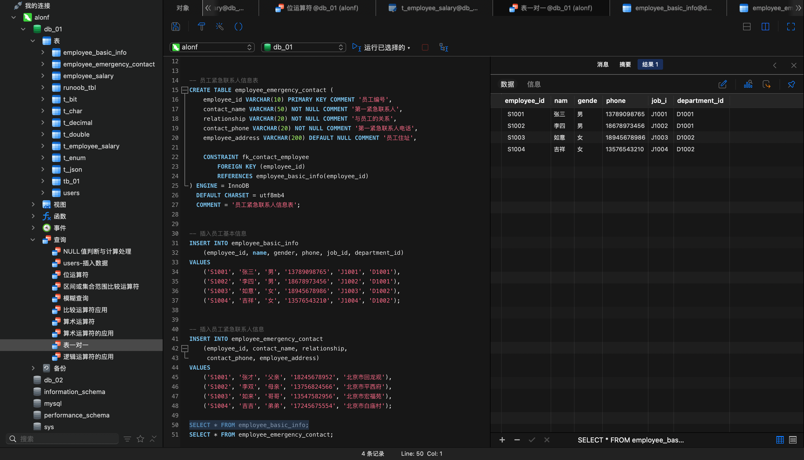
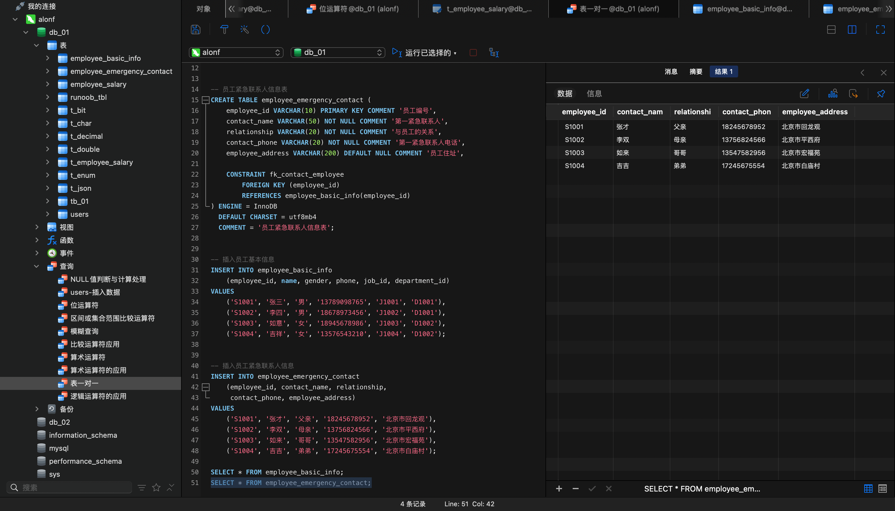

3. 关联查询员工和联系人

使用 `INNER JOIN`，查询两张表都存在对应记录的员工：

```SQL
SELECT
    e.employee_id AS 员工编号,
    e.name AS 员工姓名,
    c.contact_name AS 紧急联系人,
    c.relationship AS 关系,
    c.contact_phone AS 联系人电话
FROM employee_basic_info AS e
INNER JOIN employee_emergency_contact AS c
    ON e.employee_id = c.employee_id
ORDER BY e.employee_id;
```

其中，`e`、`c` 是表的别名，`ON` 后面指定两张表的关联条件。

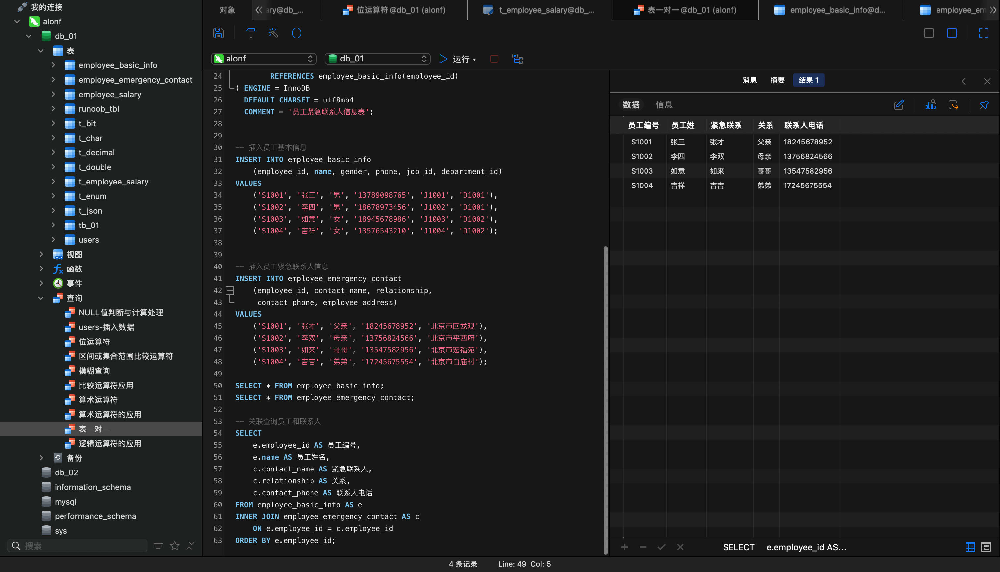

4. 查询指定员工的完整资料

根据员工编号，查询张三的基本信息和联系人

```SQL
SELECT
    e.employee_id AS 员工编号,
    e.name AS 姓名,
    e.gender AS 性别,
    e.phone AS 员工手机号,
    e.job_id AS 职位编号,
    e.department_id AS 部门编号,
    c.contact_name AS 紧急联系人,
    c.relationship AS 关系,
    c.contact_phone AS 联系人电话,
    c.employee_address AS 员工住址
FROM employee_basic_info AS e
LEFT JOIN employee_emergency_contact AS c
    ON e.employee_id = c.employee_id
WHERE e.employee_id = 'S1001';
```

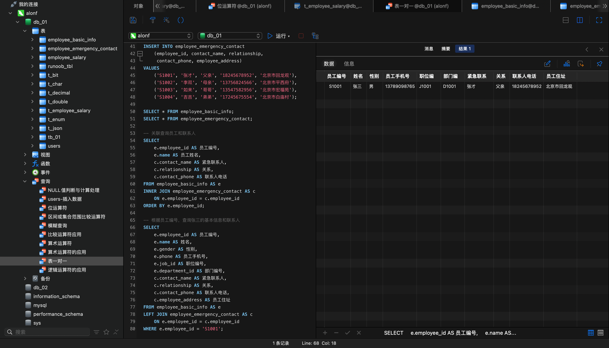

5. 查询尚未填写联系人的员工

```SQL
SELECT
    e.employee_id AS 员工编号,
    e.name AS 员工姓名,
    e.phone AS 员工手机号
FROM employee_basic_info AS e
LEFT JOIN employee_emergency_contact AS c
    ON e.employee_id = c.employee_id
WHERE c.employee_id IS NULL;
```

当前图片中的四名员工都有联系人，因此结果为空。以后新增员工但尚未添加联系人时，就能通过这条 SQL 找出来。


6. 按住址筛选员工

查询住址包含“回龙观”的员工

```SQL
SELECT
    e.employee_id AS 员工编号,
    e.name AS 员工姓名,
    c.employee_address AS 员工住址
FROM employee_basic_info AS e
JOIN employee_emergency_contact AS c
    ON e.employee_id = c.employee_id
WHERE c.employee_address LIKE '%回龙观%';
```

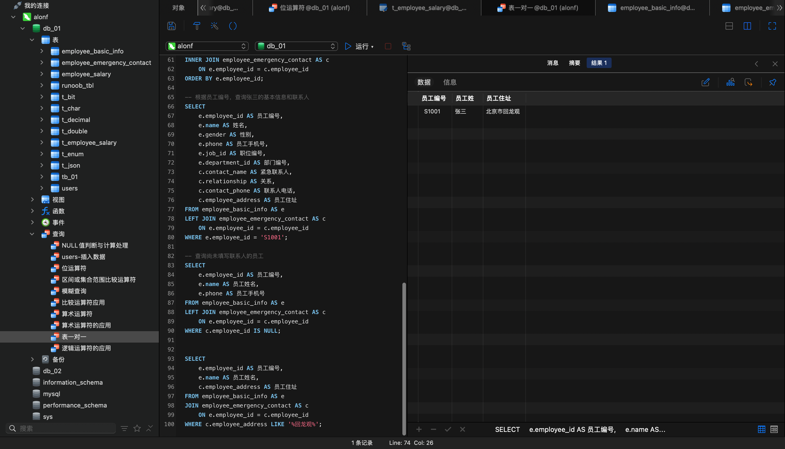

7. 修改员工的紧急联系人电话

修改张三的联系人电话：

```SQL
UPDATE employee_emergency_contact
SET contact_phone = '13800000001'
WHERE employee_id = 'S1001';
```

这里直接根据员工编号修改即可，不需要关联查询。使用编号定位，也能避免员工重名导致误改。

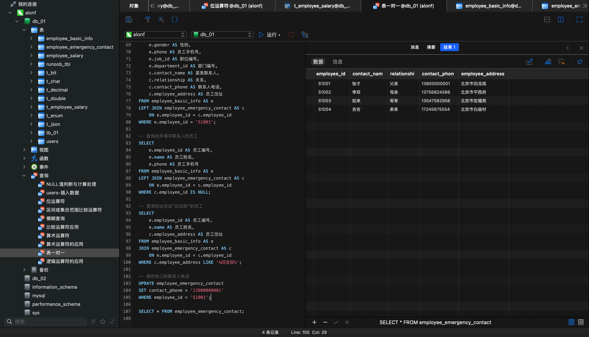

8. 使用事务，同时新增员工和联系人

如果业务要求创建员工时必须同时填写联系人，可以把两次插入放入一个事务：

```SQL
START TRANSACTION;

-- 新增员工
INSERT INTO employee_basic_info
    (employee_id, name, gender, phone, job_id, department_id)
VALUES
    ('S1005', '王五', '男', '13800000005', 'J1005', 'D1001');

-- 新增对应的紧急联系人
INSERT INTO employee_emergency_contact
    (employee_id, contact_name, relationship,
     contact_phone, employee_address)
VALUES
    ('S1005', '王建', '父亲', '13800000006', '北京市昌平区');

-- 两条语句都成功后提交
COMMIT;
```
如果执行过程中发生错误，应用程序应停止后续提交并执行 ROLLBACK，撤销本次事务中尚未提交的修改。

## 一对多

第一个表中的一个行可以与第二个表中的一个或多个行相关，但第二个表中的一个行只可以与第一个表中的一个行相关。

例如，“部门表”和“员工基本信息表”。“部门表”中的一条记录，在“员工基本信息表”中可以找到一条或多条记录对应，但反过来“员工基本信息表”中的一条记录在“部门表”中只能找到一条记录对应，即一个部门可以有多个员工，但是一个员工只能属于一个部门。这两个表存在相同意义的“部门编号”字段，使它们建立了一对多关系。

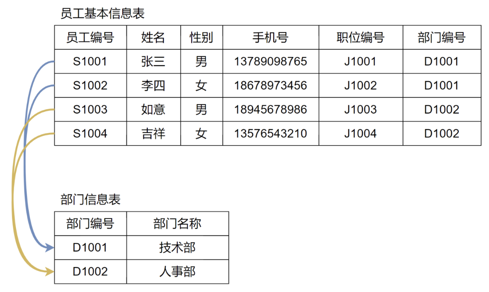

根据图片，部门与员工是一对多关系：
- 一个部门可以有多名员工。
- 每名员工只属于一个部门。
- 在员工表中保存部门编号，作为关联部门表的外键。

| 表 | 关系中的角色 | 主键 | 外键 |
| --- | --- | --- | --- |
| 部门表 `department_info` | 一的一方 | `department_id` | 无 |
| 员工表 `employee_info` | 多的一方 | `employee_id` | `department_id` |


先创建部门表，再创建引用它的员工表,然后插入数据:

- 额外增加一个暂时没有员工的“财务部”
- 员工表的 department_id 不设置唯一约束，因此多名员工可以属于同一个部门。
- ON DELETE RESTRICT 表示：部门仍被员工引用时，不允许直接删除该部门。

```SQL
-- 部门信息表
CREATE TABLE department_info (
    department_id VARCHAR(10) PRIMARY KEY COMMENT '部门编号',
    department_name VARCHAR(50) NOT NULL COMMENT '部门名称'
) ENGINE = InnoDB
  DEFAULT CHARSET = utf8mb4
  COMMENT = '部门信息表';


-- 员工基本信息表
CREATE TABLE employee_info (
    employee_id VARCHAR(10) PRIMARY KEY COMMENT '员工编号',
    name VARCHAR(50) NOT NULL COMMENT '姓名',
    gender ENUM('男', '女') NOT NULL COMMENT '性别',
    phone VARCHAR(20) NOT NULL COMMENT '手机号',
    job_id VARCHAR(10) NOT NULL COMMENT '职位编号',
    department_id VARCHAR(10) NOT NULL COMMENT '部门编号',

    CONSTRAINT fk_employee_info_department
        FOREIGN KEY (department_id)
        REFERENCES department_info(department_id)
        ON DELETE RESTRICT
) ENGINE = InnoDB
  DEFAULT CHARSET = utf8mb4
  COMMENT = '员工基本信息表';
	
	
-- 先插入部门
INSERT INTO department_info
    (department_id, department_name)
VALUES
    ('D1001', '技术部'),
    ('D1002', '人事部'),
    ('D1003', '财务部');


-- 再插入员工
INSERT INTO employee_info
    (employee_id, name, gender, phone, job_id, department_id)
VALUES
    ('S1001', '张三', '男', '13789098765', 'J1001', 'D1001'),
    ('S1002', '李四', '女', '18678973456', 'J1002', 'D1001'),
    ('S1003', '如意', '男', '18945678986', 'J1003', 'D1002'),
    ('S1004', '吉祥', '女', '13576543210', 'J1004', 'D1002');
		
		
SELECT * FROM department_info;
SELECT * FROM employee_info;
```
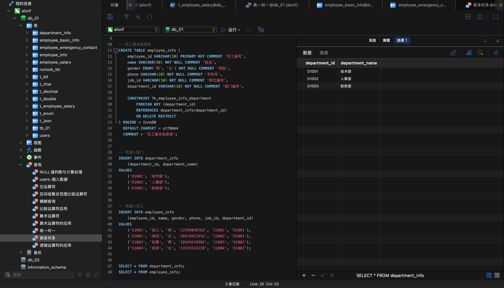

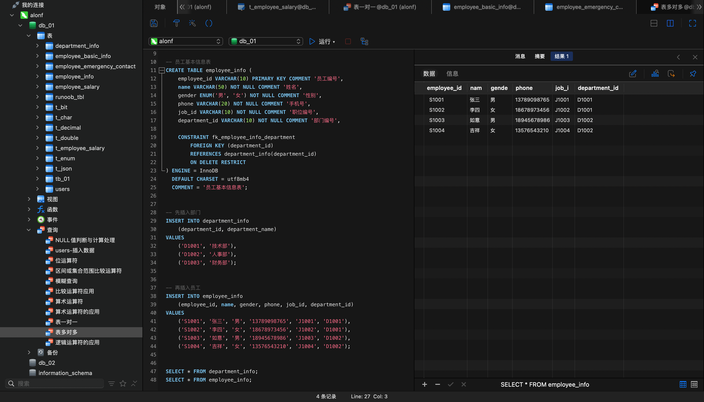

1. 查询员工及其所属部门

使用 INNER JOIN，根据部门编号关联两张表：

```SQL
SELECT
    e.employee_id AS 员工编号,
    e.name AS 员工姓名,
    e.gender AS 性别,
    d.department_name AS 所属部门
FROM employee_info AS e
INNER JOIN department_info AS d
    ON e.department_id = d.department_id
ORDER BY e.employee_id;
```

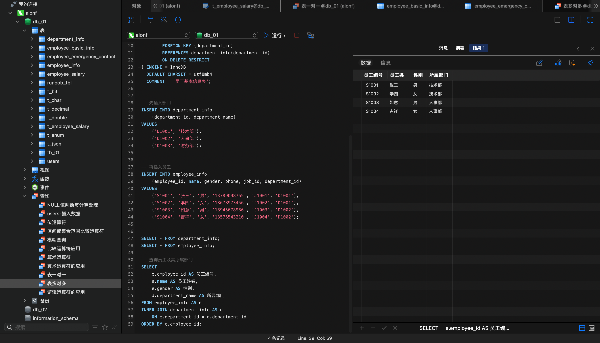

2. 查询指定部门的员工

查询技术部的所有员工：

```SQL
SELECT
    e.employee_id AS 员工编号,
    e.name AS 员工姓名,
    e.phone AS 手机号,
    d.department_name AS 部门名称
FROM employee_info AS e
JOIN department_info AS d
    ON e.department_id = d.department_id
WHERE d.department_id = 'D1001'
ORDER BY e.employee_id;
```

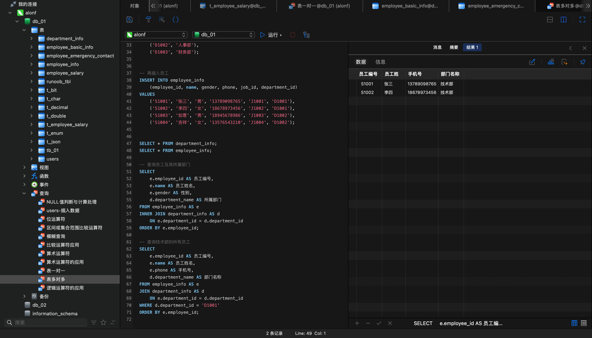

3. 调整员工所属部门

将张三从技术部调入财务部：

```SQL
UPDATE employee_info
SET department_id = 'D1003'
WHERE employee_id = 'S1001';
```

查询调整后的部门：

```SQL
SELECT
    e.name AS 员工姓名,
    d.department_name AS 所属部门
FROM employee_info AS e
JOIN department_info AS d
    ON e.department_id = d.department_id
WHERE e.employee_id = 'S1001';
```


## 多对多

该关系中第一个表中的一个行可以与第二个表中的一个或多个行相关。第二个表中的一个行也可以与第一个表中的一个或多个行相关。通常两个表的多对多关系会借助第三张表，转换为两个一对多的关系。

例如，项目系统的“员工基本信息表”和“项目信息表”是多对多关系。一个员工可以参与多个项目，一个项目也可以有多个员工参与，即“员工基本信息表”中一条记录可以与“项目信息表”多条记录对应，反过来“项目信息表”的一条记录也可以与“员工基本信息表”中多条记录对应。它们之间借助第三张“员工项目表”实现关联关系，而“员工基本信息表”与“员工项目表”是一对多关系，“项目信息表”与“员工项目表”也是一对多关系。“员工项目表”中“员工编号”字段与“员工基本信息表”中“员工编号”字段意义相同。“员工项目表”中“项目编号”字段与“项目信息表”中“项目编号”字段意义相同。

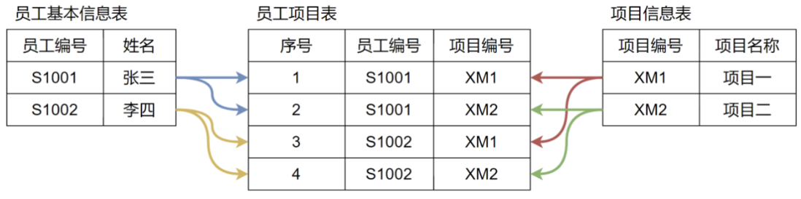

根据图片，员工与项目是多对多关系：
- 一名员工可以参与多个项目。
- 一个项目可以由多名员工参与。

因此需要 两张业务表，加一张中间表，共三张表。中间表中的每条记录，表示“某名员工参与某个项目”。

| 表名 | 中文名称 | 作用 |
| --- | --- | --- |
| `employee` | 员工基本信息表 | 保存员工编号、姓名 |
| `project` | 项目信息表 | 保存项目编号、名称 |
| `employee_project` | 员工项目关联表 | 保存员工与项目的对应关系 |

1. 创建表，插入数据

```SQL
-- 员工基本信息表
CREATE TABLE employee (
    employee_id VARCHAR(10) PRIMARY KEY COMMENT '员工编号',
    name VARCHAR(50) NOT NULL COMMENT '员工姓名'
) ENGINE = InnoDB
  DEFAULT CHARSET = utf8mb4
  COMMENT = '员工基本信息表';


-- 项目信息表
CREATE TABLE project (
    project_id VARCHAR(10) PRIMARY KEY COMMENT '项目编号',
    project_name VARCHAR(100) NOT NULL COMMENT '项目名称'
) ENGINE = InnoDB
  DEFAULT CHARSET = utf8mb4
  COMMENT = '项目信息表';


-- 员工项目关联表
CREATE TABLE employee_project (
    id INT PRIMARY KEY AUTO_INCREMENT COMMENT '序号',
    employee_id VARCHAR(10) NOT NULL COMMENT '员工编号',
    project_id VARCHAR(10) NOT NULL COMMENT '项目编号',

    -- 同一员工不能重复加入同一项目
    CONSTRAINT uk_employee_project
        UNIQUE (employee_id, project_id),

    CONSTRAINT fk_employee_project_employee
        FOREIGN KEY (employee_id)
        REFERENCES employee(employee_id)
        ON DELETE RESTRICT,

    CONSTRAINT fk_employee_project_project
        FOREIGN KEY (project_id)
        REFERENCES project(project_id)
        ON DELETE RESTRICT
) ENGINE = InnoDB
  DEFAULT CHARSET = utf8mb4
  COMMENT = '员工项目关联表';
	
-- 插入员工
INSERT INTO employee (employee_id, name)
VALUES
    ('S1001', '张三'),
    ('S1002', '李四');


-- 插入项目
INSERT INTO project (project_id, project_name)
VALUES
    ('XM1', '项目一'),
    ('XM2', '项目二');


-- 插入员工与项目的关联
INSERT INTO employee_project (employee_id, project_id)
VALUES
    ('S1001', 'XM1'),
    ('S1001', 'XM2'),
    ('S1002', 'XM1'),
    ('S1002', 'XM2');
		
SELECT * FROM employee;
SELECT * FROM project;
SELECT * FROM employee_project;
```

中间表的约束作用如下：

| 约束 | 作用 |
| --- | --- |
| 主键 `id` | 唯一标识一条关联记录 |
| 员工编号外键 | 保证关联的员工存在 |
| 项目编号外键 | 保证关联的项目存在 |
| 联合唯一约束 | 防止同一名员工重复参与同一个项目 |
| `ON DELETE RESTRICT` | 员工或项目仍有关联记录时，不允许直接删除 |

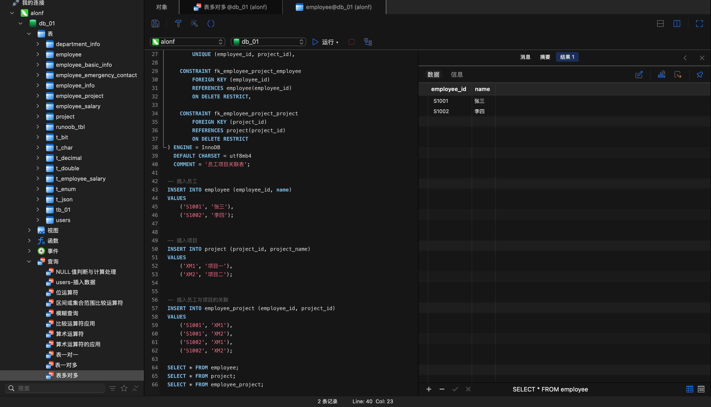


2. 查询所有员工参与的项目

通过中间表，把员工表和项目表关联起来：

```SQL
SELECT
    e.employee_id AS 员工编号,
    e.name AS 员工姓名,
    p.project_id AS 项目编号,
    p.project_name AS 项目名称
FROM employee_project AS ep
JOIN employee AS e
    ON ep.employee_id = e.employee_id
JOIN project AS p
    ON ep.project_id = p.project_id
ORDER BY e.employee_id, p.project_id;
```

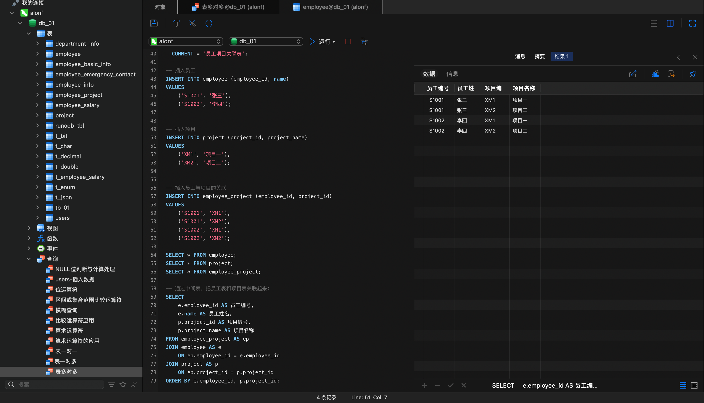