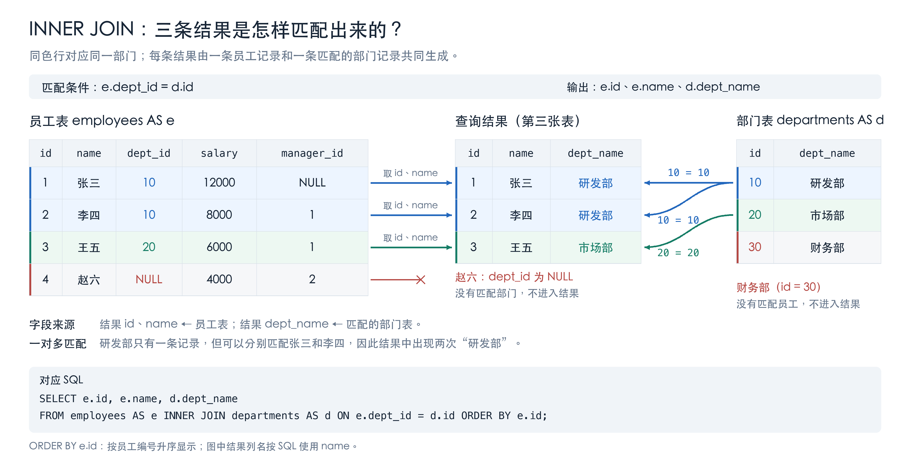
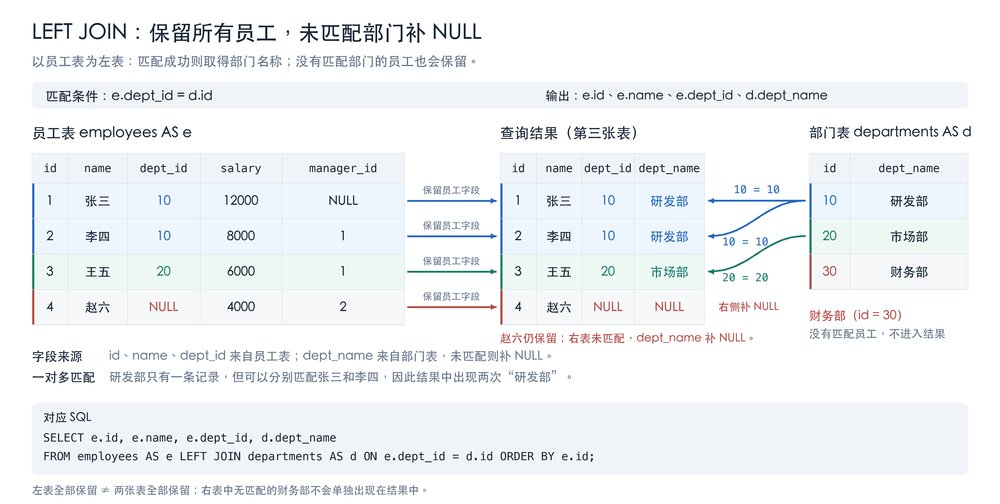
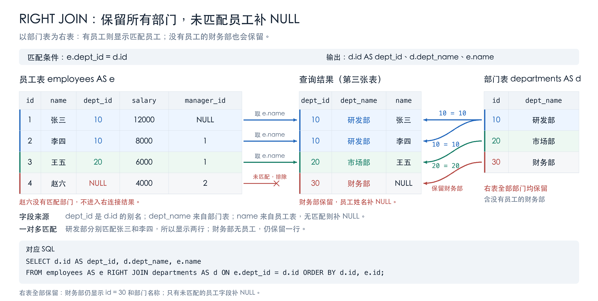
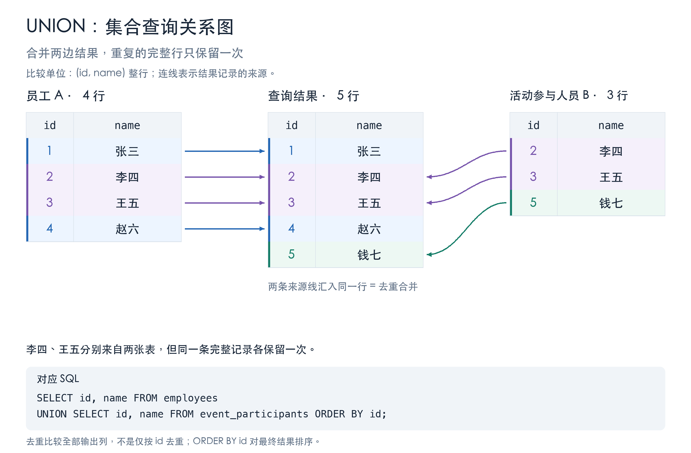
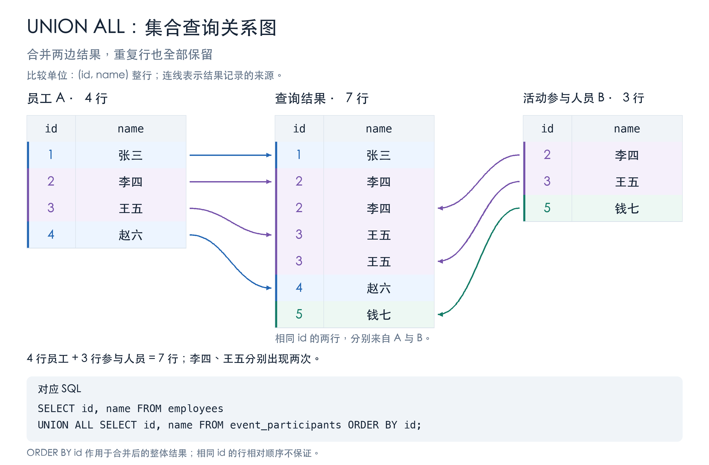
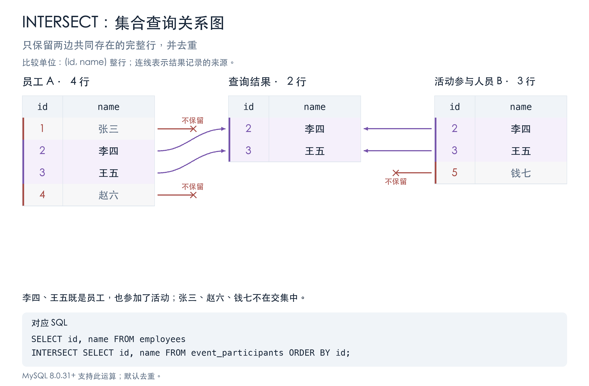
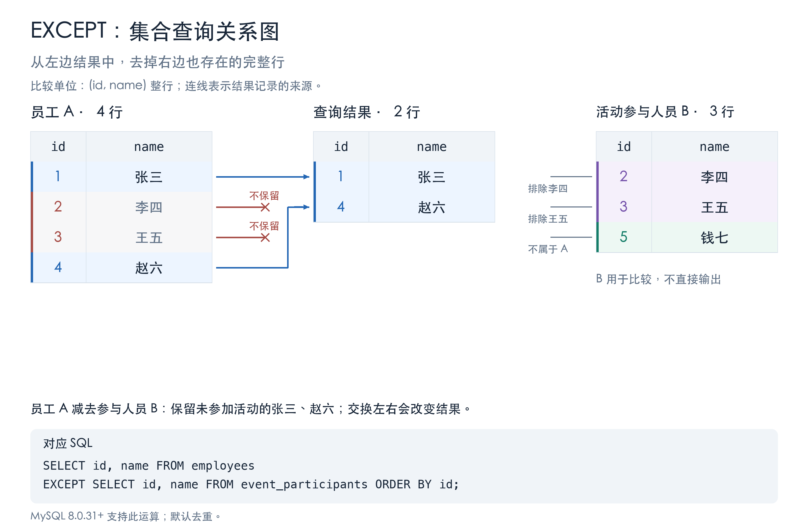

## 什么是关联查询？

- 关联查询：两个或更多个表一起查询。
- 前提条件：这些一起查询的表之间是有关系的（一对一、一对多），它们之间一定是有关联字段，这个关联字段可能建立了外键，也可能没有建立外键。

## 关联查询的几种情况

### 连接查询

| 分类角度 | 类别 | 说明 |
|---|---|---|
| **按匹配结果的保留方式** | 内连接 `INNER JOIN` | 只保留匹配成功的数据 |
| 同上 | 外连接 `OUTER JOIN` | 分为左外连接、右外连接、全外连接，保留指定一侧或两侧的未匹配数据 |
| 同上 | 交叉连接 `CROSS JOIN` | 返回所有行的组合 |
| **按关联条件** | 等值连接 | 使用 `=` 关联 |
| 同上 | 非等值连接 | 使用 `<`、`>`、`BETWEEN` 等关联 |
| **按关联的表是否相同** | 自连接 | 同一张表使用不同别名关联自己 |
| 同上 | 不同表之间的连接 | 两张或多张不同的表进行关联 |


### 集合查询

| 类型 | 关键字 | 作用 |
|---|---|---|
| 并集，去重 | `UNION` | 合并结果，去除重复行 |
| 并集，保留重复 | `UNION ALL` | 合并结果，保留重复行 |
| 交集 | `INTERSECT` | 返回两边共同存在的行 |
| 差集 | `EXCEPT` | 返回左边存在、右边不存在的行 |

## 建表

建4个表，分别是：
  - 部门表 `departments`
  - 员工表 `employees`、`dept_id` 关联部门，`manager_id` 关联员工表自身的 `id`
  - 工资等级表 `salary_grades`
  - 活动参与人员表 `event_participants`

```SQL
-- 1. 部门表
CREATE TABLE departments (
    id INT PRIMARY KEY,
    dept_name VARCHAR(50) NOT NULL
);

-- 2. 员工表
CREATE TABLE employees (
    id INT PRIMARY KEY,
    name VARCHAR(50) NOT NULL,
    dept_id INT,
    salary DECIMAL(10, 2) NOT NULL,
    manager_id INT
);

-- 3. 工资等级表
CREATE TABLE salary_grades (
    grade VARCHAR(10) PRIMARY KEY,
    min_salary DECIMAL(10, 2) NOT NULL,
    max_salary DECIMAL(10, 2) NOT NULL
);

-- 4. 活动参与人员表
CREATE TABLE event_participants (
    id INT PRIMARY KEY,
    name VARCHAR(50) NOT NULL
);

INSERT INTO departments (id, dept_name) VALUES
(10, '研发部'),
(20, '市场部'),
(30, '财务部');

INSERT INTO employees (id, name, dept_id, salary, manager_id) VALUES
(1, '张三', 10, 12000, NULL),
(2, '李四', 10, 8000, 1),
(3, '王五', 20, 6000, 1),
(4, '赵六', NULL, 4000, 2);

INSERT INTO salary_grades (grade, min_salary, max_salary) VALUES
('C', 0, 5000),
('B', 5000, 10000),
('A', 10000, 100000);

INSERT INTO event_participants (id, name) VALUES
(2, '李四'),
(3, '王五'),
(5, '钱七');

SELECT * FROM departments;
SELECT * FROM employees;
SELECT * FROM salary_grades;
SELECT * FROM event_participants;
```

### 部门表(departments)

| id | dept_name |
|---:|---|
| 10 | 研发部 |
| 20 | 市场部 |
| 30 | 财务部 |

### 员工表(employees)

这里特意设置了：
- 赵六没有部门，用于观察外连接。
- 财务部没有员工，用于观察外连接。
- 张三没有领导，用于观察自连接。
- 员工工资不同，用于匹配工资等级。

| id | name | dept_id | salary | manager_id |
|---:|---|---:|---:|---:|
| 1 | 张三 | 10 | 12000 | NULL |
| 2 | 李四 | 10 | 8000 | 1 |
| 3 | 王五 | 20 | 6000 | 1 |
| 4 | 赵六 | NULL | 4000 | 2 |

### 工资等级表(salary_grades)

| grade | min_salary | max_salary |
|---|---:|---:|
| C | 0 | 5000 |
| B | 5000 | 10000 |
| A | 10000 | 100000 |

### 活动参与人员表(event_participants)

这里约定人员 id 与员工表使用同一套编号；钱七是外部人员，没有员工记录。

| id | name |
|---:|---|
| 2 | 李四 |
| 3 | 王五 |
| 5 | 钱七 |

## 内连接、外连接、交叉连接

### 内连接

需求：查询有匹配部门的员工，以及所属部门。
  - 我们可以观察部门表和员工表，赵六没有匹配的部门，不返回
  - 财务部没有匹配的员工不返回
  - 所以最终返回的数据只有张三、李四、王五这三条数据

内连接的语法为：`表A INNER JOIN 表B ON 两表的关联条件`

```SQL
SELECT 
	e.id, 
	e.name, 
	d.dept_name 
FROM employees as e INNER JOIN departments as d 
	ON e.dept_id = d.id
ORDER BY e.id;
```
查询结果如下：

| id | nam | dept_name |
|---|---|---|
| 1 | 张三 | 研发部 |
| 2 | 李四 | 研发部 |
| 3 | 王五 | 市场部 |

查询流程图如下：



### 左连接、右连接、全外连接

#### 左连接(保留所有员工)

左连接语法：`表A LEFT JOIN 表B ON 两表的关联条件`

需求：查询全部员工及其部门，没有部门的员工也要显示。

```SQL
SELECT 
	e.id, 
	e.name, 
	e.dept_id,
	d.dept_name
FROM employees as e LEFT JOIN departments as d
	ON e.dept_id = d.id
ORDER BY e.id;
```

> 员工表在左侧，因此所有员工都保留；赵六匹配不到部门，部门字段补 NULL。

查询结果如下：

| id | name | dept_name |
|---:|---|---|
| 1 | 张三 | 研发部 |
| 2 | 李四 | 研发部 |
| 3 | 王五 | 市场部 |
| 4 | 赵六 | NULL |


查询流程图如下：




#### 右连接(保留所有部门)

右连接语法：`表A RIGHT JOIN 表B ON 两表的关联条件`

需求：查询全部部门及其员工，没有员工的部门也要显示。

```SQL
SELECT
	d.id as dept_id,
	d.dept_name,
	e.name,
	e.id
FROM employees as e RIGHT JOIN departments as d
	ON e.dept_id = d.id
ORDER BY d.id, e.id;
```

> 部门表在右侧，因此所有部门都保留。


查询结果如下：

| dept_id | dept_name | name |
|---:|---|---|
| 10 | 研发部 | 张三 |
| 10 | 研发部 | 李四 |
| 20 | 市场部 | 王五 |
| 30 | 财务部 | NULL |

查询流程图如下：




交换表的位置，可以用左连接实现相同结果：

```SQL
SELECT
    d.id AS dept_id,
    d.dept_name,
    e.name
FROM departments AS d
LEFT JOIN employees AS e
    ON e.dept_id = d.id
ORDER BY d.id, e.id;
```

> 左连接与右连接的核心区别，是保留哪一侧的全部数据。

#### 全外连接(保留所有员工和部门)

需求：有无部门的员工、有无员工的部门，都要显示。

MySQL 不直接支持 `FULL OUTER JOIN`，可以这样实现：

```SQL
-- 保留所有员工及其匹配部门
SELECT
    e.id AS employee_id,
    e.name,
    d.id AS dept_id,
    d.dept_name
FROM employees AS e
LEFT JOIN departments AS d
    ON e.dept_id = d.id

UNION ALL

-- 补充没有员工的部门
SELECT
    e.id AS employee_id,
    e.name,
    d.id AS dept_id,
    d.dept_name
FROM departments AS d
LEFT JOIN employees AS e
    ON e.dept_id = d.id
WHERE e.id IS NULL;
```
| employee_id | name | dept_id | dept_name |
|---:|---|---:|---|
| 1 | 张三 | 10 | 研发部 |
| 2 | 李四 | 10 | 研发部 |
| 3 | 王五 | 20 | 市场部 |
| 4 | 赵六 | NULL | NULL |
| NULL | NULL | 30 | 财务部 |


### 交叉连接

语法：`表A CROSS JOIN 表B`

需求：生成每名员工与每个部门的所有组合。

```SQL
SELECT
	e.id,
	e.name,
	e.dept_id,
	d.dept_name
FROM employees as e CROSS JOIN departments as d
ORDER BY e.id;
```

| id | name | dept_id | dept_name |
|---|---|---|---|
| 1 | 张三 | 10 | 财务部 |
| 1 | 张三 | 10 | 市场部 |
| 1 | 张三 | 10 | 研发部 |
| 2 | 李四 | 10 | 财务部 |
| 2 | 李四 | 10 | 市场部 |
| 2 | 李四 | 10 | 研发部 |
| 3 | 王五 | 20 | 财务部 |
| 3 | 王五 | 20 | 市场部 |
| 3 | 王五 | 20 | 研发部 |
| 4 | 赵六 | NULL | 财务部 |
| 4 | 赵六 | NULL | 市场部 |
| 4 | 赵六 | NULL | 研发部 |


## 等值连接与非等值连接

### 等值连接

语法： `表A JOIN 表B ON 两表的关联条件`

特点：使用 `=` 作为关联条件。

例如查询员工及部门：

```SQL
SELECT
	e.id,
	e.name,
	d.dept_name
FROM employees as e JOIN departments as d
	ON e.dept_id = d.id
ORDER BY e.id;
```

| name | dept_name |
|---|---|
| 张三 | 研发部 |
| 李四 | 研发部 |
| 王五 | 市场部 |

这条 SQL 同时属于：
- 内连接：只保留匹配成功的数据。
- 等值连接：关联条件使用 =。
- 不同表之间的连接：员工表关联部门表。


### 非等值连接

语法： `表A JOIN 表B ON 两表的关联条件`

特点：使用范围、大小等关系作为关联条件。

需求：根据员工工资，查询对应的工资等级。

```SQL
SELECT
	e.name as 姓名,
	e.id as 用户ID,
	e.salary as 员工工资,
	s.grade as 工资等级
FROM employees as e JOIN salary_grades as s
	ON e.salary >= s.min_salary AND e.salary < s.max_salary
ORDER BY e.id;
```

| name | salary | grade |
|---|---:|---|
| 张三 | 12000.00 | A |
| 李四 | 8000.00 | B |
| 王五 | 6000.00 | B |
| 赵六 | 4000.00 | C |

## 自连接

需求：查询每名员工及其直属领导,员工的 manager_id 对应领导的员工 id：

```SQL
SELECT
	e.name as 员工姓名,
	d.name as 领导姓名,
	e.id,
	e.manager_id
FROM employees as e LEFT JOIN employees as d
	ON e.manager_id = d.id
ORDER BY e.id;
```
| 员工姓名 | 领导姓名 | id | manager_id |
|---|---|---|---|
| 张三 | NULL | 1 | NULL |
| 李四 | 张三 | 2 | 1 |
| 王五 | 张三 | 3 | 1 |
| 赵六 | 李四 | 4 | 2 |


## 不同表之间的连接

前面的员工关联部门、员工关联工资等级，都属于不同表之间的连接。

还可以一次关联三张表。

需求：查询员工的部门、工资及工资等级，并保留没有部门的员工。

```SQL
SELECT
	e.name,
	e.id,
	e.salary,
	d.dept_name,
	s.grade
FROM employees as e LEFT JOIN departments as d
	ON e.dept_id = d.id
LEFT JOIN salary_grades as s
	ON e.salary >= s.min_salary AND e.salary < s.max_salary
ORDER BY e.id;
```

| name | id | salary | dept_nam | grade |
|---|---|---|---|---|
| 张三 | 1 | 12000.00 | 研发部 | A |
| 李四 | 2 | 8000.00 | 研发部 | B |
| 王五 | 3 | 6000.00 | 市场部 | B |
| 赵六 | 4 | 4000.00 | NULL | C |

> 这条 SQL 同时包含了左外连接、等值条件、非等值条件。

## 集合查询

### UNION 合并并去重

查询所有员工及活动参与人员，同一个人只显示一次

```SQL
SELECT id, name FROM employees
UNION
SELECT id, name FROM event_participants
ORDER BY id;
```

| id | name |
|---:|---|
| 1 | 张三 |
| 2 | 李四 |
| 3 | 王五 |
| 4 | 赵六 |
| 5 | 钱七 |



> 注意：`UNION` 按选出的整行去重，不是只按 id 去重。列的字段一定要一样

### UNION ALL 合并并保留重复

查询所有员工及活动参与人员，合并保留全部

```SQL
SELECT id, name FROM employees
UNION ALL
SELECT id, name FROM event_participants
ORDER BY id;
```

| id | name |
|---:|---|
| 1 | 张三 |
| 2 | 李四 |
| 2 | 李四 |
| 3 | 王五 |
| 3 | 王五 |
| 4 | 赵六 |
| 5 | 钱七 |



### INTERSECT 取交集

需求：查询同时属于员工、又参加了活动的人员。

```SQL
SELECT id, name FROM employees
INTERSECT
SELECT id, name FROM event_participants
ORDER BY id;
```

| id | name |
|---:|---|
| 2 | 李四 |
| 3 | 王五 |



### EXCEPT 取差集

需求：查询没有参加活动的员工。

```SQL
SELECT id, name FROM employees
EXCEPT
SELECT id, name FROM event_participants
ORDER BY id;
```

| id | name |
|---:|---|
| 1 | 张三 |
| 4 | 赵六 |

