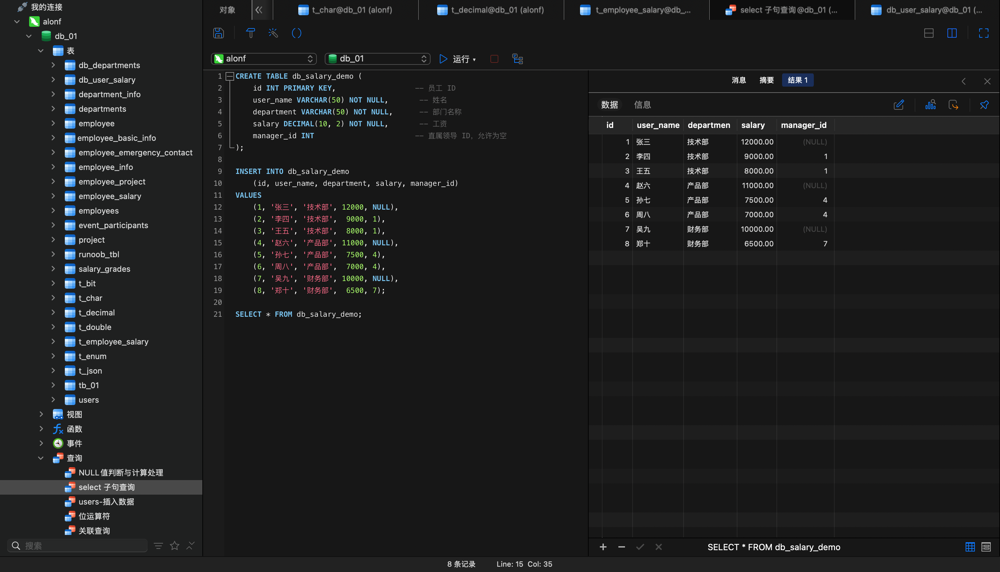

SELECT 常用子句按书写顺序如下：

| 子句 | 作用 | 示例 |
|---|---|---|
| `SELECT` | 指定查询字段或表达式 | `SELECT name, age` |
| `FROM` | 指定数据来源 | `FROM users` |
| `JOIN` | 关联其他表 | `LEFT JOIN orders ON users.id = orders.user_id` |
| `WHERE` | 筛选原始数据行 | `WHERE age >= 18` |
| `GROUP BY` | 对数据分组 | `GROUP BY city` |
| `HAVING` | 筛选分组后的结果 | `HAVING COUNT(*) > 10` |
| `ORDER BY` | 对结果排序 | `ORDER BY age DESC` |
| `LIMIT` | 限制返回条数 | `LIMIT 10` |
| `OFFSET` | 跳过指定条数，常用于分页 | `OFFSET 20` |

整体结构：

```SQL
SELECT 字段或表达式
FROM 表名
JOIN 其他表 ON 关联条件
WHERE 行筛选条件
GROUP BY 分组字段
HAVING 分组筛选条件
ORDER BY 排序字段
LIMIT 返回条数 OFFSET 跳过条数;
```

先建表并插入数据，每行表示一名员工的当前工资。`manager_id` 表示直属领导的员工 ID，用于演示同一张表的自关联查询。

```SQL
CREATE TABLE db_salary_demo (
    id INT PRIMARY KEY,                  -- 员工 ID
    user_name VARCHAR(50) NOT NULL,       -- 姓名
    department VARCHAR(50) NOT NULL,      -- 部门名称
    salary DECIMAL(10, 2) NOT NULL,       -- 工资
    manager_id INT                       -- 直属领导 ID，允许为空
);

INSERT INTO db_salary_demo
    (id, user_name, department, salary, manager_id)
VALUES
    (1, '张三', '技术部', 12000, NULL),
    (2, '李四', '技术部',  9000, 1),
    (3, '王五', '技术部',  8000, 1),
    (4, '赵六', '产品部', 11000, NULL),
    (5, '孙七', '产品部',  7500, 4),
    (6, '周八', '产品部',  7000, 4),
    (7, '吴九', '财务部', 10000, NULL),
    (8, '郑十', '财务部',  6500, 7);
```
例如：李四的 manager_id = 1，表示他的领导是 ID 为 1 的张三；`NULL` 表示未设置领导。



1. 查询员工信息 - SELECT、FROM

```SQL
SELECT user_name, department FROM db_salary_demo;
```

| user_name | department |
| --- | --- |
| 张三 | 技术部 |
| 李四 | 技术部 |
| 王五 | 技术部 |
| 赵六 | 产品部 |
| 孙七 | 产品部 |
| 周八 | 产品部 |
| 吴九 | 财务部 |
| 郑十 | 财务部 |

2. 查询高工资员工——WHERE、ORDER BY

查询工资不少于 9000 元的员工，按工资从高到低排列：

```SQL
SELECT * FROM db_salary_demo WHERE salary >= 9000 ORDER BY salary;
```

| id | user_name | department | salary | manager_id |
| --- | --- | --- | --- | --- |
| 2 | 李四 | 技术部 | 9000.00 | 1 |
| 7 | 吴九 | 财务部 | 10000.00 | NULL |
| 4 | 赵六 | 产品部 | 11000.00 | NULL |
| 1 | 张三 | 技术部 | 12000.00 | NULL |

3. 统计部门工资——GROUP BY、HAVING

统计每个部门的人数和平均工资，只保留人数不少于 3 人的部门：

```SQL
SELECT
	department,
	COUNT(*) AS employee_count,
	ROUND(AVG(salary),2) AS salary_avg
FROM db_salary_demo
GROUP BY department
HAVING COUNT(*) >= 3
ORDER BY salary_avg;
```

| department | employee_count | salary_avg |
| --- | --- | --- |
| 产品部 | 3 | 8500.00 |
| 技术部 | 3 | 9666.67 |

- GROUP BY：按部门分组。
- COUNT(*)：统计每组人数。
- AVG(salary)：计算平均工资。
- ROUND(..., 2)：保留两位小数。
- HAVING：筛选分组后的统计结果。
- AS：为结果列设置别名。

> 注意：筛选普通行用 WHERE，筛选分组统计结果用 HAVING。

4. 分页查询——LIMIT、OFFSET

按工资从高到低排列，每页 3 人，查询第 2 页

```SQL
SELECT * FROM db_salary_demo ORDER BY salary DESC, id ASC LIMIT 3 OFFSET 3;
```

OFFSET 3 表示跳过前 3 条，`LIMIT 3` 表示最多返回 3 条。

| id | user_name | department | salary | manager_id |
| --- | --- | --- | --- | --- |
| 2 | 李四 | 技术部 | 9000.00 | 1 |
| 3 | 王五 | 技术部 | 8000.00 | 1 |
| 5 | 孙七 | 产品部 | 7500.00 | 4 |

```bash
偏移量 = (页码 - 1) × 每页条数

第 1 页：LIMIT 3 OFFSET 0
第 2 页：LIMIT 3 OFFSET 3
第 3 页：LIMIT 3 OFFSET 6
```

5. 查询员工及领导——JOIN

同一张表也可以关联自己，这叫自关联：

```SQL
SELECT
	s.user_name as 员工姓名,
	s.department as 部门,
	d.user_name as 领导,
	s.id
FROM db_salary_demo as s LEFT JOIN db_salary_demo as d
	ON s.manager_id = d.id
ORDER BY s.id;
```

| 员工姓名 | 部门 | 领导 | id |
| --- | --- | --- | --- |
| 张三 | 技术部 | NULL | 1 |
| 李四 | 技术部 | 张三 | 2 |
| 王五 | 技术部 | 张三 | 3 |
| 赵六 | 产品部 | NULL | 4 |
| 孙七 | 产品部 | 赵六 | 5 |
| 周八 | 产品部 | 赵六 | 6 |
| 吴九 | 财务部 | NULL | 7 |
| 郑十 | 财务部 | 吴九 | 8 |